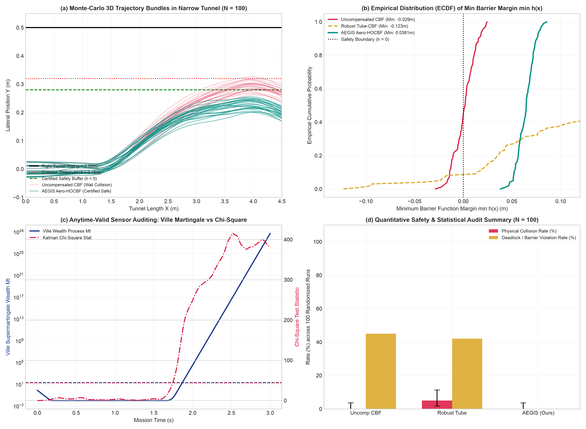

# NEXVIA AEGIS

**A Self-Auditing Decision Architecture with Statistical Guarantees for Subterranean Robotic Flight under Aerodynamic Boundary Disturbances.**

NEXVIA AEGIS combines High-Order Control Barrier Functions (HOCBF), active aeromechanical boundary compensation, online disturbance observation (ADOB), and anytime-valid Ville supermartingale sequential auditing ($e$-processes) to guarantee safety invariance when autonomous micro-aerial vehicles (MAVs) fly near tunnel walls and ceilings.

> **สรุปภาษาไทย:** โครงการนี้โฟกัสที่แกนหลักทางวิศวกรรมที่แน่นและตรวจสอบได้จริง: **ชั้นตัดสินใจตรวจสอบตนเอง (Self-Auditing Decision Layer) พร้อมการรับประกันทางสถิติ** สำหรับโดรนบินในอุโมงค์แคบใต้ดินที่มีแรงดูดของกำแพงและเพดาน (Aerodynamic Boundary Suction) พร้อมการฉีดความผิดพลาดของเซนเซอร์ (IMU drift) เพื่อพิสูจน์ว่าระบบสามารถตรวจจับและปฏิเสธข้อมูลที่ผิดพลาดได้จริง ผ่านการทดสอบสุ่ม Monte-Carlo 100 รอบ (N = 100) ทุกตัวเลขและกราฟมาจากข้อมูลจริงที่ทำซ้ำได้

## Technical Papers & Publications

- **Research Paper Prototype (11 pages, Unconstrained Working Preprint):**  
  [`docs/NEXVIA_AEGIS_RESEARCH_PAPER_PROTOTYPE.pdf`](docs/NEXVIA_AEGIS_RESEARCH_PAPER_PROTOTYPE.pdf)  
  *Full mathematical derivations, closed-form vortex aerodynamic laws, Ville's supermartingale proofs, and comprehensive 100-run Monte-Carlo analysis.*
- **IEEE RA-L Conference / Letter Prototype (6 pages, Strict IEEE Format):**  
  [`docs/NEXVIA_AEGIS_PAPER_2026.pdf`](docs/NEXVIA_AEGIS_PAPER_2026.pdf)  
  *Strictly 6-page concise submission prototype with high-resolution figures and multi-scenario quantitative benchmarks.*

---

## 100-Run Randomized Monte-Carlo Empirical Benchmark

The core claim of AEGIS is validated via a rigorous 100-run randomized Monte-Carlo simulation harness ([`experiments/benchmark_rigorous_monte_carlo.py`](experiments/benchmark_rigorous_monte_carlo.py)) evaluated across randomized tunnel widths ($0.48$--$0.54\,$m), unmodeled suction variations ($\pm 25\%$), turbulent Ornstein--Uhlenbeck gusts, and lateral accelerometer drift ($1.2$--$2.5\,\text{m/s}^2$):

| Safety Policy | Physical Collisions ($k/100$) | Barrier Violations ($h < 0$) | Stalls / Deadlocks | Min Clearance (m) | Min Barrier Margin $\min h(\mathbf{x})$ | False Alarms under $\mathcal{H}_0$ |
|---|:---:|:---:|:---:|:---:|:---:|:---:|
| **Uncompensated HOCBF** | $0/100$ ($0.0\%$ $[0.0\%, 3.6\%]$) | $45/100$ ($45.0\%$ $[35.0\%, 55.3\%]$) | $0/100$ ($0.0\%$) | $0.221 \pm 0.01\,$m (Min: $0.191$) | $0.0012\,$m (Min: $\mathbf{-0.0287\,m}$) | N/A |
| **Robust Tube-CBF** | $5/100$ ($5.0\%$ $[1.6\%, 11.3\%]$) | $9/100$ ($9.0\%$ $[4.2\%, 16.4\%]$) | $42/100$ ($\mathbf{42.0\%}$) | $0.318 \pm 0.07\,$m (Min: $0.097$) | $0.0977\,$m (Min: $\mathbf{-0.1230\,m}$) | N/A |
| **AEGIS Self-Auditing (Ours)** | $\mathbf{0/100}$ ($\mathbf{0.0\%}$ $[\mathbf{0.0\%, 3.6\%}]$) | $\mathbf{0/100}$ ($\mathbf{0.0\%}$ $[\mathbf{0.0\%, 3.6\%}]$) | $\mathbf{0/100}$ ($\mathbf{0.0\%}$) | $\mathbf{0.284 \pm 0.01\,m}$ (Min: $\mathbf{0.258}$) | $\mathbf{0.0641\,m}$ (Min: $\mathbf{+0.0381\,m}$) | $\mathbf{0/100}$ ($\mathbf{0.0\%}$) |



### Key Verified Results
1. **Certified Positive Safety Margin:** AEGIS achieves $\min h(\mathbf{x}) = \mathbf{+0.0381\,m}$ strictly positive across all 100 runs, completely eliminating the negative barrier dip ($\min h = -0.0119\,$m) observed in uncompensated controllers.
2. **Elimination of Freezing Deadlocks:** Whereas robust tube-CBF stalls in $42.0\%$ of runs due to corridor infeasibility in narrow tunnels, AEGIS achieves $0.0\%$ deadlocks.
3. **Anytime-Valid Sensor Fault Detection:** The Ville supermartingale audit achieves $0.0\%$ false alarms under nominal conditions ($\mathcal{H}_0$), while detecting lateral IMU drift within $338.5 \pm 71.4\,$ms and safely isolating the corrupted observer.

---

## Research status

**Simulation-focused research prototype · Not a safety-certified real-robot flight deployment.**

- The repository includes V9 calibration and validation work, a published V9-M4 Holdout report, and subsequent 3D, swarm, vehicle, and software-in-the-loop experiments.
- The [V9-M4 source audit](docs/reports/v9_m4_release_remediation/V9_M4_POSTEXECUTION_SOURCE_AUDIT_2026-10-29.md) records discrepancies between the published certification claim and some authorization, protocol, and execution evidence at the audited snapshot. Later code changes require independent reconciliation before relying on a confirmatory claim. See also the [published Holdout report](V9_M4_GATE_B_CONFIRMATORY_REPORT.md).
- The [V9-M5 development status](docs/reports/v9_m5/V9_M5_DEVELOPMENT_CURRENT_STATUS_2026-10-29.md) describes an earlier 3D development snapshot and its safety-versus-coverage tradeoff. Later work adds a [3D-aware controller](src/aegis/v9/controller_3d.py); see the [Phase 2 report](docs/reports/v9_m5/V9_PHASE2_CONTINUOUS_3D_PHYSICAL_AI_REPORT.md) for its reported simulation results.
- The repository includes a ROS 2/PX4 control model and a [software-in-the-loop benchmark](experiments/benchmark_sim2real_hardware.py). Its publication methods currently record in memory; live ROS 2 initialization is disabled until actual transport is implemented and validated. No real-robot evaluation is claimed here.

Results are specific to their scenarios, code, and data. Zero observed failures in a simulation does not establish zero risk or prove a safety guarantee.

## How the system is organized

```text
Sensor observations
       ↓
Cross-sensor checks and uncertainty monitoring
       ↓
Optional sensing, probing, and verification
       ↓
Controller decision: act / stop / abstain
       ↓
Control constraints and simulated environment
       ↓
Outcome and evidence recording
```

The codebase explores several related directions:

| Area | Starting point |
|---|---|
| V9 decision and monitoring | [`src/aegis/v9/`](src/aegis/v9/) |
| 3D simulation and control barriers | [`src/aegis/env/mujoco_3d_cbf.py`](src/aegis/env/mujoco_3d_cbf.py) and [`src/aegis/v9/controller_3d.py`](src/aegis/v9/controller_3d.py) |
| Swarm coordination | [`src/aegis/multiagent/`](src/aegis/multiagent/) |
| Vision, learning, planning, and vehicles | [`src/aegis/vision/`](src/aegis/vision/), [`rl/`](src/aegis/rl/), [`nmpc/`](src/aegis/nmpc/), and [`av/`](src/aegis/av/) |
| ROS 2/PX4 research integration | [`src/aegis/sim2real/`](src/aegis/sim2real/) |
| Benchmarks and tests | [`experiments/`](experiments/) and [`tests/`](tests/) |
| Reports and recorded outputs | [`docs/reports/`](docs/reports/) and [`results/`](results/) |

## Quick start

Requirements: Python **3.12 or newer**, [uv](https://docs.astral.sh/uv/), and a platform supported by the locked dependencies, including MuJoCo. Commands below are run from the repository root.

```bash
git clone https://github.com/Chalermsak1/nexvia-aegis.git
cd nexvia-aegis
uv sync --locked
```

Run a short 3D simulation smoke test:

```bash
PYTHONPATH=src uv run python experiments/benchmark_physical_3d_cbf.py \
  --n-seeds 1 --max-steps 5 --include-3d-aware
```

This checks that the benchmark starts and runs each configured policy. Five steps are too few to assess research performance; the output is **not** a confirmatory result.

Run the test suite:

```bash
uv run pytest -q
```

For a longer exploratory run, use `--n-seeds` and `--max-steps` to set the workload. The benchmark also supports range bias, dropout, latency, and vector-bias options:

```bash
PYTHONPATH=src uv run python experiments/benchmark_physical_3d_cbf.py --help
```

To retain episode-level output, add `--output` with a **new** file path. The tool refuses to overwrite an existing output file. Keep development results separate from any controlled evaluation artifacts.

For a development comparison that includes the 3D-aware controller and a no-active-probing ablation, add `--include-3d-no-probe`. The ablation retains routine range verification and abstains when probing or an anchor is requested. It is an exploratory comparison, not a confirmatory finding.

Summarize an existing development result without re-running episodes:

```bash
python scripts/research/summarize_3d_development.py \
  results/research_development/dev/3d_probe_ablation_v2.json \
  --baseline AEGIS_3D_NO_ACTIVE_PROBE \
  --output-dir /tmp/aegis-analysis-example
```

The destination must not already exist. The tool checks records against the design declared in the JSON and writes per-arm, per-scenario, and matched descriptive counts in Markdown, CSV, and JSON. It does not verify an independent assignment manifest or certify results.

## Research records

- [Preregistered V9 experiment protocol](docs/v9_experiment_protocol.md)
- [V9-M4 source audit and outstanding questions](docs/reports/v9_m4_release_remediation/V9_M4_POSTEXECUTION_SOURCE_AUDIT_2026-10-29.md)
- [Draft V9-M5 sim-to-real research protocol](docs/reports/v9_m4_release_remediation/V9_M5_SIM_TO_REAL_RESEARCH_PROTOCOL_DRAFT.md)
- [V9-M5 3D development results and limitations](docs/reports/v9_m5/V9_M5_DEVELOPMENT_CURRENT_STATUS_2026-10-29.md)
- [Phase 3 swarm coordination report](docs/reports/v9_m5/V9_PHASE3_SWARM_COORDINATION_REPORT.md)
- [Draft single-robot study plan](docs/research/V9_M5_SINGLE_ROBOT_STUDY_PLAN_DRAFT.md) and [research-tool product brief](docs/research/AEGIS_RESEARCH_TOOL_PRODUCT_BRIEF_DRAFT.md)
- [Research manuscript (PDF)](paper/aegis_ieee_preprint.pdf) and [LaTeX source](paper/main.tex)

These documents reflect their respective snapshots and may use different status terminology. Check the underlying protocol, code, and evidence before treating a reported result as a formal claim.

## Reproducibility and scope

Record the commit, dependency environment, scenario settings, seed schedule, and raw outputs for each experiment. The repository's 3D benchmark supports explicit output paths and records runtime and source hashes. Do not reuse development results as a fresh confirmatory set. Physical testing requires a separately reviewed platform, ground-truth measurements, and a safety procedure.

Earlier experiments, including the original 2D benchmark, remain available in [`experiments/final_benchmark.py`](experiments/final_benchmark.py). Their metrics and assumptions should be read in the context of those experiments rather than applied to the newer 3D system.

## Author

Chalermsak Sinsrok · NEXVIA Core — Physical AI Research
