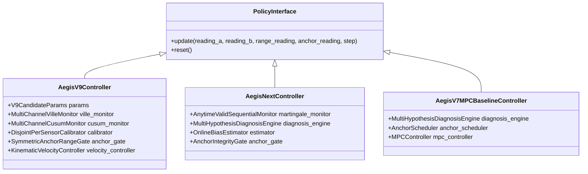

# NEXVIA AEGIS V9-M4 — D_dev Benchmark Plan

**Document Version:** 1.0.0  
**Project:** NEXVIA AEGIS  
**Milestone:** V9-M4 (Autonomous Safety & Research Integrity Verification Subsystem)  
**Governance Status:** `BLOCKED — GATE_B_NOT_AUTHORIZED`  
**Execution Scope:** Authorized Development Partition ($\mathcal{D}_{\text{dev,r1}}$)  
**Target Policies:** V9 Candidates (`V9_CAND_1`, `V9_CAND_2`, `V9_CAND_3`) vs. V8 (`AEGIS_NEXT_MARTINGALE`) vs. V7 (`AEGIS_V7_MPC_BASELINE`)

---

## 1. Executive Summary & Preflight Authorization

This document establishes the formal preflight verification and experimental design for the comparative benchmark of NEXVIA AEGIS policies on the authorized Development Dataset ($\mathcal{D}_{\text{dev}}$).

### 1.1 Authorization & Partition Boundary

| Parameter | Specification | Preregistered Source of Truth |
|---|---|---|
| **Git Working Tree** | Branch `main`, Commit `a37d1d9bc93cf5ed60c702a2c753b74f925b6bf2` | Repository HEAD |
| **Partition Name** | Development Grid ($\mathcal{D}_{\text{dev,r1}}$) | `docs/v9_m2r1_protocol_amendment.md`, `docs/v9_m2r2_protocol_amendment.md` |
| **Seed Range** | `77000..77029` (30 seeds per scenario) | Protocol Amendment R1 (Fresh non-overlapping Master SeedSequence) |
| **Prohibited Partitions** | Holdout Mixture ($\mathcal{D}_{\text{test}}^{\text{mix}}$, `73000..74439`), Holdout Scenarios ($\mathcal{D}_{\text{test}}^{\text{scen}}$, `75000..75119`), Calibration ($\mathcal{D}_{\text{cal}}$, `76000..76959`), Validation ($\mathcal{D}_{\text{val}}$, `72000..72039`) | `experiments/v9_evaluate_dev.py:enforce_dev_only_seeds` |
| **Confirmatory Status** | **UNAUTHORIZED** (`GATE_B_NOT_AUTHORIZED`). Development metrics are exploratory diagnostic evidence only and do NOT certify $H_1..H_5$ hypotheses. | `docs/v9_experiment_protocol.md` Section 3.6 |

### 1.2 Episode Count Interpretation

As defined in `docs/v9_m2r2_protocol_amendment.md` Section 2.4 and `docs/v9_experiment_protocol.md` Section 2.5.2:
- The development partition consists of **12 stratified scenarios** ($S_{12} = S_{10} \cup S_{\text{ext}}$).
- Each scenario is evaluated over **30 deterministic seeds** (`77000` to `77029`).
- Therefore, **360 episodes per policy** ($12 \times 30 = 360$) is the exact preregistered scope.
- Across the five primary evaluated policies, the total number of episode executions is:
  $$N_{\text{total}} = 5 \times 360 = 1{,}800 \text{ episodes}$$
  *(With all 8 policies in the evaluation suite, total execution equals $8 \times 360 = 2{,}880$ episodes).*

---

## 2. Policy Definitions & Configurations

The benchmark compares five policies using strict four-input sensor-interface parity:
$$\pi(\text{reading\_a}, \text{reading\_b}, \text{range\_reading}, \text{anchor\_reading}, \text{step}) \to (\mathbf{u}_t, \text{decision}, \hat{\mathbf{x}}_t, \text{query\_anchor})$$

All policies receive only observable sensor fields (`.estimate`, `.distance`, `.sigma`, `.valid`) and never access ground-truth world state or injection parameters.

### 2.1 Evaluated Policy Specifications



1. **`V9_CAND_1_TIER1_STRICTEST` (V9 Tier 1):**
   - Disagreement threshold: $\tau_{\text{diff}} = 2.40$
   - Anchor/range chord gate threshold: $\tau_{\text{ar}} = 2.40$
   - Ville sequential monitor significance: $\alpha_{\text{mon}} = 0.005$
   - CUSUM drift detection threshold: $h_{\text{cusum}} = 3.60$
   - FIM observability eigenvalue floor: $\lambda_{\text{fim}} = 0.05$
   - Minimum calibration fit steps: $n_{\text{fit}} = 12$, validation steps: $n_{\text{val}} = 6$
   - Arrival tolerance: $0.22\text{ m}$

2. **`V9_CAND_2_TIER2_VERY_STRICT` (V9 Tier 2):**
   - $\tau_{\text{diff}} = 2.60$, $\tau_{\text{ar}} = 2.60$, $\alpha_{\text{mon}} = 0.010$, $h_{\text{cusum}} = 3.80$, $\lambda_{\text{fim}} = 0.05$, $n_{\text{fit}} = 12$, $n_{\text{val}} = 6$
   - Arrival tolerance: $0.22\text{ m}$

3. **`V9_CAND_3_TIER3_BALANCED_STRICT` (V9 Tier 3 — Preregistered Nominal Candidate):**
   - $\tau_{\text{diff}} = 2.80$, $\tau_{\text{ar}} = 2.80$, $\alpha_{\text{mon}} = 0.015$, $h_{\text{cusum}} = 4.00$, $\lambda_{\text{fim}} = 0.04$, $n_{\text{fit}} = 10$, $n_{\text{val}} = 5$
   - Arrival tolerance: $0.22\text{ m}$

4. **`AEGIS_NEXT_MARTINGALE` (V8.1 Baseline):**
   - Architecture: Sequential Martingale Monitor with Testing by Betting, Huber M-estimator, Kinematic velocity controller, single-epoch anchor gate.
   - Known limitations: Single-epoch anchor gate vulnerable to corrupted anchor stress; coupled bias estimation.

5. **`AEGIS_V7_MPC_BASELINE` (V7 Baseline):**
   - Architecture: Multi-hypothesis diagnosis engine (6 hypothesis models), MPC velocity baseline controller.
   - Known limitations: Severe coasting overshoot and timeout paradox (up to 40% timeouts in long horizons); no anytime-valid betting martingales.

---

## 3. Simulation Environment & Scenario Suite ($S_{12}$)

### 3.1 MuJoCo Rigid-Body Physics Engine (`AegisPhysicalWorld`)

- **Simulation core:** MuJoCo (`mujoco.MjModel`, `mujoco.MjData`)
- **Integration timestep:** $\Delta t = 0.02\text{ s}$
- **Gravity:** $g = [0, 0, -9.81]\text{ m/s}^2$
- **Arena dimensions:** $6.0\text{ m} \times 6.0\text{ m}$ bounded plane
- **Robot model:** Sphere geom, radius $r = 0.20\text{ m}$, mass $m = 1.0\text{ kg}$, free joint, planar slide actuation
- **Max episode horizon:** $T_{\max} = 300\text{ steps}$ ($6.0\text{ s}$ simulated physical time)
- **Arrival radius:** $r_{\text{success}} = 0.25\text{ m}$ from ground-truth target position

### 3.2 The 12 Preregistered Scenarios ($S_{12}$)

| Index | Scenario Identifier | Suite | Corruption / Fault Mechanism |
|:---:|---|:---:|---|
| 0 | `NOMINAL` | $S_{10}$ | Zero bias, nominal Gaussian noise ($\sigma_a = 0.05, \sigma_b = 0.05, \sigma_r = 0.05$). |
| 1 | `PRIMARY_BIAS` | $S_{10}$ | Unilateral persistent bias on Sensor A ($\mathbf{b}_a = [0.45, -0.30]\text{ m}$). |
| 2 | `INDEPENDENT_BIAS` | $S_{10}$ | Asymmetric independent biases on Sensor A and B ($\mathbf{b}_a = [0.40, 0.20], \mathbf{b}_b = [-0.30, 0.35]$). |
| 3 | `CORRELATED_BIAS` | $S_{10}$ | Common-mode correlated bias ($\mathbf{b}_a = \mathbf{b}_b = [0.40, 0.40]\text{ m}$). |
| 4 | `SENSOR_DRIFT` | $S_{10}$ | Linear velocity drift on Sensor A ($\mathbf{d}_a = [0.003, 0.002]\text{ m/step}$). |
| 5 | `OUTLIER_BURSTS` | $S_{10}$ | Heavy-tailed $4.5\times\sigma$ bursts ($p = 0.12$) violating nominal Gaussianity. |
| 6 | `SENSOR_DROPOUT` | $S_{10}$ | Intermittent sensor dropouts ($p_{\text{drop}} = 0.15$) on Sensor A. |
| 7 | `FAULTY_REFERENCE_SENSOR` | $S_{10}$ | Corrupted Range Sensor with $+1.00\text{ m}$ distance bias. |
| 8 | `CORRUPTED_ANCHOR_STRESS` | $S_{10}$ | Corrupted high-integrity anchor ($+1.20\text{ m}$ spoofed coordinates). |
| 9 | `COMPOUND_HOLDOUT_EXTREME` | $S_{10}$ | Compound bias + heavy-tail bursts + anchor corruption. |
| 10 | `COMPOUND_DRIFT_DROPOUT` | $S_{\text{ext}}$ | Continuous drift + high dropout probability ($p=0.30$). |
| 11 | `COMPOUND_ANTIPODAL_RANGE_SHIFT` | $S_{\text{ext}}$ | Antipodal vector displacement + inverted range shift. |

---

## 4. Metrics & Statistical Evaluation Methodology

### 4.1 Primary Metrics & Outcome Algebra

Every episode terminates in exactly one mutually exclusive outcome:
$$\text{Outcome}_i \in \{\text{TRUE\_SUCCESS}, \text{FALSE\_SUCCESS}, \text{ABSTAIN\_EXPLICIT}, \text{TIMEOUT}, \text{CRASHED}\}$$

1. **Accepted Decisions ($M$):** $M = \sum_{i=1}^N \mathbb{I}(\text{Outcome}_i \in \{\text{TRUE\_SUCCESS}, \text{FALSE\_SUCCESS}\})$
2. **True Success ($TS$):** Ground-truth distance $\|\mathbf{x}_{\text{final}} - \mathbf{x}_{\text{target}}\|_2 \le 0.25\text{ m}$ upon stopping.
3. **False Success ($FS$ or $K$):** Decision is accepted (`STOP`), but ground-truth distance $> 0.25\text{ m}$, or unhandled simulator crash occurs.
4. **Coverage ($\hat{C}$):** $\hat{C} = \frac{M}{N}$
5. **Task Success Rate ($\text{TSR}$):** $\text{TSR} = \frac{TS}{N}$
6. **Selective Risk ($\hat{R}_{\text{sel}}$):**
   $$\hat{R}_{\text{sel}} = \begin{cases} \frac{FS}{M} & \text{if } M > 0 \\ \text{UNDEFINED} & \text{if } M = 0 \end{cases}$$
7. **Unconditional Risk / Incident Rate ($\hat{R}_{\text{inc}}$):** $\hat{R}_{\text{inc}} = \frac{FS}{N}$
8. **Timeout Rate:** $\text{TOR} = \frac{\text{Timeout}}{N}$

### 4.2 Paired Statistical Comparison Framework

Because episodes are evaluated under **Common Random Numbers (CRN)** with identical paired scenarios and seeds $(s, \text{seed})$:
- **Paired Binary Difference:** For metric $Y \in \{TS, M, FS\}$:
  $$d_i = Y_{A, i} - Y_{B, i} \in \{-1, 0, 1\}$$
- **Exact Two-Sided McNemar Test:** Evaluates whether discordant pairs $b = |\{i: Y_{A, i}=1, Y_{B, i}=0\}|$ and $c = |\{i: Y_{A, i}=0, Y_{B, i}=1\}|$ are symmetrically distributed under $H_0: p_b = p_c$:
  $$p_{\text{McNemar}} = 2 \sum_{k=b}^{b+c} \binom{b+c}{k} 0.5^{b+c} \quad (\text{if } b > c)$$
- **Paired Bootstrap Confidence Interval:** 10,000 paired resamples stratified across scenarios to compute 95% percentile bootstrap CIs for $\Delta \text{TSR}$ and $\Delta \text{Coverage}$.
- **Descriptive Confidence Intervals:** Exact Clopper-Pearson 95% two-sided intervals for individual policy rates.

---

## 5. Execution Safety & Isolation Protocol

To guarantee zero contamination of protected project artifacts:
1. **Isolated Output Directory:** Write all assessment outputs exclusively with suffix `_assessment` into `results/v9/dev/` and `results/v9/manifests/`.
2. **Immutable Protected Files:** Never overwrite `dev_episodes_r1.csv`, `dev_ordering_report_r1.json`, or any historical artifacts.
3. **Seed Guard:** Script strictly enforces `seed in 77000..77029`. Any call outside development seeds will throw an immediate `ValueError`.
4. **Execution Command:**
   ```bash
   PYTHONPATH=src uv run python experiments/v9_evaluate_dev.py \
       --seeds-start 77000 \
       --seeds-count 30 \
       --suffix _assessment \
       --out-dir results/v9/dev
   ```

---

*Plan approved for execution under Milestone V9-M4 Governance (`GATE_B_NOT_AUTHORIZED`).*
