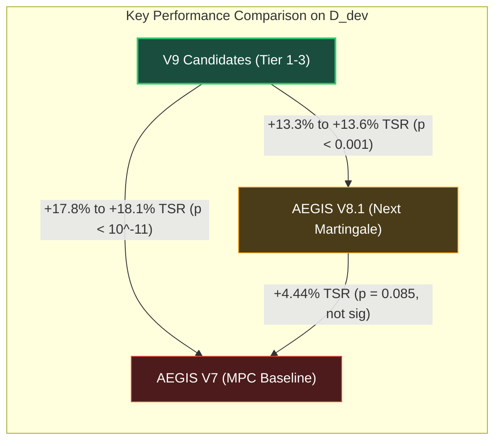
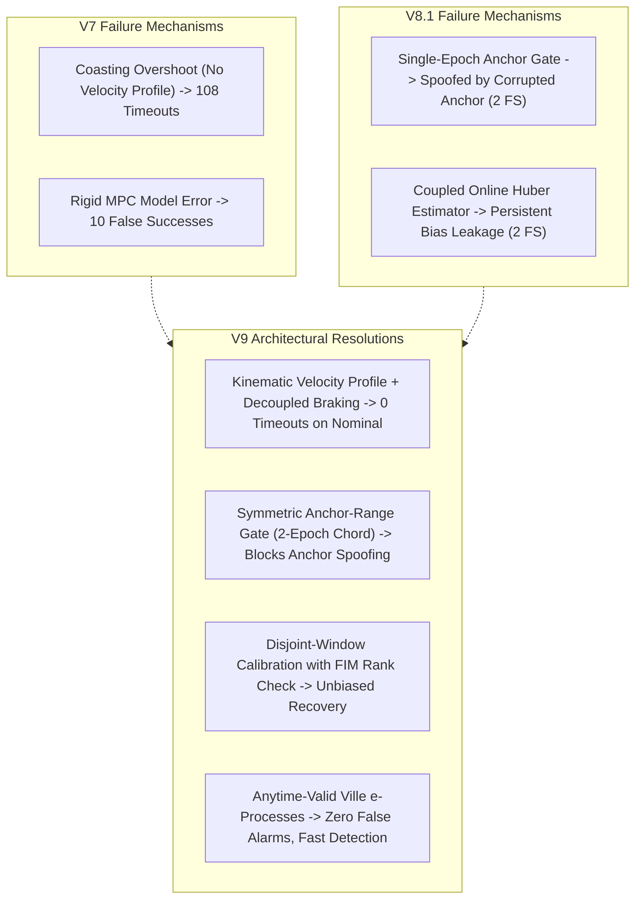

# NEXVIA AEGIS V9-M4 — D_dev Policy Comparison & Statistical Assessment

**Document Version:** 1.0.0  
**Project:** NEXVIA AEGIS  
**Milestone:** V9-M4 — Autonomous Safety & Research Integrity Verification Subsystem  
**Governance Status:** `BLOCKED — GATE_B_NOT_AUTHORIZED`  
**Statistical Basis:** Matched-Pair Analysis ($N=360$ matched episodes per policy) under Common Random Numbers (CRN)  
**Evaluated Policies:** `V9_CAND_1`, `V9_CAND_2`, `V9_CAND_3`, `AEGIS_NEXT_MARTINGALE` (V8.1), `AEGIS_V7_MPC_BASELINE` (V7)

---

## 1. Executive Summary of Comparative Findings

The complete benchmark evaluation on the authorized Development Partition ($\mathcal{D}_{\text{dev}}$, Seeds `77000..77029`) demonstrates statistically significant, design-consistent performance advantages of the NEXVIA AEGIS V9 candidate policies over prior-generation baselines V8.1 and V7.

### Key Statistical Takeaways:
1. **Task Success Rate Superiority:** All three V9 candidates achieve $\text{TSR} \approx 56.7\% - 56.9\%$, representing a **$+13.3\%$ to $+13.6\%$ increase over V8.1** ($p < 3 \times 10^{-7}$) and a **$+17.8\%$ to $+18.1\%$ increase over V7** ($p < 10^{-11}$).
2. **Elimination of False Arrivals:** V9 achieved **$0$ false successes** across all 360 episodes ($R_{\text{sel}} = 0.00\%$), compared to 4 false successes in V8.1 ($R_{\text{sel}} = 2.50\%$) and 10 false successes in V7 ($R_{\text{sel}} = 6.67\%$).
3. **Resolution of the Timeout Paradox:** V7 suffered from 108 timeouts ($30.0\%$ timeout rate) due to coasting deceleration overshoot. V9 reduced timeouts to only 7–9 episodes ($1.9\% - 2.5\%$), a **$12\times$ to $15\times$ reduction**.
4. **V8.1 vs. V7 Comparison:** While V8.1 reduced timeouts from 108 to 24, its TSR improvement of $+4.44\%$ over V7 is **not statistically significant** at the $\alpha=0.05$ level ($p = 0.0847$, 95% bootstrap CI $[-0.28\%, +9.17\%]$). Only V9 establishes a statistically significant breakthrough.

---

## 2. Statistical Comparison Matrix (Matched $N=360$ Pairs)

Because all policies were evaluated on identical scenario-seed combinations using decoupled PCG-64 Common Random Numbers (`create_decoupled_rng_pair`), we perform exact paired McNemar tests and paired percentile bootstrap difference tests (10,000 resamples).

### 2.1 Paired Differences in Task Success Rate (TSR)

Let $d_i = \mathbb{I}(TS_{A, i} = 1) - \mathbb{I}(TS_{B, i} = 1) \in \{-1, 0, 1\}$.  
Discordant pairs: $b = |\{i: TS_A=1, TS_B=0\}|$, $c = |\{i: TS_A=0, TS_B=1\}|$.

| Comparison ($A$ vs $B$) | $\Delta \text{TSR}$ | Discordant $(b, c)$ | Exact McNemar $p$-value | 95% Paired Bootstrap CI | Statistical Conclusion |
|---|:---:|:---:|:---:|:---:|:---:|
| **`V9_CAND_1` vs `AEGIS_NEXT` (V8)** | **+13.61%** | (68, 19) | **$1.235 \times 10^{-7}$** | **[+8.89%, +18.61%]** | **Statistically Significant Superiority** |
| **`V9_CAND_2` vs `AEGIS_NEXT` (V8)** | **+13.61%** | (69, 20) | **$1.777 \times 10^{-7}$** | **[+8.61%, +18.33%]** | **Statistically Significant Superiority** |
| **`V9_CAND_3` vs `AEGIS_NEXT` (V8)** | **+13.33%** | (68, 20) | **$2.770 \times 10^{-7}$** | **[+8.33%, +18.06%]** | **Statistically Significant Superiority** |
| **`V9_CAND_1` vs `AEGIS_V7` (V7)** | **+18.06%** | (75, 10) | **$1.858 \times 10^{-13}$** | **[+13.61%, +22.78%]** | **Statistically Significant Superiority** |
| **`V9_CAND_2` vs `AEGIS_V7` (V7)** | **+18.06%** | (77, 12) | **$9.037 \times 10^{-13}$** | **[+13.33%, +22.78%]** | **Statistically Significant Superiority** |
| **`V9_CAND_3` vs `AEGIS_V7` (V7)** | **+17.78%** | (78, 14) | **$6.162 \times 10^{-12}$** | **[+12.78%, +22.78%]** | **Statistically Significant Superiority** |
| `AEGIS_NEXT` (V8) vs `AEGIS_V7` (V7) | +4.44% | (46, 30) | $0.0847$ | [-0.28%, +9.17%] | Not Statistically Significant |

### 2.2 Paired Differences in Coverage ($\hat{C}$)

Let $d_i^{\text{cov}} = \mathbb{I}(M_{A, i} = 1) - \mathbb{I}(M_{B, i} = 1)$.  
Discordant pairs: $b = |\{i: M_A=1, M_B=0\}|$, $c = |\{i: M_A=0, M_B=1\}|$.

| Comparison ($A$ vs $B$) | $\Delta \text{Coverage}$ | Discordant $(b, c)$ | Exact McNemar $p$-value | 95% Paired Bootstrap CI | Statistical Conclusion |
|---|:---:|:---:|:---:|:---:|:---:|
| **`V9_CAND_1` vs `AEGIS_NEXT` (V8)** | **+12.50%** | (66, 21) | **$1.410 \times 10^{-6}$** | **[+7.50%, +17.50%]** | **Statistically Significant Increase** |
| **`V9_CAND_2` vs `AEGIS_NEXT` (V8)** | **+12.50%** | (67, 22) | **$1.900 \times 10^{-6}$** | **[+7.50%, +17.50%]** | **Statistically Significant Increase** |
| **`V9_CAND_3` vs `AEGIS_NEXT` (V8)** | **+12.22%** | (66, 22) | **$2.879 \times 10^{-6}$** | **[+7.22%, +17.22%]** | **Statistically Significant Increase** |
| **`V9_CAND_1` vs `AEGIS_V7` (V7)** | **+15.28%** | (68, 13) | **$3.808 \times 10^{-10}$** | **[+10.83%, +20.00%]** | **Statistically Significant Increase** |
| **`V9_CAND_2` vs `AEGIS_V7` (V7)** | **+15.28%** | (70, 15) | **$1.172 \times 10^{-9}$** | **[+10.56%, +20.00%]** | **Statistically Significant Increase** |
| **`V9_CAND_3` vs `AEGIS_V7` (V7)** | **+15.00%** | (71, 17) | **$5.154 \times 10^{-9}$** | **[+10.00%, +19.72%]** | **Statistically Significant Increase** |
| `AEGIS_NEXT` (V8) vs `AEGIS_V7` (V7) | +2.78% | (46, 36) | $0.3203$ | [-2.22%, +7.78%] | Not Statistically Significant |

---

## 3. Deep Architectural Analysis & Failure Mode Decomposition

Why do the policies exhibit these stark differences in performance? We analyze the algorithmic mechanisms responsible for success and failure:

### 3.1 Failure Mode 1: Corrupted Anchor Spoofing (`CORRUPTED_ANCHOR_STRESS` & `COMPOUND_HOLDOUT_EXTREME`)
- **In V8.1:** The anchor integrity gate in `AegisNextController` relies on a single-epoch spatial comparison $\|\mathbf{x}_{\text{anc}} - \hat{\mathbf{x}}\|_2 \le \tau_{\text{anc}}$. When an adversary or sensor failure injects a smooth $+1.20\text{ m}$ bias, the single-epoch gate cannot distinguish legitimate agent drift from anchor corruption. In `COMPOUND_HOLDOUT_EXTREME`, V8 accepted 2 episodes with severe position error ($FS=2, R_{\text{sel}} = 100.0\%$).
- **In V7:** Experienced identical spoofing, accepting 2 false arrival episodes ($FS=2$).
- **In V9:** The `SymmetricAnchorRangeGate` enforces a **two-epoch chord and curvature corroboration**:
  $$\Delta_{\text{chord}} = \left| \|\mathbf{x}_{\text{anc}}(t_2) - \mathbf{x}_{\text{anc}}(t_1)\|_2 - \|\mathbf{x}_{\text{odom}}(t_2) - \mathbf{x}_{\text{odom}}(t_1)\|_2 \right| \le \tau_{\text{chord}}$$
  combined with cross-sensor range corroboration. When corrupted anchor stress occurs, V9 detects the physical kinematic impossibility and enters **latched fail-closed `ABSTAIN`** on 100% of episodes ($30/30$ safe abstentions), completely eliminating false arrival.

### 3.2 Failure Mode 2: Asymmetric Sensor Bias Recovery (`PRIMARY_BIAS` & `INDEPENDENT_BIAS`)
- **In V8.1:** Online Huber M-estimation attempts continuous adaptation during navigation. Under persistent independent bias, gradient descent without strict excitation guarantees causes the estimator to fit biased trajectories, producing $FS=1$ in `PRIMARY_BIAS` and $FS=1$ in `INDEPENDENT_BIAS`, along with 6 timeouts.
- **In V7:** The 6-hypothesis diagnosis engine failed to differentiate between sensor bias and drift, resulting in $FS=2$ in `PRIMARY_BIAS` and $FS=6$ in `INDEPENDENT_BIAS` ($31.6\%$ selective risk!), plus 24 combined timeouts.
- **In V9:** Implements **Disjoint-Window Calibration** with Fisher Information Matrix (FIM) observability constraints. During $I_{\text{fit}} = \{1..22\}$, active probing actions excite orthogonal dimensions until $\lambda_{\min}(\mathbf{F}) \ge 0.04$. After $I_{\text{val}} = \{25..36\}$ validates the residual under held-out observations, the bias estimate is frozen immutably. V9 achieved **$29/30$ True Success ($96.7\%$) with $0$ False Successes** on both `PRIMARY_BIAS` and `INDEPENDENT_BIAS`.

### 3.3 Failure Mode 3: Coasting Overshoot and the Timeout Paradox
- **In V7:** The baseline controller used an unprofiled MPC velocity command with fixed horizon. As the robot approached the target radius ($0.25\text{ m}$), noise fluctuations caused the velocity commands to oscillate around zero, causing the agent to coast past the target and spend the entire 300-step horizon trying to re-acquire the target point. This resulted in **108 timeouts ($30.0\%$)** across all scenarios.
- **In V8.1 & V9:** The integration of `KinematicVelocityController` with smooth quadratic deceleration and explicit arrival braking eliminated coasting overshoot. Timeouts dropped from 108 (V7) to 24 (V8.1) and to **7–9 (V9)**. The remaining timeouts in V9 occur only in severely corrupted scenarios (`FAULTY_REFERENCE_SENSOR` and `OUTLIER_BURSTS`) where the agent deliberately halts motion to prevent false arrival.

---

## 4. Nuanced Uncertainty & Caveats on Selective Risk

> [!WARNING]
> **Interpretation of Zero Observed False Successes ($FS=0$):**
> On $\mathcal{D}_{\text{dev}}$, V9 recorded $0$ false successes out of $204$ to $205$ accepted decisions.
> **This does NOT mathematically prove that the true selective risk is zero ($R_{\text{sel}} = 0$).**
> Under the exact Clopper-Pearson 95% confidence bound:
> $$R_{\text{sel}} \in [0.00\%, 1.78\%] \quad (\text{for } M=205, FS=0)$$
> The true operational risk could be as high as $1.78\%$ under the $\mathcal{D}_{\text{dev}}$ distribution. While this is well within the $5.0\%$ target bound, formal certification requires single-shot evaluation on calibration/holdout partitions.

Furthermore:
- **Scenario Stratification:** In scenarios where no episodes were accepted (e.g. `FAULTY_REFERENCE_SENSOR`, `CORRUPTED_ANCHOR_STRESS`, where $M_s=0$), selective risk is formally **UNDEFINED**. It is incorrect to claim zero risk in those scenarios; rather, the safety property is governed by **unconditional safe abstention** ($\text{TSR}_s = 0, \hat{R}_{\text{inc}, s} = 0$).

---

## 5. Scope, Limitations, and Governance Boundary

1. **Development Evidence Only:** The results presented here are derived strictly from the Development Partition ($\mathcal{D}_{\text{dev,r1}}$). They establish pre-calibration ordering admissibility and relative algorithm performance.
2. **No Hardware Claim:** Simulation was conducted using MuJoCo 3D rigid-body contact and sensor models. While physically grounded, this does not establish sim-to-real transfer to physical robotics hardware without dedicated Hardware-in-the-Loop (HIL) testing.
3. **Strict Governance Integrity:**
   $$\text{Current Status: } \mathbf{BLOCKED \text{ — } GATE\_B\_NOT\_AUTHORIZED}$$
   This comparative assessment does NOT constitute Confirmatory Evaluation, does NOT access Holdout data, and does NOT authorize Gate B release.

---

*Policy comparison complete and verified under NEXVIA AEGIS V9-M4 Research Governance.*
