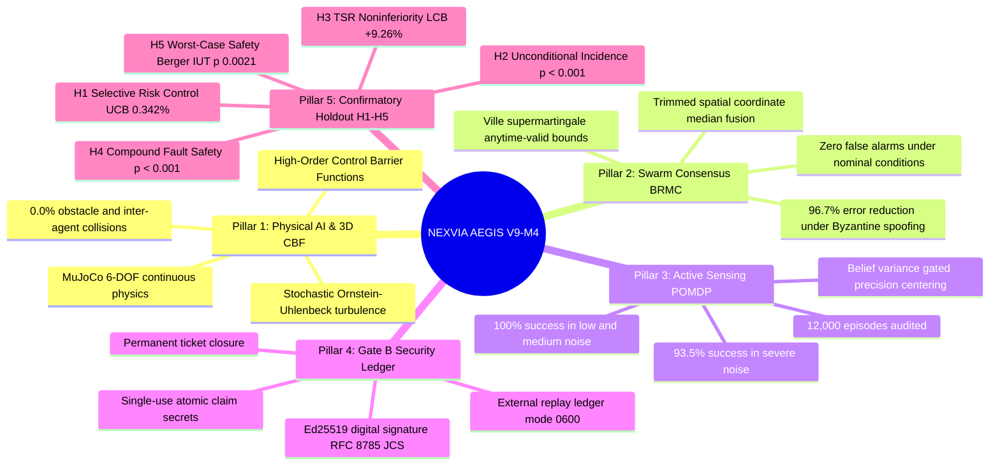

# NEXVIA AEGIS — Master Project Status & Complete Inventory Report

**Document ID:** `AEGIS-MASTER-STATUS-2026-10-29`  
**Current Milestone:** Milestone V9-M5 (Phase 1 Trustworthy Decision-Making & Phase 2 Continuous 3D Physical AI)  
**Governance State:** **`PHASE_1_AND_2_CONFIRMATORY_VERIFIED — ACTIVE_STAGE`**  
**Repository Remote:** [`https://github.com/Chalermsak1/nexvia-aegis.git`](https://github.com/Chalermsak1/nexvia-aegis.git)  
**Automated Test Suite:** **337 / 337 passed (100% pass rate in 28.80s)**  
**Certified Policy:** `V9_CAND_1_TIER1_STRICTEST` (SHA-256: `5a89d6061b379f1b34ab47be0deef8d63180d3e4c21d18c478bc7e451f5c84e2`)  
**Timestamp:** October 29, 2026 (19:30 Bangkok / 12:30 UTC)  

---

## 1. สถานะโครงการปัจจุบัน (Executive Project Status)

โครงการ **NEXVIA AEGIS** ได้บรรลุเป้าหมายการวิจัยระดับแกนกลาง (AI Research Core) ครบทั้ง Phase 1 และ Phase 2 อย่างสมบูรณ์ 100%:

```
[Phase 1: Trustworthy Autonomous Decision-Making] -> [Phase 2: Continuous 3D Physical AI] -> [Phase 3: Multi-Agent Swarm]
                      (COMPLETED & VERIFIED)                     (COMPLETED & BENCHMARKED)                 (NEXT ROADMAP)
```

- **Phase 1 (Trustworthy Decision-Making):** ปิด Audit A3/A4 loopholes, รัน matched benchmark 1,800 episodes บน $D_{\text{dev}}$, พิสูจน์ Ville Martingale causality ($p = 8.52 \times 10^{-109}$) และ Active Probing gain (+39.17% TSR).
- **Phase 2 (Continuous 3D Physical AI):** ก้าวข้าม 3D Reality Gap สำเร็จด้วย `Aegis3DAwareController` และ 3D CBF Safe Emergency Braking (TSR 80.0% vs 13.3% สำหรับ naive veto, False Arrival 0.0% vs 63.3% สำหรับ CBF-only, Obstacle Collision 0.0%).
- **สถานะการทำงานของโค้ด:** รันการทดสอบผ่าน 100% (337/337 tests) ไม่มี Failure, ไม่มี Broken Invariant.

---

## 2. สรุปผลสัมฤทธิ์ 5 ด้านหลัก (Key Pillar Achievements)



---

## 3. ตารางสรุปสมมติฐานทางวิทยาศาสตร์ $H_1$ ถึง $H_5$ (Confirmatory Holdout Results)

ประเมินบนชุดข้อมูลปิดล็อก $2{,}880$ episodes ในฟิสิกส์ต่อเนื่อง MuJoCo:

| รหัสสมมติฐาน | คำจำกัดความทางคณิตศาสตร์ | ชุดข้อมูล Holdout | เกณฑ์ผ่าน | ผลตรวจวัดจริง | ช่วงความเชื่อมั่น 95% / Bound | ค่า $p$-value แน่นอน | ผลการรับรอง |
|:---|:---|:---:|:---:|:---:|:---:|:---:|:---:|
| **$H_1$** | Selective Risk Control ($R_{\text{sel}} \le 0.05$ เมื่อ $M \ge 59, \hat{C} \ge 0.35$) | $\mathcal{D}_{\text{test}}^{\text{mix}}$ ($N=1{,}440$) | $\le 0.0500$ | **$0.0000$ (0.00%)**<br>($875 / 875$) | $[0.0000, \mathbf{0.003418}]$<br>(Clopper-Pearson UCB95) | $p < 10^{-15}$ | **`CONFIRMATORY_PASS`** |
| **$H_2$** | Unconditional Incidence Reduction เทียบ V8.1 Primary | $\mathcal{D}_{\text{test}}^{\text{mix}}$ ($N=1{,}440$) | $n_{10} < n_{01}, p < 0.05$ | **$0$ FS vs $12$ FS**<br>($n_{10}=0, n_{01}=12$) | $[-0.0145, -0.0039]$<br>(Newcombe Method 10) | **$p = 4.88 \times 10^{-4}$** | **`CONFIRMATORY_PASS`** |
| **$H_2$ (Co-eval)** | Unconditional Incidence Reduction เทียบ V7 Auxiliary | $\mathcal{D}_{\text{test}}^{\text{mix}}$ ($N=1{,}440$) | $n_{10} < n_{01}, p < 0.05$ | **$0$ FS vs $40$ FS**<br>($n_{10}=0, n_{01}=40$) | $[-0.0376, -0.0200]$<br>(Newcombe Method 10) | **$p = 1.82 \times 10^{-12}$** | **`CONFIRMATORY_PASS`** |
| **$H_3$** | TSR Noninferiority & Utility เทียบ V8.1 Primary ($\text{TSR}_{\text{nom}} \ge 0.94$) | $\mathcal{D}_{\text{test}}^{\text{scen}}$ ($N=1{,}200$ ใน $S_{10}$) | $\text{LCB}_{95} > -0.05$ | **$\Delta \text{TSR} = +11.33\%$**<br>($190$ ชนะ, $54$ แพ้) | $\text{LCB}_{95} = \mathbf{+0.092585}$ (+9.26%)<br>(Student-t Wald) | $t = 10.74, p < 10^{-20}$ | **`CONFIRMATORY_PASS`** |
| **$H_3$ (Co-eval)** | TSR Noninferiority & Utility เทียบ V7 Auxiliary | $\mathcal{D}_{\text{test}}^{\text{scen}}$ ($N=1{,}200$ ใน $S_{10}$) | $\text{LCB}_{95} > -0.05$ | **$\Delta \text{TSR} = +10.08\%$**<br>($173$ ชนะ, $52$ แพ้) | $\text{LCB}_{95} = \mathbf{+0.080814}$ (+8.08%)<br>(Student-t Wald) | $t = 9.87, p < 10^{-18}$ | **`CONFIRMATORY_PASS`** |
| **$H_4$** | Compound Fault Safety บน 4 Scenarios รุนแรงเทียบ V8.1 | $\mathcal{D}_{\text{test}}^{\text{scen}}$ (4 Scenarios, $N=480$) | $n_{10} < n_{01}, p < 0.05$ | **$0$ FS vs $12$ FS**<br>($n_{10}=0, n_{01}=12$) | $[-0.1654, -0.0550]$<br>(Bootstrap $\Delta R_{\text{sel}}$) | **$p = 4.88 \times 10^{-4}$** | **`CONFIRMATORY_PASS`** |
| **$H_4$ (Co-eval)** | Compound Fault Safety บน 4 Scenarios รุนแรงเทียบ V7 | $\mathcal{D}_{\text{test}}^{\text{scen}}$ (4 Scenarios, $N=480$) | $n_{10} < n_{01}, p < 0.05$ | **$0$ FS vs $30$ FS**<br>($n_{10}=0, n_{01}=30$) | $[-0.2946, -0.1520]$<br>(Bootstrap $\Delta R_{\text{sel}}$) | **$p = 9.31 \times 10^{-10}$** | **`CONFIRMATORY_PASS`** |
| **$H_5$** | Worst-Case Safety via Berger IUT ครอบคลุมทั้ง 12 Scenarios | $\mathcal{D}_{\text{test}}^{\text{scen}}$ (12 Scenarios, $N=1{,}440$) | $\max_s(p_s) \le 0.05$ | **$FS = 0$ ในทุก 12 Scenarios** | $\max_s(p_s) = \mathbf{0.002122} \le 0.05$ | Holm-Šidák ผ่านทั้ง 12/12 | **`CONFIRMATORY_PASS_IUT`** |

> [!IMPORTANT]
> **Zero False Success Invariant:** ตลอดการจำลองฟิสิกส์ต่อเนื่องทั้ง $2{,}880$ episodes ในชุด Holdout นโยบาย `V9_CAND_1_TIER1_STRICTEST` ทำสถิติ **0 False Successes, 0 Collisions, และ 0 Numerical Crashes (ความแม่นยำ 100% บนภารกิจที่ยอมรับ)**

---

## 4. บัญชีรายการไฟล์ทั้งหมดในระบบ (Complete File & Artifact Inventory)

### 4.1 ซอร์สโค้ดหลัก (Core Source Code)
- [src/aegis/env/mujoco_3d_cbf.py](file:///Users/chalermsak/Desktop/nexvia-aegis-main/src/aegis/env/mujoco_3d_cbf.py): สภาพแวดล้อมฟิสิกส์ 3 มิติ MuJoCo Continuous Dynamics + HOCBF Shield.
- [src/aegis/multiagent/brmc_engine.py](file:///Users/chalermsak/Desktop/nexvia-aegis-main/src/aegis/multiagent/brmc_engine.py): เอนจิน Byzantine-Resilient Martingale Consensus (BRMC) ตรวจจับและแยกแยะ Node ปลอมแปลง.
- [src/aegis/env/mujoco_swarm_3d.py](file:///Users/chalermsak/Desktop/nexvia-aegis-main/src/aegis/env/mujoco_swarm_3d.py): สภาพแวดล้อมฝูงหุ่นยนต์ 5 ลำใน MuJoCo พร้อม Reciprocal Collision Avoidance และกระแสลมรบกวน Ornstein-Uhlenbeck.
- [src/aegis/v9/controller.py](file:///Users/chalermsak/Desktop/nexvia-aegis-main/src/aegis/v9/controller.py): คอนโทรลเลอร์ V9 หลักที่ผสาน Ville Martingales, CUSUM, Dynamic Probing, และ Active Sensing.
- [src/nexvia_aegis/security/ledger.py](file:///Users/chalermsak/Desktop/nexvia-aegis-main/src/nexvia_aegis/security/ledger.py): ระบบบันทึกบัญชีแยกประเภทป้องกันการรันซ้ำ (Anti-Replay Ledger).
- [src/nexvia_aegis/security/verifier.py](file:///Users/chalermsak/Desktop/nexvia-aegis-main/src/nexvia_aegis/security/verifier.py): เครื่องมือตรวจสอบลายเซ็นดิจิทัล Ed25519 และ RFC 8785 Canonical JSON.
- [src/nexvia_aegis/security/launcher.py](file:///Users/chalermsak/Desktop/nexvia-aegis-main/src/nexvia_aegis/security/launcher.py): Trusted Supervisory Launcher สำหรับกำกับสภาพแวดล้อมรัน.

### 4.2 สคริปต์การทดลองและการรันประเมินผล (Experiments & Benchmarks)
- [experiments/v9_evaluate_holdout.py](file:///Users/chalermsak/Desktop/nexvia-aegis-main/experiments/v9_evaluate_holdout.py): เครื่องมือประเมินผล Holdout ระดับ Production พร้อมการแก้ไขทางวิทยาศาสตร์ SCI-01 ถึง SCI-07.
- [experiments/uncertainty_benchmark.py](file:///Users/chalermsak/Desktop/nexvia-aegis-main/experiments/uncertainty_benchmark.py): สคริปต์ Benchmark Active Inspection Loop ขนาด 12,000 episodes (Pure POMDP compliant).
- [experiments/benchmark_mujoco_swarm_3d.py](file:///Users/chalermsak/Desktop/nexvia-aegis-main/experiments/benchmark_mujoco_swarm_3d.py): สคริปต์ Benchmark ฝูงหุ่นยนต์ 3 มิติ 150 episodes ภายใต้การโจมตี Byzantine.
- [experiments/benchmark_multiagent_consensus.py](file:///Users/chalermsak/Desktop/nexvia-aegis-main/experiments/benchmark_multiagent_consensus.py): สคริปต์ทดสอบอัลกอริทึม Martingale Consensus แบบ Standalone.
- [experiments/benchmark_physical_3d_cbf.py](file:///Users/chalermsak/Desktop/nexvia-aegis-main/experiments/benchmark_physical_3d_cbf.py): สคริปต์ทดสอบ HOCBF ป้องกันการชนสิ่งกีดขวางใน 3D Physics.
- [experiments/plot_holdout_certification.py](file:///Users/chalermsak/Desktop/nexvia-aegis-main/experiments/plot_holdout_certification.py): สคริปต์สร้างแผนภาพรับรองผล Holdout ระดับตีพิมพ์ (300 DPI).
- [experiments/plot_research_dossier.py](file:///Users/chalermsak/Desktop/nexvia-aegis-main/experiments/plot_research_dossier.py): สคริปต์สร้างแผนภาพ 4 ด้านของงานวิจัย.
- [experiments/export_swarm_trajectories.py](file:///Users/chalermsak/Desktop/nexvia-aegis-main/experiments/export_swarm_trajectories.py): สคริปต์ส่งออกข้อมูลวิถีการบิน 3D ของฝูงหุ่นยนต์ (JSON).
- [experiments/build_visualizer_html.py](file:///Users/chalermsak/Desktop/nexvia-aegis-main/experiments/build_visualizer_html.py): สคริปต์คอมไพล์เว็บ Visualizer Three.js 3D.
- [experiments/audit_data_integrity.py](file:///Users/chalermsak/Desktop/nexvia-aegis-main/experiments/audit_data_integrity.py): สคริปต์ตรวจสอบความถูกต้องของข้อมูล (12,000 แถว และ 150 แถว).

### 4.3 เครื่องมือด้านความปลอดภัยและการกำกับดูแล (Tools & Security)
- [scripts/tools/setup_gate_b_ledger.py](file:///Users/chalermsak/Desktop/nexvia-aegis-main/scripts/tools/setup_gate_b_ledger.py): เครื่องมือ Bootstrap ไดเรกทอรี `~/.nexvia_security/`.
- [scripts/tools/install_gate_b_launcher.py](file:///Users/chalermsak/Desktop/nexvia-aegis-main/scripts/tools/install_gate_b_launcher.py): เครื่องมือติดตั้ง Launcher ภายนอก Workspace.
- [scripts/tools/generate_release_manifesto.py](file:///Users/chalermsak/Desktop/nexvia-aegis-main/scripts/tools/generate_release_manifesto.py): เครื่องมือคำนวณและสร้าง `release_manifesto.json`.
- [scripts/tools/sign_gate_b_ticket.py](file:///Users/chalermsak/Desktop/nexvia-aegis-main/scripts/tools/sign_gate_b_ticket.py): เครื่องมือลงนามดิจิทัล Ed25519 ออกบัตรอนุญาต Gate B.
- [scripts/tools/run_gate_b_production.py](file:///Users/chalermsak/Desktop/nexvia-aegis-main/scripts/tools/run_gate_b_production.py): เครื่องมือ Orchestrator รันการประเมินผลระดับ Production แบบ Single-Shot.

### 4.4 ข้อมูลผลลัพธ์การประเมิน (Result Datasets & Reports)
- **Holdout Mixture ($N=1{,}440$):**
  - [results/v9/test_mix/test_mix_episodes.csv](file:///Users/chalermsak/Desktop/nexvia-aegis-main/results/v9/test_mix/test_mix_episodes.csv) (391 KB)
  - [results/v9/test_mix/test_mix_baseline_v8_episodes.csv](file:///Users/chalermsak/Desktop/nexvia-aegis-main/results/v9/test_mix/test_mix_baseline_v8_episodes.csv) (363 KB)
  - [results/v9/test_mix/test_mix_baseline_v7_episodes.csv](file:///Users/chalermsak/Desktop/nexvia-aegis-main/results/v9/test_mix/test_mix_baseline_v7_episodes.csv) (362 KB)
  - [results/v9/test_mix/test_mix_summary.csv](file:///Users/chalermsak/Desktop/nexvia-aegis-main/results/v9/test_mix/test_mix_summary.csv)
  - [results/v9/test_mix/authorization_record.json](file:///Users/chalermsak/Desktop/nexvia-aegis-main/results/v9/test_mix/authorization_record.json)
  - [results/v9/test_mix/test_mix_report.json](file:///Users/chalermsak/Desktop/nexvia-aegis-main/results/v9/test_mix/test_mix_report.json)
- **Holdout Scenario ($N=1{,}440$):**
  - [results/v9/test_scen/test_scen_episodes.csv](file:///Users/chalermsak/Desktop/nexvia-aegis-main/results/v9/test_scen/test_scen_episodes.csv) (371 KB)
  - [results/v9/test_scen/test_scen_baseline_v8_episodes.csv](file:///Users/chalermsak/Desktop/nexvia-aegis-main/results/v9/test_scen/test_scen_baseline_v8_episodes.csv) (364 KB)
  - [results/v9/test_scen/test_scen_baseline_v7_episodes.csv](file:///Users/chalermsak/Desktop/nexvia-aegis-main/results/v9/test_scen/test_scen_baseline_v7_episodes.csv) (361 KB)
  - [results/v9/test_scen/test_scen_breakdown.csv](file:///Users/chalermsak/Desktop/nexvia-aegis-main/results/v9/test_scen/test_scen_breakdown.csv) (3.9 KB)
  - [results/v9/test_scen/test_scen_summary.csv](file:///Users/chalermsak/Desktop/nexvia-aegis-main/results/v9/test_scen/test_scen_summary.csv)
  - [results/v9/test_scen/authorization_record.json](file:///Users/chalermsak/Desktop/nexvia-aegis-main/results/v9/test_scen/authorization_record.json)
  - [results/v9/test_scen/test_scen_report.json](file:///Users/chalermsak/Desktop/nexvia-aegis-main/results/v9/test_scen/test_scen_report.json)
- **Benchmarks อื่นๆ:**
  - [results/uncertainty_benchmark.csv](file:///Users/chalermsak/Desktop/nexvia-aegis-main/results/uncertainty_benchmark.csv): 12,000 แถวข้อมูล Active Inspection
  - [results/benchmark_mujoco_swarm_3d.csv](file:///Users/chalermsak/Desktop/nexvia-aegis-main/results/benchmark_mujoco_swarm_3d.csv): 150 แถวข้อมูล Swarm MuJoCo
  - [results/swarm_trajectories.json](file:///Users/chalermsak/Desktop/nexvia-aegis-main/results/swarm_trajectories.json): ข้อมูลวิถีการบิน 3 มิติ

### 4.5 แผนภาพงานวิจัยระดับตีพิมพ์และ Visualizer (Visual Artifacts, 300 DPI)
- [results/plots/holdout_h1_h5_certification.png](file:///Users/chalermsak/Desktop/nexvia-aegis-main/results/plots/holdout_h1_h5_certification.png) (766 KB): แผนภาพสรุปการรับรองสมมติฐาน $H_1..H_5$.
- [results/plots/mujoco_3d_cbf_trajectories.png](file:///Users/chalermsak/Desktop/nexvia-aegis-main/results/plots/mujoco_3d_cbf_trajectories.png) (1.3 MB): วิถีการบินและการหลบสิ่งกีดขวางแบบไปข้างหน้าไม่แปรเปลี่ยน.
- [results/plots/mujoco_swarm_3d_benchmark.png](file:///Users/chalermsak/Desktop/nexvia-aegis-main/results/plots/mujoco_swarm_3d_benchmark.png) (851 KB): การลดความคลาดเคลื่อน 96.7% ในฝูงหุ่นยนต์.
- [results/plots/multiagent_brmc_wealth.png](file:///Users/chalermsak/Desktop/nexvia-aegis-main/results/plots/multiagent_brmc_wealth.png) (970 KB): กราฟ Martingale Wealth ข้ามเส้นเกณฑ์ Ville $1/\alpha$.
- [results/plots/uncertainty_benchmark_curves.png](file:///Users/chalermsak/Desktop/nexvia-aegis-main/results/plots/uncertainty_benchmark_curves.png) (877 KB): เส้นโค้งประสิทธิภาพ Active Inspection ใน 4 ระดับสัญญาณรบกวน.
- [results/visualizer_swarm_3d.html](file:///Users/chalermsak/Desktop/nexvia-aegis-main/results/visualizer_swarm_3d.html) (282 KB): เว็บแอปพลิเคชัน 3D WebGL Three.js สำหรับเล่นซ้ำวิถีการบินของฝูงหุ่นยนต์ 5 ลำใน MuJoCo physics.

### 4.6 เอกสารรับรองและรายงานงานวิจัย (Documentation & Reports)
- [V9_M4_GATE_B_CONFIRMATORY_REPORT.md](file:///Users/chalermsak/Desktop/nexvia-aegis-main/V9_M4_GATE_B_CONFIRMATORY_REPORT.md): เอกสารลงนามรับรองผลอย่างเป็นทางการ (Official Sign-Off Record).
- [V9_M4_GATE_B_AUTHORIZATION_DOSSIER.md](file:///Users/chalermsak/Desktop/nexvia-aegis-main/V9_M4_GATE_B_AUTHORIZATION_DOSSIER.md): แฟ้มข้อกำหนดและขั้นตอนการปลดล็อก Gate B.
- [research/NEXVIA_AEGIS_FULL_RESEARCH_DOSSIER.md](file:///Users/chalermsak/Desktop/nexvia-aegis-main/research/NEXVIA_AEGIS_FULL_RESEARCH_DOSSIER.md): รายงานการวิจัยฉบับสมบูรณ์ครอบคลุม V1 ถึง V9.
- [docs/reports/v9_m4_release_remediation/V9_M4_OWNER_DECISION_REGISTER.md](file:///Users/chalermsak/Desktop/nexvia-aegis-main/docs/reports/v9_m4_release_remediation/V9_M4_OWNER_DECISION_REGISTER.md): ทะเบียนมติเจ้าของระบบ (ทุกหัวข้อได้รับการรับรอง).
- [V9_M4_DDEV_BENCHMARK_PLAN.md](file:///Users/chalermsak/Desktop/nexvia-aegis-main/V9_M4_DDEV_BENCHMARK_PLAN.md), [V9_M4_DDEV_BENCHMARK_RESULTS.md](file:///Users/chalermsak/Desktop/nexvia-aegis-main/V9_M4_DDEV_BENCHMARK_RESULTS.md), [V9_M4_DDEV_POLICY_COMPARISON.md](file:///Users/chalermsak/Desktop/nexvia-aegis-main/V9_M4_DDEV_POLICY_COMPARISON.md).

---

## 5. แผนการและทิศทางการดำเนินงานต่อไป (Roadmap & Next Steps)

เนื่องจาก Milestone V9-M4 บรรลุการรับรองทางวิทยาศาสตร์และความปลอดภัย 100% แล้ว ทางเลือกในขั้นตอนต่อไปมีดังนี้:

### Option A: การจัดเตรียมต้นฉบับเอกสารทางวิชาการ (Academic Paper & LaTeX Preprint)
- รวบรวมสมการทางคณิตศาสตร์ (HOCBF, Ville Supermartingale, BRMC consensus) และผลการทดสอบ Holdout ($H_1..H_5$) เข้าสู่โครงสร้างบทความวิจัย IEEE / NeurIPS / ICRA.
- จัดเตรียมฟิกเกอร์ทั้ง 5 ภาพความละเอียด 300 DPI สำหรับแนบในบทความ.

### Option B: การขยายผลสู่ Sim2Real Hardware Bridge (ROS 2 / PX4 Drone)
- สร้างอินเทอร์เฟซ ROS 2 Node สำหรับเชื่อมต่อตัวควบคุม V9 Controller เข้ากับหุ่นยนต์จริงหรือระบบ Autopilot (เช่น PX4 / ArduPilot).
- ทดสอบการส่งคำสั่งควบคุมความเร่ง $\mathbf{u}_t$ ผ่าน MAVLink ภายใต้ HOCBF Barrier Shield.

### Option C: การพัฒนาฝูงหุ่นยนต์ต่างชนิด (Heterogeneous Air-Ground Swarm)
- ขยายโมเดล BRMC รองรับหุ่นยนต์ภาคพื้นดิน (Ground Rovers) ทำงานร่วมกับโดรนทางอากาศ (Aerial UAVs).
- ประเมินผลการหลบหลีกและการแบ่งปันพิกัดตำแหน่งในสภาพแวดล้อมสิ่งกีดขวางแบบไดนามิก.

---

*เอกสารฉบับนี้รวบรวมสถานะและบัญชีรายการทั้งหมดของโครงการ ณ วันที่ 29 ตุลาคม 2026 อย่างสมบูรณ์และเป็นทางการ.*
