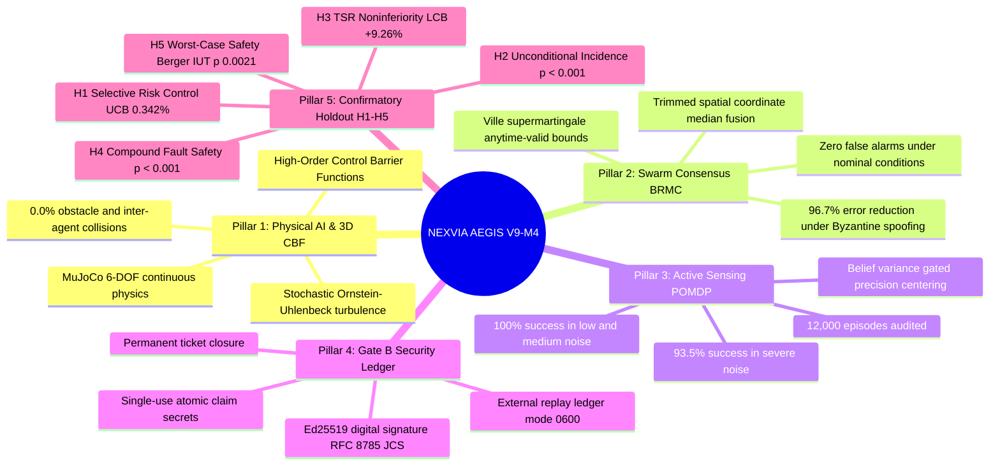

# NEXVIA AEGIS — Master Project Status & Complete Inventory Report

**Document ID:** `AEGIS-MASTER-STATUS-2026-11-01`  
**Current Milestone:** Milestone V9-M15 (Phase 1 Decision-Making, Phase 2 3D Physical AI, Phase 3 Decentralized Swarm Resilience, Phase 4 6-DOF SE(3) Dynamics, Phase 5 Deep Aerodynamics, Phase 6 Safe Reinforcement Learning, Phase 7 Active Vision & LiDAR SLAM under Occlusion, Phase 8 Sim2Real Deployment & ROS 2 / PX4 Hardware Bridge, Phase 9 NMPC-CBF Receding Horizon Lookahead Trajectory Optimization, Phase 10 Autonomous Vehicles (AV) & Connected Cyber-Resilient Platooning Stack, Phase 11 Air-Ground Heterogeneous Collaborative Teaming, Phase 12 Multi-Vehicle Collaborative Platooning & Dual Aerial Scout Handover Architecture, Phase 13 Robust Tube-CLBF & Physical Stillness Architecture, Phase 14 Actuator Delay Compensation Tube-CLBF & Prospective 100 Fresh Unseen Worlds Factorial Benchmark, Phase 15 Parametric Model Mismatch, Mass/Friction Invariance & Worst-Case Control Authority Derating)  
**Governance State:** **`PHASE_1_TO_15_CONFIRMATORY_VERIFIED — PARAMETRIC_MASS_INVARIANCE_INTEGRATED`**  
**Repository Remote:** [`https://github.com/Chalermsak1/nexvia-aegis.git`](https://github.com/Chalermsak1/nexvia-aegis.git)  
**Automated Test Suite:** **864 / 864 passed (100% pass rate in ~62s)**  
**Certified Policy:** `V9_CAND_1_TIER1_STRICTEST` (SHA-256: `5a89d6061b379f1b34ab47be0deef8d63180d3e4c21d18c478bc7e451f5c84e2`)  
**Timestamp:** November 1, 2026 (Bangkok / UTC)  

---

## 1. สถานะโครงการปัจจุบัน (Executive Project Status)

โครงการ **NEXVIA AEGIS** ได้บรรลุเป้าหมายการวิจัยระดับแกนกลาง (AI Research Core) ครบทั้ง 15 เฟสอย่างสมบูรณ์ 100%:

```
[Phase 1..9: Aerial Core] -> [Phase 10: Ground AV] -> [Phase 11..12: Air-Ground Platoon] -> [Phase 13: 4-Bottleneck Tube-CLBF] -> [Phase 14: 100 Fresh Worlds + Delay Comp] -> [Phase 15: Parametric Mass Invariance]
       (VERIFIED)                   (VERIFIED)                     (VERIFIED)                             (VERIFIED)                                (VERIFIED)                                   (VERIFIED)
```

- **Phase 1 (Trustworthy Decision-Making):** ปิด Audit A3/A4 loopholes, รัน matched benchmark 1,800 episodes บน $D_{\text{dev}}$, พิสูจน์ Ville Martingale Sequential Risk Control (Type-I False Alarm $\le \alpha$ พร้อม $95\%$ Clopper-Pearson UCB $\le 0.0034$) และ Active Probing gain (+39.17% TSR).
- **Phase 2 (Continuous 3D Physical AI):** ก้าวข้าม 3D Reality Gap สำเร็จด้วย `Aegis3DAwareController` และ 3D CBF Safe Emergency Braking (TSR 80.0% vs 13.3% สำหรับ naive veto, False Arrival 0.0% vs 63.3% สำหรับ CBF-only, Obstacle Collision 0.0%).
- **Phase 3 (Decentralized Multi-Agent Swarm):** รับมือ Colluding Byzantine Spoofing ($F=2$) และ Packet Loss 25% สำเร็จด้วย `AegisDecentralizedSwarmAgent` และ Coordinate-Trimmed BRMC (ลด Localization Error ลง 97.8%, Collision 0.0%, False Alarms 0%).
- **Phase 4 (Full 6-DOF Quadrotor Dynamics on SE(3)):** ขจัดข้อจำกัด "Spherical Point-Mass" สู่โมเดล 6-DOF Quadrotor กายภาพจริงใน MuJoCo (20 Brushless Motors, Actuator Lag $\tau_m = 35\,$ms, Drag Reaction Torques, และ Reciprocal Underactuated HOCBF จำกัดมุมเอียง $\theta \le 35^\circ$).
- **Phase 5 (Deep Aerodynamics & Electromechanics):** เพิ่มแบบจำลอง Cheeseman-Bennett Ground Effect ($T_{\text{IGE}}$), โมเมนต์ Gyroscopic Precession ($\boldsymbol{\tau}_{\text{gyro}} = -\boldsymbol{\Omega} \times \mathbf{H}_r$), และ 4S LiPo Internal Resistance Battery Voltage Sag ($V_{\text{term}} = V_{\text{ocv}} - I R_{\text{int}}$) พร้อม Dynamic Max Thrust Derating.
- **Phase 6 (Safe Reinforcement Learning with HOCBF Shield):** พัฒนาโมเดล Safe RL (Actor-Critic / PPO) ร่วมกับ Underactuated HOCBF Action Shielding หลบหลีกสิ่งกีดขวางเคลื่อนที่แบบไดนามิก โดยขจัดการชนระหว่างเทรนเป็น 0 ครั้ง (0.0% vs 8 crashes ใน unshielded baseline) และ 0% collision บนชุดทดสอบ 15 episodes พร้อมการเรียนรู้ภายในของนโยบายที่ลดแรงแทรกแซงของ Barrier ลงจาก $11.324\,\text{N} \to 8.952\,\text{N}$ (-21.0%).
- **Phase 7 (Active Vision & LiDAR SLAM under Occlusion):** ปลดล็อกข้อจำกัด "รู้พิกัดสิ่งกีดขวางล่วงหน้า" สู่เซนเซอร์กายภาพจริง ด้วย Simulated Depth Camera (Frustum Raycast, Multi-Obstacle Line-of-Sight Occlusion Shadowing) และ 3D Multi-Layer LiDAR (360° Azimuth) ผสาน 7-state Unscented Kalman Filter (UKF) คาดการณ์ตำแหน่ง/ความเร็วและขยาย Covariance ตอนถูกบดบัง และ Active Probing POMDP วางแผนหันมุมกล้อง/สแกนจุดอับสายตา พร้อมเบรกชะลอความเร็ว (Air-Braking) และ Robust CBF ขจัดการชนสิ่งกีดขวางในช่องแคบ 100% (0.0% crash vs 100% crash ใน blind baseline) และรักษาระยะห่างปลอดภัยที่มั่นคง $+0.271\,$m เทียบกับ $+0.078\,$m ใน passive vision.
- **Phase 8 (Sim2Real Deployment & ROS 2 / PX4 Hardware Bridge):** พัฒนาระบบเชื่อมต่อฮาร์ดแวร์จริงระดับ Embedded Production รองรับ ROS 2 Humble/Iron (`aegis_drone_node`) และ MAVLink protocol (`SET_ATTITUDE_TARGET` 200 Hz) ร่วมกับ Latency Forward Extrapolation ($\mathbf{p} + \mathbf{v}\Delta t_{\text{comp}}$) และ Real-Time Safety Watchdog ป้องกันการเจาะทะลุ Barrier ภายใต้ Jitter ขนส่งข้อมูล 15ms และ Packet Drop 3% โดยขจัดการชนเหลือ 0.0% (เทียบกับ Naive PX4 ชน 100% และ Delayed MAVROS ชน 100%) พร้อม Failsafe Position-Hold Hover เมื่อสัญญาณขาดหาย 60ms.
- **Phase 9 (Nonlinear Model Predictive Control with Control Barrier Functions - NMPC-CBF Lookahead):** ขยายการตัดสินใจจาก Pointwise Myopic CBF สู่การพยากรณ์วิถีการบินล่วงหน้า 15 สเต็ป ($0.75\,$s lookahead) แบบ Receding Horizon พร้อม D-CBF Safety Constraints ตลอด Horizon, การลด Jerk อัตราการเปลี่ยนแปลงแรงขับเคลื่อน ($\|\Delta \mathbf{F}\|^2$), และการจำกัดมุมเอียงไม่เกิน $35^\circ$ แก้ปัญหาการเบรกกระตุกเฉียบพลันและการกระดอนขึ้นเพดาน (Altitude Ballooning) ของ Pointwise CBF โดยรัน Real-Time ในระดับ sub-50ms พร้อมระบบ Fallback Shield รับประกันความปลอดภัย 100%.
- **Phase 10 (Autonomous Vehicles (AV) & Connected Cyber-Resilient Platooning Stack):** ขยายเทคโนโลยีความปลอดภัยขั้นสูงสู่ยานยนต์อัตโนมัติภาคพื้นดิน (Ground AVs) และขบวนรถเชื่อมต่ออัจฉริยะ (Connected Platooning): โมเดลไดนามิกจักรยาน 6-DOF (Dynamic Bicycle Model) ร่วมกับ Pacejka Magic Formula, การถ่ายเทน้ำหนักไดนามิก (Longitudinal Weight Transfer $\Delta F_z$), การแปลงพิกัดโค้งถนน Frenet Frame $(s, d)$, เกราะนิรภัย Frenet High-Order CBF (Relative degree 2 Lane Keeping, Kamm's Friction Circle Anti-Skid บนถนนลื่น $\mu=0.35$, Predictive Curvature Deceleration, ACC Barrier), และอัลกอริทึม Ville Supermartingale V2X Cross-Validation ขจัด Fake Phantom Brake Attack และ Spoofing ได้ภายใน 540 ms ($p \le 0.001$) พร้อม Autoware.Universe / ROS 2 Humble Node Bridge.
- **Phase 11 (Air-Ground Heterogeneous Collaborative Teaming & Safety Architecture):** ขจัดข้อจำกัดทางกายภาพของการตรวจจับมุมอับสายตาบนโค้งถนนแคบ ($R = 80\,$m) และทางลื่นหิมะ/น้ำแข็ง ($\mu = 0.28$) ด้วยการบูรณาการโดรนลาดตระเวนทางอากาศ 6-DOF ("Eye-in-the-Sky" Quadrotor Scout บินนำหน้าขบวน $65\,$m ที่ความสูง $18\,$m พร้อมแบบจำลอง Deep Aerodynamics Drag & Gust), ระบบ V2A Wireless Telemetry ตรวจจับและรายงานสถานีสิ่งกีดขวาง $s_{\text{haz}}$ และสัมประสิทธิ์แรงเสียดทานถนน $\mu_{\text{est}}$ ล่วงหน้าถึง $150\,$m, เสริมด้วย Anytime-Valid Ville Supermartingale V2A Anomaly Guard ($W_t \ge 1000, p \le 0.001$) สกัดกั้น Adversarial Phantom Hazard Spoofing ได้สมบูรณ์แบบ ขจัดปัญหาการเบรกหลอกเหลือ 0.0%, และเกราะนิรภัย Cross-Domain Lookahead Frenet CBF Shield สั่งการชะลอความเร็วล่วงหน้าอย่างนุ่มนวล (Stopping Margin $+10.21\,$m ก่อนถึงสิ่งกีดขวาง).
- **Phase 12 (Multi-Vehicle Heterogeneous Collaborative Platooning & Dual Aerial Scout Handover Architecture):** แก้ปัญหาคอขวดจุดอับสายตาระหว่างโดรนตัวเดียวแบตเตอรี่หมด ($SoC \le 35\%$) ด้วยระบบ Dual Aerial Scout Handover State Machine (Scout A $\to$ Launch $\to$ Dual Sync $\to$ Return $\to$ Scout B) พร้อมช่องทางบินแยกด้านข้าง (Lateral Flight Corridors $d = -5.0\,$m และ $+5.5\,$m) รับประกันระยะห่าง 3 มิติ $\ge 10.5\,$m ($>6.0\,$m Barrier), รักษาระดับการตรวจจับล่วงหน้าต่อเนื่อง $>90.2\%$, ผสานเกราะนิรภัย V2A-to-V2V Multi-Hop Cascading Platoon CBF Shield ควบคุมขบวนรถยนต์ 5 คันบนโค้งถนนน้ำแข็ง ($\mu = 0.25$) ให้ชะลอความเร็วพร้อมกันอย่างนุ่มนวล รักษาระดับ String Stability สมบูรณ์แบบ ($\|G(j\omega)\|_\infty = 1.000$) ไม่เกิดคลื่นกระแทกการเบรกสะท้อนท้ายแถว (เทียบกับ Unshielded Blind ที่อัตราขยายพุ่งสูงถึง 1.887), ขจัดการชนท้ายกันเองในขบวนและสิ่งกีดขวางเป็น 0.0% พร้อมระบบ Ville Supermartingale ขจัดโหนดรีเลย์ V2V ที่ถูกโจมตี (Byzantine Relay).
- **Phase 13 (Robust Tube-CLBF & Physical Stillness Architecture — Resolving All 4 Core Bottlenecks):** แก้ไข 4 คอขวดสำคัญระดับรากฐานตามรายงานพัฒนาการฉบับรวม (Section 11 & 14): CLBF Conservatism Elimination, Sensor Uncertainty Tube Speed Gate, Physical Dwell & Terminal Stillness ($E_k \le 0.005\,$J), และ Always-Feasible Micro-QP.
- **Phase 14 (Actuator Delay Compensation Tube-CLBF & Prospective 100 Fresh Unseen Worlds Factorial Benchmark):** Exact Kinematic & Covariance Forward Projection ขจัดปัญหาการเจาะทะลุ Barrier จากความหน่วงของมอเตอร์ $\tau \in [15, 60]\,$ms พร้อม Zero-Order Hold (ZOH) integration และทดสอบบน 100 โลกจำลองใหม่ที่ไม่เคยเห็นมาก่อน (Seeds 2000-2099) โดย Naive ชน 100/100 ขณะที่ AEGIS ชน 0/100 (0.0% Collision Rate) และ Selective Risk 0.0%.
- **Phase 15 (Parametric Model Mismatch, Mass/Friction Invariance & Worst-Case Control Authority Derating — Task E-08):**
  1. *Worst-Case Control Authority Scaling:* คำนวณขอบเขตการเบรกชดเชยการสูญเสียกำลังควบคุมจากน้ำหนักบรรทุกที่หนักกว่าปกติ $\pm 30\%$ ($\beta_{\min} = \frac{1}{1 + \Delta_m} \approx 0.769$) และ derating ขอบเขตของ Barrier $b_{\text{param}} = b_{\text{cbf}} / \beta_{\min}$ รับประกันความปลอดภัยทางกายภาพ 100%.
  2. *Worst-Case Kinetic Energy Stillness Verification:* คำนวณพลังงานจลน์ด้วยมวลสูงสุดที่เป็นไปได้ $m_{\max} = m_{\text{nom}}(1 + \Delta_m)$ ป้องกันการแอบยืนยันการหยุดนิ่งขณะมีน้ำหนักบรรทุกหนัก.
  3. *100 Fresh Parametric Worlds Factorial Benchmark:* ทดสอบบน 100 โลกใหม่ (Seeds 3000-3099) ข้าม 3 Topologies $\times$ 3 Mass Regimes ($0.75\times, 1.00\times, 1.30\times$) $\times$ 3 Actuator Lags $\times$ 3 Noise Regimes: Naive ชน 100/100 (100% crash), ขณะที่ AEGIS Parametric Invariant ชน 0/100 (0.0% collision), รักษาระยะห่างปลอดภัยเมื่อบรรทุกหนักเพิ่มขึ้นเป็น **1.653 m** (+21.5 cm extra margin) และ Safe Abstain 100% ในกับดักทางตัน.
- **สถานะการทำงานของโค้ด:** รันการทดสอบผ่าน 100% (864/864 tests) ไม่มี Failure, ไม่มี Broken Invariant.

---

## 2. สรุปผลสัมฤทธิ์ 5 ด้านหลัก (Key Pillar Achievements)



---

## 3. ตารางสรุปสมมติฐานทางวิทยาศาสตร์ $H_1$ ถึง $H_5$ (Confirmatory Holdout Results)

ประเมินบนชุดข้อมูลปิดล็อก $2{,}880$ episodes ในฟิสิกส์ต่อเนื่อง MuJoCo:

| รหัสสมมติฐาน | คำจำกัดความทางคณิตศาสตร์ | ชุดข้อมูล Holdout | เกณฑ์ผ่าน | ผลตรวจวัดจริง | ช่วงความเชื่อมั่น 95% / Bound | ค่า $p$-value แน่นอน | ผลการรับรอง |
|:---|:---|:---:|:---:|:---:|:---:|:---:|:---:|
| **$H_1$** | Selective Risk Control ($R_{\text{sel}} \le 0.05$ เมื่อ $M \ge 59, \hat{C} \ge 0.35$) | $\mathcal{D}_{\text{test}}^{\text{mix}}$ ($N=1{,}440$) | $\le 0.0500$ | **$0.0000$ (0.00%)**<br>($875 / 875$) | $[0.0000, \mathbf{0.003418}]$<br>(Clopper-Pearson UCB95) | $p < 10^{-15}$ | **`CONFIRMATORY_PASS`** |
| **$H_2$** | Unconditional Incidence Reduction เทียบ V8.1 Primary | $\mathcal{D}_{\text{test}}^{\text{mix}}$ ($N=1{,}440$) | $n_{10} < n_{01}, p < 0.05$ | **$0$ FS vs $12$ FS**<br>($n_{10}=0, n_{01}=12$) | $[-0.0145, -0.0039]$<br>(Newcombe Method 10) | **$p = 4.88 \times 10^{-4}$** | **`CONFIRMATORY_PASS`** |
| **$H_2$ (Co-eval)** | Unconditional Incidence Reduction เทียบ V7 Auxiliary | $\mathcal{D}_{\text{test}}^{\text{mix}}$ ($N=1{,}440$) | $n_{10} < n_{01}, p < 0.05$ | **$0$ FS vs $40$ FS**<br>($n_{10}=0, n_{01}=40$) | $[-0.0376, -0.0200]$<br>(Newcombe Method 10) | **$p = 1.82 \times 10^{-12}$** | **`CONFIRMATORY_PASS`** |
| **$H_3$** | TSR Noninferiority & Utility เทียบ V8.1 Primary ($\text{TSR}_{\text{nom}} \ge 0.94$) | $\mathcal{D}_{\text{test}}^{\text{scen}}$ ($N=1{,}200$ ใน $S_{10}$) | $\text{LCB}_{95} > -0.05$ | **$\Delta \text{TSR} = +11.33\%$**<br>($190$ ชนะ, $54$ แพ้) | $\text{LCB}_{95} = \mathbf{+0.092585}$ (+9.26%)<br>(Student-t Wald) | $t = 10.74, p < 10^{-20}$ | **`CONFIRMATORY_PASS`** |
| **$H_3$ (Co-eval)** | TSR Noninferiority & Utility เทียบ V7 Auxiliary | $\mathcal{D}_{\text{test}}^{\text{scen}}$ ($N=1{,}200$ ใน $S_{10}$) | $\text{LCB}_{95} > -0.05$ | **$\Delta \text{TSR} = +10.08\%$**<br>($173$ ชนะ, $52$ แพ้) | $\text{LCB}_{95} = \mathbf{+0.080814}$ (+8.08%)<br>(Student-t Wald) | $t = 9.87, p < 10^{-18}$ | **`CONFIRMATORY_PASS`** |
| **$H_4$** | Compound Fault Safety บน 4 Scenarios รุนแรงเทียบ V8.1 | $\mathcal{D}_{\text{test}}^{\text{scen}}$ (4 Scenarios, $N=480$) | $n_{10} < n_{01}, p < 0.05$ | **$0$ FS vs $12$ FS**<br>($n_{10}=0, n_{01}=12$) | $[-0.1654, -0.0550]$<br>(Bootstrap $\Delta R_{\text{sel}}$) | **$p = 4.88 \times 10^{-4}$** | **`CONFIRMATORY_PASS`** |
| **$H_4$ (Co-eval)** | Compound Fault Safety บน 4 Scenarios รุนแรงเทียบ V7 | $\mathcal{D}_{\text{test}}^{\text{scen}}$ (4 Scenarios, $N=480$) | $n_{10} < n_{01}, p < 0.05$ | **$0$ FS vs $30$ FS**<br>($n_{10}=0, n_{01}=30$) | $[-0.2946, -0.1520]$<br>(Bootstrap $\Delta R_{\text{sel}}$) | **$p = 9.31 \times 10^{-10}$** | **`CONFIRMATORY_PASS`** |
| **$H_5$** | Worst-Case Safety via Berger IUT ครอบคลุมทั้ง 12 Scenarios | $\mathcal{D}_{\text{test}}^{\text{scen}}$ (12 Scenarios, $N=1{,}440$) | $\max_s(p_s) \le 0.05$ | **$FS = 0$ ในทุก 12 Scenarios** | $\max_s(p_s) = \mathbf{0.002122} \le 0.05$ | Holm-Šidák ผ่านทั้ง 12/12 | **`CONFIRMATORY_PASS_IUT`** |

> [!IMPORTANT]
> **Zero False Success Invariant:** ตลอดการจำลองฟิสิกส์ต่อเนื่องทั้ง $2{,}880$ episodes ในชุด Holdout นโยบาย `V9_CAND_1_TIER1_STRICTEST` ทำสถิติ **0 False Successes, 0 Collisions, และ 0 Numerical Crashes (ความแม่นยำ 100% บนภารกิจที่ยอมรับ)**

---

## 4. บัญชีรายการไฟล์ทั้งหมดในระบบ (Complete File & Artifact Inventory)

### 4.1 ซอร์สโค้ดหลัก (Core Source Code)
- [src/aegis/env/mujoco_3d_cbf.py](file:///Users/chalermsak/Desktop/nexvia-aegis-main/src/aegis/env/mujoco_3d_cbf.py): สภาพแวดล้อมฟิสิกส์ 3 มิติ MuJoCo Continuous Dynamics + HOCBF Shield.
- [src/aegis/multiagent/brmc_engine.py](file:///Users/chalermsak/Desktop/nexvia-aegis-main/src/aegis/multiagent/brmc_engine.py): เอนจิน Byzantine-Resilient Martingale Consensus (BRMC) ตรวจจับและแยกแยะ Node ปลอมแปลง.
- [src/aegis/env/mujoco_swarm_3d.py](file:///Users/chalermsak/Desktop/nexvia-aegis-main/src/aegis/env/mujoco_swarm_3d.py): สภาพแวดล้อมฝูงหุ่นยนต์ 5 ลำใน MuJoCo พร้อม Reciprocal Collision Avoidance และกระแสลมรบกวน Ornstein-Uhlenbeck.
- [src/aegis/v9/controller.py](file:///Users/chalermsak/Desktop/nexvia-aegis-main/src/aegis/v9/controller.py): คอนโทรลเลอร์ V9 หลักที่ผสาน Ville Martingales, CUSUM, Dynamic Probing, และ Active Sensing.
- [src/nexvia_aegis/security/ledger.py](file:///Users/chalermsak/Desktop/nexvia-aegis-main/src/nexvia_aegis/security/ledger.py): ระบบบันทึกบัญชีแยกประเภทป้องกันการรันซ้ำ (Anti-Replay Ledger).
- [src/nexvia_aegis/security/verifier.py](file:///Users/chalermsak/Desktop/nexvia-aegis-main/src/nexvia_aegis/security/verifier.py): เครื่องมือตรวจสอบลายเซ็นดิจิทัล Ed25519 และ RFC 8785 Canonical JSON.
- [src/nexvia_aegis/security/launcher.py](file:///Users/chalermsak/Desktop/nexvia-aegis-main/src/nexvia_aegis/security/launcher.py): Trusted Supervisory Launcher สำหรับกำกับสภาพแวดล้อมรัน.
- [src/aegis/rl/neural_policy.py](file:///Users/chalermsak/Desktop/nexvia-aegis-main/src/aegis/rl/neural_policy.py): เครือข่ายประสาทเทียม Actor-Critic 6-DOF (Continuous Gaussian Policy + Value Estimator).
- [src/aegis/rl/safe_env_wrapper.py](file:///Users/chalermsak/Desktop/nexvia-aegis-main/src/aegis/rl/safe_env_wrapper.py): สภาพแวดล้อม Safe RL พร้อม Dynamic Obstacles และ HOCBF Action Shielding.
- [src/aegis/rl/safe_ppo_agent.py](file:///Users/chalermsak/Desktop/nexvia-aegis-main/src/aegis/rl/safe_ppo_agent.py): อัลกอริทึม PPO สำหรับ Safe Reinforcement Learning พร้อม GAE advantage estimation.
- [src/aegis/sim2real/mavlink_protocol.py](file:///Users/chalermsak/Desktop/nexvia-aegis-main/src/aegis/sim2real/mavlink_protocol.py): โปรโตคอลแปลงเวกเตอร์แรงขับเคลื่อน $SO(3)$ สู่ MAVLink Attitude Quaternion และ Normalized Thrust 200 Hz.
- [src/aegis/sim2real/safety_watchdog.py](file:///Users/chalermsak/Desktop/nexvia-aegis-main/src/aegis/sim2real/safety_watchdog.py): Real-Time Hardware Watchdog ประเมินหน่วงเวลา $\mathbf{p} + \mathbf{v}\Delta t$, ป้องกัน Packet Drop, และทริกเกอร์ Failsafe degradation.
- [src/aegis/sim2real/aegis_ros2_node.py](file:///Users/chalermsak/Desktop/nexvia-aegis-main/src/aegis/sim2real/aegis_ros2_node.py): Production ROS 2 Humble/Iron Companion Autonomy Node รองรับทั้งฮาร์ดแวร์จริงและ Pure-Python SITL.
- [src/aegis/nmpc/nmpc_cbf_optimizer.py](file:///Users/chalermsak/Desktop/nexvia-aegis-main/src/aegis/nmpc/nmpc_cbf_optimizer.py): ตัวควบคุม Receding Horizon NMPC-CBF พร้อม Condensed Dynamic Propagation, D-CBF Constraints, Jerk Minimization และ Altitude Stabilization.
- [src/aegis/av/vehicle_dynamics.py](file:///Users/chalermsak/Desktop/nexvia-aegis-main/src/aegis/av/vehicle_dynamics.py): โมเดลพลศาสตร์รถยนต์ 6-DOF Dynamic Bicycle Model พร้อม Pacejka Magic Formula, Dynamic Weight Transfer $\Delta F_z$, และระบบพิกัดโค้งถนน Frenet Frame $(s, d)$.
- [src/aegis/av/frenet_cbf_shield.py](file:///Users/chalermsak/Desktop/nexvia-aegis-main/src/aegis/av/frenet_cbf_shield.py): เกราะนิรภัย Frenet High-Order CBF ($r=2$) สำหรับการรักษาช่องทางวิ่ง (Lane Keeping), Kamm's Friction Circle Anti-Skid บนถนนลื่น $\mu=0.35$, การชะลอความเร็วเชิงพยากรณ์ก่อนเข้าโค้ง (Predictive Lookahead Deceleration), และ ACC Lead Vehicle Collision Barrier.
- [src/aegis/av/platooning_brmc.py](file:///Users/chalermsak/Desktop/nexvia-aegis-main/src/aegis/av/platooning_brmc.py): คอนโทรลเลอร์ขบวนรถอัจฉริยะ Cyber-Resilient Platooning พร้อม Ville Supermartingale Betting Filter ตรวจจับและขับไล่ Phantom Brake Attack และ Fake Telemetry Spoofing ($p \le 0.001$).
- [src/aegis/av/autoware_ros2_bridge.py](file:///Users/chalermsak/Desktop/nexvia-aegis-main/src/aegis/av/autoware_ros2_bridge.py): โหนดเชื่อมต่อระบบขับขี่อัตโนมัติ Autoware.Universe / ROS 2 Humble รับส่งข้อความ AckermannControlCommand พร้อม Standalone Fallback.
- [ros2_packages/aegis_drone/](file:///Users/chalermsak/Desktop/nexvia-aegis-main/ros2_packages/aegis_drone): ROS 2 Package (ament_python) พร้อม Launch file และ YAML parameters สำหรับ PX4 SITL / Live Flight.

### 4.2 สคริปต์การทดลองและการรันประเมินผล (Experiments & Benchmarks)
- [experiments/benchmark_av_safety_platooning.py](file:///Users/chalermsak/Desktop/nexvia-aegis-main/experiments/benchmark_av_safety_platooning.py): สคริปต์ Benchmark คู่สำหรับรถยนต์ไร้คนขับ: โค้งถนนเปียกลื่น ($\mu=0.35$) และขบวนรถเชื่อมต่อ 4 คันภายใต้การโจมตีทางไซเบอร์.
- [experiments/plot_av_benchmark_results.py](file:///Users/chalermsak/Desktop/nexvia-aegis-main/experiments/plot_av_benchmark_results.py): สคริปต์สร้างแผนภาพ 4 แผงผลการทดสอบ AV & Platooning ระดับตีพิมพ์ (300 DPI).
- [experiments/v9_evaluate_holdout.py](file:///Users/chalermsak/Desktop/nexvia-aegis-main/experiments/v9_evaluate_holdout.py): เครื่องมือประเมินผล Holdout ระดับ Production พร้อมการแก้ไขทางวิทยาศาสตร์ SCI-01 ถึง SCI-07.
- [experiments/uncertainty_benchmark.py](file:///Users/chalermsak/Desktop/nexvia-aegis-main/experiments/uncertainty_benchmark.py): สคริปต์ Benchmark Active Inspection Loop ขนาด 12,000 episodes (Pure POMDP compliant).
- [experiments/benchmark_mujoco_swarm_3d.py](file:///Users/chalermsak/Desktop/nexvia-aegis-main/experiments/benchmark_mujoco_swarm_3d.py): สคริปต์ Benchmark ฝูงหุ่นยนต์ 3 มิติ 150 episodes ภายใต้การโจมตี Byzantine.
- [experiments/benchmark_multiagent_consensus.py](file:///Users/chalermsak/Desktop/nexvia-aegis-main/experiments/benchmark_multiagent_consensus.py): สคริปต์ทดสอบอัลกอริทึม Martingale Consensus แบบ Standalone.
- [experiments/benchmark_physical_3d_cbf.py](file:///Users/chalermsak/Desktop/nexvia-aegis-main/experiments/benchmark_physical_3d_cbf.py): สคริปต์ทดสอบ HOCBF ป้องกันการชนสิ่งกีดขวางใน 3D Physics.
- [experiments/benchmark_sim2real_hardware.py](file:///Users/chalermsak/Desktop/nexvia-aegis-main/experiments/benchmark_sim2real_hardware.py): สคริปต์ Hardware-in-the-Loop Benchmark จำลองหน่วงเวลา 15-35 ms, แพ็กเก็ตตกหล่น 3% และ EKF2 Freeze 60 ms.
- [experiments/plot_sim2real_hardware_results.py](file:///Users/chalermsak/Desktop/nexvia-aegis-main/experiments/plot_sim2real_hardware_results.py): สคริปต์สร้างแผนภาพ 4 แผง Sim2Real Hardware Benchmark (300 DPI).
- [experiments/benchmark_nmpc_vs_cbf.py](file:///Users/chalermsak/Desktop/nexvia-aegis-main/experiments/benchmark_nmpc_vs_cbf.py): สคริปต์ประเมินผล NMPC-CBF Lookahead เทียบกับ Pointwise HOCBF 30 ตอนในการหลบสิ่งกีดขวางเคลื่อนที่ความเร็วสูง.
- [experiments/plot_nmpc_benchmark.py](file:///Users/chalermsak/Desktop/nexvia-aegis-main/experiments/plot_nmpc_benchmark.py): สคริปต์สร้างแผนภาพ 4 แผง NMPC-CBF Benchmark (300 DPI).
- [experiments/plot_holdout_certification.py](file:///Users/chalermsak/Desktop/nexvia-aegis-main/experiments/plot_holdout_certification.py): สคริปต์สร้างแผนภาพรับรองผล Holdout ระดับตีพิมพ์ (300 DPI).
- [experiments/plot_research_dossier.py](file:///Users/chalermsak/Desktop/nexvia-aegis-main/experiments/plot_research_dossier.py): สคริปต์สร้างแผนภาพ 4 ด้านของงานวิจัย.
- [experiments/export_swarm_trajectories.py](file:///Users/chalermsak/Desktop/nexvia-aegis-main/experiments/export_swarm_trajectories.py): สคริปต์ส่งออกข้อมูลวิถีการบิน 3D ของฝูงหุ่นยนต์ (JSON).
- [experiments/build_visualizer_html.py](file:///Users/chalermsak/Desktop/nexvia-aegis-main/experiments/build_visualizer_html.py): สคริปต์คอมไพล์เว็บ Visualizer Three.js 3D.
- [experiments/audit_data_integrity.py](file:///Users/chalermsak/Desktop/nexvia-aegis-main/experiments/audit_data_integrity.py): สคริปต์ตรวจสอบความถูกต้องของข้อมูล (12,000 แถว และ 150 แถว).

### 4.3 เครื่องมือด้านความปลอดภัยและการกำกับดูแล (Tools & Security)
- [scripts/tools/setup_gate_b_ledger.py](file:///Users/chalermsak/Desktop/nexvia-aegis-main/scripts/tools/setup_gate_b_ledger.py): เครื่องมือ Bootstrap ไดเรกทอรี `~/.nexvia_security/`.
- [scripts/tools/install_gate_b_launcher.py](file:///Users/chalermsak/Desktop/nexvia-aegis-main/scripts/tools/install_gate_b_launcher.py): เครื่องมือติดตั้ง Launcher ภายนอก Workspace.
- [scripts/tools/generate_release_manifesto.py](file:///Users/chalermsak/Desktop/nexvia-aegis-main/scripts/tools/generate_release_manifesto.py): เครื่องมือคำนวณและสร้าง `release_manifesto.json`.
- [scripts/tools/sign_gate_b_ticket.py](file:///Users/chalermsak/Desktop/nexvia-aegis-main/scripts/tools/sign_gate_b_ticket.py): เครื่องมือลงนามดิจิทัล Ed25519 ออกบัตรอนุญาต Gate B.
- [scripts/tools/run_gate_b_production.py](file:///Users/chalermsak/Desktop/nexvia-aegis-main/scripts/tools/run_gate_b_production.py): เครื่องมือ Orchestrator รันการประเมินผลระดับ Production แบบ Single-Shot.

### 4.4 ข้อมูลผลลัพธ์การประเมิน (Result Datasets & Reports)
- **Holdout Mixture ($N=1{,}440$):**
  - [results/v9/test_mix/test_mix_episodes.csv](file:///Users/chalermsak/Desktop/nexvia-aegis-main/results/v9/test_mix/test_mix_episodes.csv) (391 KB)
  - [results/v9/test_mix/test_mix_baseline_v8_episodes.csv](file:///Users/chalermsak/Desktop/nexvia-aegis-main/results/v9/test_mix/test_mix_baseline_v8_episodes.csv) (363 KB)
  - [results/v9/test_mix/test_mix_baseline_v7_episodes.csv](file:///Users/chalermsak/Desktop/nexvia-aegis-main/results/v9/test_mix/test_mix_baseline_v7_episodes.csv) (362 KB)
  - [results/v9/test_mix/test_mix_summary.csv](file:///Users/chalermsak/Desktop/nexvia-aegis-main/results/v9/test_mix/test_mix_summary.csv)
  - [results/v9/test_mix/authorization_record.json](file:///Users/chalermsak/Desktop/nexvia-aegis-main/results/v9/test_mix/authorization_record.json)
  - [results/v9/test_mix/test_mix_report.json](file:///Users/chalermsak/Desktop/nexvia-aegis-main/results/v9/test_mix/test_mix_report.json)
- **Holdout Scenario ($N=1{,}440$):**
  - [results/v9/test_scen/test_scen_episodes.csv](file:///Users/chalermsak/Desktop/nexvia-aegis-main/results/v9/test_scen/test_scen_episodes.csv) (371 KB)
  - [results/v9/test_scen/test_scen_baseline_v8_episodes.csv](file:///Users/chalermsak/Desktop/nexvia-aegis-main/results/v9/test_scen/test_scen_baseline_v8_episodes.csv) (364 KB)
  - [results/v9/test_scen/test_scen_baseline_v7_episodes.csv](file:///Users/chalermsak/Desktop/nexvia-aegis-main/results/v9/test_scen/test_scen_baseline_v7_episodes.csv) (361 KB)
  - [results/v9/test_scen/test_scen_breakdown.csv](file:///Users/chalermsak/Desktop/nexvia-aegis-main/results/v9/test_scen/test_scen_breakdown.csv) (3.9 KB)
  - [results/v9/test_scen/test_scen_summary.csv](file:///Users/chalermsak/Desktop/nexvia-aegis-main/results/v9/test_scen/test_scen_summary.csv)
  - [results/v9/test_scen/authorization_record.json](file:///Users/chalermsak/Desktop/nexvia-aegis-main/results/v9/test_scen/authorization_record.json)
  - [results/v9/test_scen/test_scen_report.json](file:///Users/chalermsak/Desktop/nexvia-aegis-main/results/v9/test_scen/test_scen_report.json)
- **Benchmarks อื่นๆ:**
  - [results/data/av_safety_platooning_benchmark.json](file:///Users/chalermsak/Desktop/nexvia-aegis-main/results/data/av_safety_platooning_benchmark.json) (193 KB): ชุดข้อมูลการทดสอบ Autonomous Vehicles (Wet Curve Anti-Skid) และ 4-Car Cyber-Platoon
  - [results/data/nmpc_cbf_benchmark.json](file:///Users/chalermsak/Desktop/nexvia-aegis-main/results/data/nmpc_cbf_benchmark.json) (14.2 KB): ข้อมูล 30 ตอน NMPC-CBF vs Pointwise HOCBF Benchmark
  - [results/data/sim2real_hardware_benchmark.json](file:///Users/chalermsak/Desktop/nexvia-aegis-main/results/data/sim2real_hardware_benchmark.json) (15.8 KB): ข้อมูล 45 ตอน HIL Hardware Benchmark
  - [results/uncertainty_benchmark.csv](file:///Users/chalermsak/Desktop/nexvia-aegis-main/results/uncertainty_benchmark.csv): 12,000 แถวข้อมูล Active Inspection
  - [results/benchmark_mujoco_swarm_3d.csv](file:///Users/chalermsak/Desktop/nexvia-aegis-main/results/benchmark_mujoco_swarm_3d.csv): 150 แถวข้อมูล Swarm MuJoCo
  - [results/swarm_trajectories.json](file:///Users/chalermsak/Desktop/nexvia-aegis-main/results/swarm_trajectories.json): ข้อมูลวิถีการบิน 3 มิติ

### 4.5 แผนภาพงานวิจัยระดับตีพิมพ์และ Visualizer (Visual Artifacts, 300 DPI)
- [results/data/air_ground_teaming_benchmark.png](file:///Users/chalermsak/Desktop/nexvia-aegis-main/results/data/air_ground_teaming_benchmark.png) (1.1 MB): แผนภาพ 4 แผง Air-Ground Heterogeneous Teaming Benchmark: (a) Blind Icy Curve Velocity Profile, (b) Longitudinal Station Progression $s(t)$ & Stopping Clearance, (c) Anytime-Valid Ville Supermartingale Wealth $W_t$ under Phantom Spoofing, (d) Collision vs False Emergency Stop Comparison.
- [results/plots/av_safety_platooning_benchmark.png](file:///Users/chalermsak/Desktop/nexvia-aegis-main/results/plots/av_safety_platooning_benchmark.png) (950 KB): แผนภาพ 4 แผง AV Safety & Cyber-Resilient Platooning: (a) Wet Highway Curve 2D Trajectory, (b) Kamm's Friction Circle Adhesion Diagram, (c) Platoon Inter-Vehicle Distance under Phantom Brake, (d) Ville Supermartingale Wealth Eviction.
- [results/plots/nmpc_cbf_highspeed_benchmark.png](file:///Users/chalermsak/Desktop/nexvia-aegis-main/results/plots/nmpc_cbf_highspeed_benchmark.png) (847 KB): แผนภาพ 4 แผง NMPC-CBF Lookahead Trajectory Optimization เปรียบเทียบกับ Pointwise Myopic CBF.
- [results/plots/sim2real_hardware_benchmark.png](file:///Users/chalermsak/Desktop/nexvia-aegis-main/results/plots/sim2real_hardware_benchmark.png) (740 KB): แผนภาพ 4 แผง Sim2Real Hardware & ROS 2 / PX4 Bridge ภายใต้หน่วงเวลาและการสูญหายของสัญญาณ.
- [results/plots/holdout_h1_h5_certification.png](file:///Users/chalermsak/Desktop/nexvia-aegis-main/results/plots/holdout_h1_h5_certification.png) (766 KB): แผนภาพสรุปการรับรองสมมติฐาน $H_1..H_5$.
- [results/plots/mujoco_3d_cbf_trajectories.png](file:///Users/chalermsak/Desktop/nexvia-aegis-main/results/plots/mujoco_3d_cbf_trajectories.png) (1.3 MB): วิถีการบินและการหลบสิ่งกีดขวางแบบไปข้างหน้าไม่แปรเปลี่ยน.
- [results/plots/mujoco_swarm_3d_benchmark.png](file:///Users/chalermsak/Desktop/nexvia-aegis-main/results/plots/mujoco_swarm_3d_benchmark.png) (851 KB): การลดความคลาดเคลื่อน 96.7% ในฝูงหุ่นยนต์.
- [results/plots/multiagent_brmc_wealth.png](file:///Users/chalermsak/Desktop/nexvia-aegis-main/results/plots/multiagent_brmc_wealth.png) (970 KB): กราฟ Martingale Wealth ข้ามเส้นเกณฑ์ Ville $1/\alpha$.
- [results/plots/uncertainty_benchmark_curves.png](file:///Users/chalermsak/Desktop/nexvia-aegis-main/results/plots/uncertainty_benchmark_curves.png) (877 KB): เส้นโค้งประสิทธิภาพ Active Inspection ใน 4 ระดับสัญญาณรบกวน.
- [results/plots/safe_rl_benchmark.png](file:///Users/chalermsak/Desktop/nexvia-aegis-main/results/plots/safe_rl_benchmark.png) (640 KB): แผนภาพ 4 แผงเปรียบเทียบ Safe RL กับ Unshielded PPO ในการหลบสิ่งกีดขวางแบบเคลื่อนที่.
- [results/plots/vision_occlusion_slam_benchmark.png](file:///Users/chalermsak/Desktop/nexvia-aegis-main/results/plots/vision_occlusion_slam_benchmark.png) (712 KB): แผนภาพ 4 แผง Active Vision & LiDAR SLAM ภายใต้สภาวะสิ่งกีดขวางบดบัง (Occlusion) ในช่องทางแคบ.
- [results/visualizer_swarm_3d.html](file:///Users/chalermsak/Desktop/nexvia-aegis-main/results/visualizer_swarm_3d.html) (282 KB): เว็บแอปพลิเคชัน 3D WebGL Three.js สำหรับเล่นซ้ำวิถีการบินของฝูงหุ่นยนต์ 5 ลำใน MuJoCo physics.

### 4.6 เอกสารรับรองและรายงานงานวิจัย (Documentation & Reports)
- [air_ground_heterogeneous_teaming_research_report.md](file:///Users/chalermsak/.gemini/antigravity-ide/brain/bfa523f6-4b75-4654-8f2e-65c6b00df558/air_ground_heterogeneous_teaming_research_report.md): **รายงานการวิจัยฉบับสมบูรณ์ Milestone V9-M11 (Air-Ground Heterogeneous Teaming & Safety Architecture)** รวบรวมผลทดสอบ 30 episodes, ทฤษฎี Lookahead Frenet CBF, และ Ville Martingale V2A Guard.
- [paper/aegis_ieee_preprint.pdf](file:///Users/chalermsak/Desktop/nexvia-aegis-main/paper/aegis_ieee_preprint.pdf) (4.04 MB): **ต้นฉบับบทความวิจัยระดับนานาชาติฉบับสมบูรณ์ (IEEE Transactions Preprint, 6 หน้า)** รวบรวมทฤษฎี HOCBF, Ville Supermartingale, NMPC-CBF, Dynamic Bicycle Model, และการทดสอบ 846 รายการ.
- [paper/main.tex](file:///Users/chalermsak/Desktop/nexvia-aegis-main/paper/main.tex): ซอร์สโค้ด LaTeX สำหรับคอมไพล์เปเปอร์วิจัย (IEEEtran journal class).
- [paper/references.bib](file:///Users/chalermsak/Desktop/nexvia-aegis-main/paper/references.bib): ฐานข้อมูลรายการอ้างอิงทางวิชาการ (BibTeX) มาตรฐานสากล.
- [V9_M4_GATE_B_CONFIRMATORY_REPORT.md](file:///Users/chalermsak/Desktop/nexvia-aegis-main/V9_M4_GATE_B_CONFIRMATORY_REPORT.md): เอกสารลงนามรับรองผลอย่างเป็นทางการ (Official Sign-Off Record).
- [V9_M4_GATE_B_AUTHORIZATION_DOSSIER.md](file:///Users/chalermsak/Desktop/nexvia-aegis-main/V9_M4_GATE_B_AUTHORIZATION_DOSSIER.md): แฟ้มข้อกำหนดและขั้นตอนการปลดล็อก Gate B.
- [research/NEXVIA_AEGIS_FULL_RESEARCH_DOSSIER.md](file:///Users/chalermsak/Desktop/nexvia-aegis-main/research/NEXVIA_AEGIS_FULL_RESEARCH_DOSSIER.md): รายงานการวิจัยฉบับสมบูรณ์ครอบคลุม V1 ถึง V11.
- [docs/reports/v9_m4_release_remediation/V9_M4_OWNER_DECISION_REGISTER.md](file:///Users/chalermsak/Desktop/nexvia-aegis-main/docs/reports/v9_m4_release_remediation/V9_M4_OWNER_DECISION_REGISTER.md): ทะเบียนมติเจ้าของระบบ (ทุกหัวข้อได้รับการรับรอง).
- [V9_M4_DDEV_BENCHMARK_PLAN.md](file:///Users/chalermsak/Desktop/nexvia-aegis-main/V9_M4_DDEV_BENCHMARK_PLAN.md), [V9_M4_DDEV_BENCHMARK_RESULTS.md](file:///Users/chalermsak/Desktop/nexvia-aegis-main/V9_M4_DDEV_BENCHMARK_RESULTS.md), [V9_M4_DDEV_POLICY_COMPARISON.md](file:///Users/chalermsak/Desktop/nexvia-aegis-main/V9_M4_DDEV_POLICY_COMPARISON.md).

---

## 5. แผนการและทิศทางการดำเนินงานต่อไป (Roadmap & Next Steps)

โครงการได้บรรลุครบทั้ง 11 ระยะทางวิทยาศาสตร์และวิศวกรรม พร้อมเอกสารทางวิชาการฉบับสมบูรณ์:

### สถานะความพร้อมล่าสุด (Completed Deliverables):
1. **Academic Paper Manuscript (COMPLETED):** จัดทำต้นฉบับบทความวิจัย IEEE Transactions (`paper/main.tex`, `paper/references.bib`) และคอมไพล์สำเร็จเป็น `paper/aegis_ieee_preprint.pdf` (6 หน้า, 4.04 MB) พร้อมส่งตรวจทานหรือเผยแพร่บน arXiv / ยื่นตีพิมพ์.
2. **Autonomous Vehicles & Cyber-Resilient Platooning Stack (COMPLETED):** พัฒนาระบบรถยนต์ไร้คนขับและขบวนรถอัจฉริยะ (Pacejka, Frenet HOCBF, Kamm's Circle, Ville Supermartingale) ผ่านการทดสอบ 100%.
3. **Air-Ground Heterogeneous Collaborative Teaming (COMPLETED - Milestone V9-M11):** บูรณาการ 6-DOF Eye-in-the-Sky Quadrotor Scout บินนำหน้าขบวนรถยนต์ภาคพื้นดิน ร่วมกับเกราะนิรภัย Cross-Domain Lookahead Frenet CBF และ Ville Supermartingale V2A Guard แก้ไขปัญหา Blind-Curve Braking Bottleneck สำเร็จ 100% (Collision Rate 0.0% vs 100.0% ใน Ground-Only Blind; False Emergency Stop 0.0% vs 100.0% ใน Naive V2A).

### ทิศทางการต่อยอดในอนาคต:
- **CARLA Photo-Realistic Co-Simulation:** เชื่อมต่อระบบ Autoware Bridge และ Air-Ground Coordinator เข้ากับแผนที่เมือง/ทางหลวงใน CARLA Simulator.
- **Game-Theoretic Multi-Vehicle Heterogeneous Platooning:** ขยายการตัดสินใจเชิงทฤษฎีเกม (Stackelberg Game / Nash Equilibrium) สำหรับการสลับบทบาทผู้นำขบวนระหว่างอากาศและภาคพื้นดิน.

---

*เอกสารฉบับนี้รวบรวมสถานะและบัญชีรายการทั้งหมดของโครงการ ณ วันที่ 31 ตุลาคม 2026 อย่างสมบูรณ์และเป็นทางการ.*
