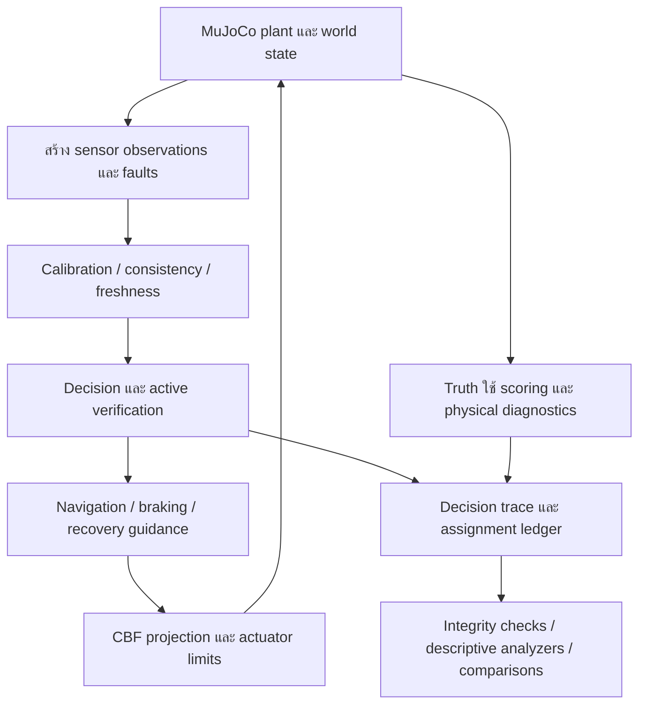

# รายงานพัฒนาการ NEXVIA AEGIS และแผนยกระดับคุณภาพงานวิจัยฉบับรวม

**วันที่ตัดข้อมูล:** 31 ตุลาคม 2026 ตามบริบทการพัฒนาใน workspace นี้  
**Repository:** https://github.com/Chalermsak1/nexvia-aegis.git  
**Branch ที่ตรวจ:** `codex/research-hardening`  
**ฐานโค้ดของรายงาน:** `74b0bfab8e57cd450293e49de881207074df3141`  
**ผู้จัดทำ:** AI research/engineering coordinator ร่วมกับเอเจนต์ตรวจโค้ด หลักฐาน และแผนการทดลอง  
**ประเภทเอกสาร:** รายงานสังเคราะห์หลักฐานและข้อเสนอพัฒนาต่อ ไม่ใช่การอนุมัติโปรโตคอล รายงานรับรองความปลอดภัย หรือผลประเมินเชิงยืนยันใหม่  
**สถานะการอนุญาตในงานชุดนี้:** **`GATE_B_NOT_AUTHORIZED`**

> ข้อสรุปหลัก: โครงการมีต้นแบบวิจัยใน simulation ที่พัฒนาเครื่องมือตรวจข้อมูล การควบคุม การวินิจฉัย และการเก็บหลักฐานไปมากแล้ว แต่ยังไม่มีหลักฐานเพียงพอให้สรุปว่าระบบทำงานปลอดภัยและมีประโยชน์อย่างสม่ำเสมอในโลกจริง งานที่สำคัญถัดไปคือทำให้ความหมายของ “ถึงเป้าหมาย–หยุด–หยุดนิ่ง–abstain” ตรงกับพฤติกรรมทางกายภาพ วินิจฉัยการปฏิเสธบนโลกใหม่ ลดการพึ่ง simulator truth และทำให้การทดลอง/การอนุมัติตรวจสอบได้อย่างอิสระ

## สารบัญ

1. [ขอบเขตและวิธีอ่านหลักฐาน](#section-01)
2. [สถานะโครงการและประเด็นเอกสารขัดแย้ง](#section-02)
3. [คำถามวิจัยและคุณค่าที่ควรพิสูจน์](#section-03)
4. [โครงสร้างระบบและข้อมูลที่แต่ละส่วนใช้](#section-04)
5. [พัฒนาการตั้งแต่งานเดิมถึงปัจจุบัน](#section-05)
6. [รายละเอียดสิ่งที่พัฒนาแล้ว](#section-06)
7. [ผลการทดลองสำคัญและการตีความ](#section-07)
8. [ความหมายของตัวชี้วัดและข้อจำกัดเชิงสถิติ](#section-08)
9. [การเก็บหลักฐานและความสามารถทำซ้ำ](#section-09)
10. [การทดสอบซอฟต์แวร์](#section-10)
11. [ปัญหาวิทยาศาสตร์และวิศวกรรมที่ยังเปิดอยู่](#section-11)
12. [สถานะ V9-M4 และข้อจำกัดด้าน governance](#section-12)
13. [แบบแผนการวิจัยถัดไปที่เสนอ](#section-13)
14. [ทะเบียนงานพัฒนาพร้อมลำดับความสำคัญ](#section-14)
15. [แผนการทดสอบก่อนขยายการทดลอง](#section-15)
16. [ลำดับส่งมอบและเงื่อนไขการก้าวสู่ระยะถัดไป](#section-16)
17. [ประเด็นที่เจ้าของโครงการและผู้ตรวจอิสระต้องตัดสิน](#section-17)
18. [แนวทางพัฒนาเป็นเครื่องมือใช้งานและธุรกิจ](#section-18)
19. [การเตรียม manuscript และชุดข้อมูลเผยแพร่](#section-19)
20. [งานถัดไปที่ควรลงมือก่อน](#section-20)
21. [ทะเบียนแหล่งอ้างอิงและหลักฐาน](#section-21)
22. [คำศัพท์และสถานะสุดท้าย](#section-22)

## 1. ขอบเขตและวิธีอ่านหลักฐาน

รายงานนี้รวบรวมสิ่งที่พัฒนามาใน repository โดยเน้นเส้นทาง V9/V9-M4 และ V9-M5 single-robot 3D simulation ซึ่งเป็นงานที่ตรวจและพัฒนาต่ออย่างต่อเนื่อง ไม่ได้ตรวจรับรองทุก subsystem เช่น swarm, vision, RL, NMPC หรือ autonomous vehicle ใหม่ทั้งหมด และไม่ได้ตรวจผล raw Holdout หรือเนื้อหา reserved seeds

การจัดทำครั้งนี้อ่าน source, README, รายงานการพัฒนา และเอกสาร governance รวมถึงตรวจโครงสร้าง/hash ของ development JSONL ledgers **19 ไฟล์** ผลตรวจเก็บใน [ดัชนีหลักฐานประกอบ](NEXVIA_AEGIS_DEVELOPMENT_EVIDENCE_INDEX_2026-10-31.json) ดัชนีนี้ครอบคลุม JSONL ภายใต้ `results/research_development/dev/` เท่านั้น ไม่ใช่ทะเบียน artifact ทั้ง repository และไม่ใช่ approved manifest

ตัวเลขแต่ละกลุ่มมีระดับหลักฐานต่างกัน:

| ป้ายกำกับ | ความหมายในรายงาน |
|---|---|
| ตรวจจาก source ปัจจุบัน | พฤติกรรมหรือข้อจำกัดที่อ่านจาก checkout ที่ระบุ ไม่ใช่การพิสูจน์ทุก execution path |
| ผล development ที่มี artifact | ผล simulation ตามไฟล์และชุดเงื่อนไขที่ระบุ ตรวจโครงสร้างและความสอดคล้องได้ตามขอบเขต analyzer |
| รายงานย้อนหลัง | ตัวเลขที่เอกสารเดิมรายงาน ไม่ได้รันซ้ำหรือคำนวณ raw data ใหม่ทุกชุดในการจัดทำรายงานนี้ |
| ข้อค้นพบเชิงวินิจฉัย | ตัวอย่างหรือ counterexample ที่ช่วยแยกกลไกของปัญหา ไม่ใช่ค่าประสิทธิภาพทั่วไป |
| ข้อเสนอ | งาน สถาปัตยกรรม หรือวิธีประเมินที่ยังต้องออกแบบ/ทบทวน/อนุมัติตามความเกี่ยวข้อง |
| ยังไม่ยืนยัน | ไม่มีหลักฐานเพียงพอ หรือเอกสาร/โค้ด/การอนุมัติยังขัดกัน |

ข้อจำกัดสำคัญของการอ่านรายงาน:

- ไม่รวมจำนวน episodes ต่างการทดลองเป็น sample size เดียว เพราะหลายงานใช้โลกเดิม เปลี่ยน candidate หรือเลือกกรณีที่เคยล้มเหลวมาวินิจฉัยซ้ำ
- การเปลี่ยน source หลังสร้าง artifact ทำให้ source hash ใน artifact ต่างจาก checkout ปัจจุบันได้ตามปกติ ต้องใช้ snapshot เดิมเมื่ออ้าง exact reproduction
- การสร้างรายงานนี้ไม่ได้รัน simulation ใหม่ ไม่แก้ controller/protocol ไม่เปิด Holdout และไม่สร้าง ticket
- ข้อเสนอในรายงานไม่ใช่คำอนุมัติของเจ้าของโครงการ นักสถิติ ผู้เชี่ยวชาญควบคุม หรือ security reviewer
- ไม่มี systematic literature review ใหม่ในงานจัดทำรายงานนี้ จึงไม่ประกาศ novelty, state of the art หรือ superiority เหนืองานวิจัยภายนอก

## 2. สถานะโครงการและประเด็นเอกสารขัดแย้ง

### 2.1 สถานะที่เหมาะสมกับหลักฐานปัจจุบัน

**Instrumented exploratory simulation prototype:** ต้นแบบวิจัยที่จำลองและตรวจเหตุการณ์ได้ละเอียดขึ้น มีการทดสอบซอฟต์แวร์และการหักล้างสมมติฐานของ candidate แต่ยังไม่ได้ยืนยันความพร้อมใช้งานจริงหรือการรับรองความปลอดภัย

| ด้าน | สถานะที่รายงานนี้ใช้ | เหตุผล |
|---|---|---|
| V9-M2R2 Calibration | มีประวัติรายงานว่าดำเนินการแล้ว | ไม่ได้ตรวจรับรอง raw artifacts/calibration claims ใหม่ในงานนี้ |
| V9-M3 Validation | มีประวัติรายงาน validation ใน simulation 480 episodes | เป็นสถานะย้อนหลัง ไม่ใช่ evidence ของ real robot หรือ V9-M5 ปัจจุบัน |
| V9-M4 | มี published Holdout/certification claims แต่ independent reconciliation ยังเป็นประเด็นเปิด | README และ source audit ระบุว่ามีรายงานเผยแพร่แล้ว แต่เอกสารอนุมัติ/โปรโตคอล/provenance มีข้อขัดแย้ง |
| V9-M5 3D | exploratory development ที่มีหลาย candidate และผลตรวจเชิงวินิจฉัย | ผลบนโลกใหม่ยังมี abstention สูง และยังมี truth-state dependencies |
| Evidence tooling | มี prototype ledger/analyzer/forensics และ matched comparators | ยังเป็น local unkeyed/self-reported evidence ไม่ใช่ external attestation |
| ROS 2/PX4 | มี interface model และ simulation harness | publisher ปัจจุบันเก็บใน memory; live transport ถูกปิดอย่างชัดเจน |
| Hardware/HIL | ยังไม่มีหลักฐานทดสอบจริงในงานชุดนี้ | เจ้าของโครงการแจ้งว่ายังไม่มีฮาร์ดแวร์ |
| Product/market | มี product hypothesis และ offline CLI | ยังไม่ยืนยัน customer discovery, pilot, sales หรือ willingness to pay |

### 2.2 สิ่งที่ต้องระบุให้ถูกต้องเกี่ยวกับ V9-M4

ห้ามสรุปว่า “V9-M4 ไม่เคยรันในประวัติโครงการ” เพราะ repository มีรายงานเผยแพร่ที่อ้าง execution แล้ว ขณะเดียวกันห้ามนำรายงานนั้นมาเท่ากับ independent certification โดยอัตโนมัติ

ข้อเท็จจริงในงานชุดนี้คือ **ไม่มีการรัน V9-M4 ใหม่ ไม่มีการเปิด raw Holdout/reserved seeds และไม่มีการอนุญาต Gate B ใหม่** ส่วน published claims เดิมต้องตรวจภายใต้การควบคุมและผู้ตรวจที่ได้รับอนุญาตต่างหาก [G01]

Owner Decision Register ยังมีถ้อยคำที่ขัดกันภายในเอกสาร: ส่วนต้นอ้าง approved/certified ขณะที่รายละเอียดและส่วนท้ายยัง pending/unauthorized เอกสาร SCI-01 และ historical-hash supplement ก็ยังมีสถานะ unapproved/draft จึงต้องทำ dated reconciliation ไม่เลือกเฉพาะข้อความที่สนับสนุนข้อสรุปที่ต้องการ [G02–G04]

### 2.3 สถานะ commit

Commit `74b0bfa…` เป็น commit งาน research development ที่ push แล้วบน branch `codex/research-hardening` ไม่ใช่หลักฐานว่าเจ้าของแต่งตั้งให้เป็น final release candidate เอกสาร release manifesto ยังอ้าง candidate อีก SHA หนึ่ง การมี Git commit หรือ tag ไม่แทน owner designation, release approval หรือ scientific acceptance

## 3. คำถามวิจัยและคุณค่าที่ควรพิสูจน์

คำถามหลักที่มีทิศทางชัดที่สุดคือ:

> เมื่อข้อมูลหลายเซนเซอร์อาจผิดพลาด ล่าช้า ขาดหาย หรือผิดร่วมกัน ระบบควรตัดสินใจเคลื่อนที่ ตรวจเพิ่ม หยุด หรือ abstain อย่างไร เพื่อหลีกเลี่ยงการยืนยันผิด ขณะยังทำภารกิจได้ในสัดส่วนที่มีประโยชน์ และเก็บหลักฐานให้ตรวจสอบได้?

งานวิจัยมีสามชั้นที่ต้องแยกกัน:

1. **Epistemic decision:** หลักฐานที่มีเพียงพอให้เชื่อว่า “ถึงเป้าหมาย” หรือไม่ รวม calibration, sensor consistency, freshness และ active verification
2. **Physical control:** คำสั่งทำให้หุ่นเข้าใกล้เป้าหมาย หลบสิ่งกีดขวาง ลดความเร็ว หรือคงตัวได้จริงเพียงใดภายใต้ข้อจำกัดแรงและแบบจำลอง
3. **Evidence and evaluation:** ผลที่อ้างมาจากการทดลองที่ครบ ตรงโปรโตคอล ทำซ้ำได้ และไม่ปกปิด failure/missingness หรือไม่

การทำชั้นใดชั้นหนึ่งดีไม่ได้รับประกันอีกชั้นหนึ่ง: sensor gate อาจมีเหตุผลแต่หุ่นยังเคลื่อนที่, CBF อาจ feasible แต่เส้นทางค้าง, ledger อาจถูกโครงสร้างแต่บันทึก scientific claim ที่ไม่มีหลักฐานได้

**Contribution ที่เสนอให้พัฒนาและตรวจวรรณกรรมต่อ** คือ workflow สำหรับ evidence-aware arrival/recovery ภายใต้ sensor faults ที่เชื่อมการตัดสินใจทางสถิติ/ข้อมูลกับพฤติกรรมทางกายภาพและการเก็บหลักฐาน ไม่ควรตั้ง contribution เป็น “ปลอดภัยทุกกรณี” หรือ “แก้ sensor uncertainty ได้แล้ว”

ก่อนเขียน claim ใหม่ ต้องทำตารางเทียบงานเดิมที่มีอยู่จริง ระบุ assumptions, fault model, input information, endpoint และสิ่งที่ implementation นี้เพิ่ม พร้อมเปิดเผยด้านที่เป็นการรวมองค์ประกอบเดิมหรือ replication

## 4. โครงสร้างระบบและข้อมูลที่แต่ละส่วนใช้

แผนภาพเป็นภาพรวมเชิงแนวคิด เส้นทางจริงปัจจุบันยังมี simulator truth เข้า damping, CBF และ braking ด้วย จึงยังไม่ใช่สถาปัตยกรรมที่จำกัด truth ไว้เฉพาะ scoring ทั้งระบบ

| ส่วน | ไฟล์เริ่มต้น | บทบาทและข้อจำกัด |
|---|---|---|
| 3D plant/CBF | `src/aegis/env/mujoco_3d_cbf.py` | MuJoCo dynamics, obstacle/boundary constraints, actuator box, feasibility/projection; ไม่ได้พิสูจน์ continuous-time invariance |
| 3D decision core | `src/aegis/v9/controller_3d.py` | sensor checking, calibration/probing, navigation/arrival proposal; ไม่ใช่ frozen V9-M4 evaluator |
| Arrival wrappers | `anchor_arrival_candidate.py`, `stabilized_arrival_candidate.py` | เพิ่ม anchor/observed-speed confirmation; ยังเป็น heuristic development criteria |
| Recovery | `anchor_recovery_candidate.py` | bounded anchor-guided recovery และ timeout; gain/limits ต่างจาก base navigation |
| Post-proposal monitor | `recovery_monitor_candidate.py` | ตรวจ vector/range ใน BRAKING/ANCHOR/RECOVERY; เริ่ม monitor ใหม่หลัง proposal |
| Velocity alternatives | `sustained_stop_candidate.py`, `velocity_freshness_candidate.py`, `bounded_gap_candidate.py`, `dual_velocity_candidate.py` | ทดลอง dwell, freshness, bounded-gap และ redundancy; แต่ละตัวมี assumptions และ failure modes |
| Benchmark harness | `experiments/benchmark_physical_3d_cbf.py` | reset/random streams/fault injection/decision-physics ordering/scoring/diagnostics |
| Estimated control component | `scripts/research/no_oracle_control.py` | ใช้ estimates ใน damping/brake/projector; ยังไม่ใช่ mission-level no-oracle implementation |
| Assignment/evidence | `development_ledger.py`, `ledger_forensics.py` | state machine, incremental events, hash-chain checks, damaged-tail diagnosis |
| Comparison tooling | `analyze_*`, `diagnose_*`, `compare_recovery_budgets.py`, `summarize_recovery_factorial.py` | ตรวจความสอดคล้องและสรุปแบบ descriptive; ไม่อนุมัติ hypotheses |
| ROS interface | `src/aegis/sim2real/aegis_ros2_node.py` | in-memory publishers; live transport ยังไม่ implement/validate |

### 4.1 Information parity ที่ยังต้องแก้

การเทียบ controller ต้องบันทึกอย่างน้อยว่าแต่ละ arm รู้ target, pose, velocity, obstacle geometry, map, mass, gravity และ timestamp จากที่ใด ข้อมูลใดเป็น estimate และข้อมูลใดเป็น simulator truth

ปัจจุบัน arrival benchmark ยังใช้ `action_3d - 0.5 * vel` ที่ `vel` เป็น plant truth และ CBF รับ truth position/velocity อีกชั้น ส่วน braking micro-study ใช้ estimated position/velocity ผ่าน projector แต่ยังรู้ obstacle geometry, arena และ physical constants จาก simulator ไม่ควรใช้คำว่า “no-oracle system” โดยไม่ระบุส่วนที่ยังเป็น oracle [E04–E05]

## 5. พัฒนาการตั้งแต่งานเดิมถึงปัจจุบัน

ตารางนี้สรุปความรู้ที่สะสม ไม่ใช่ประกาศว่าทุกขั้นผ่าน scientific acceptance แล้ว ตัวเลขย้อนหลังด้านล่างอ้างจากรายงานที่มีอยู่; งานจัดทำฉบับนี้ไม่ได้ reanalyze raw JSON ย้อนหลังทุกชุด

| ลำดับการพัฒนา | ปัญหาที่พบ | สิ่งที่เพิ่ม/เปลี่ยน | ความรู้ที่ได้ |
|---|---|---|---|
| Planar V9 → 3D benchmark | 2D STOP logic ไม่ครอบคลุม 3D arrival | range guard, range window, 3D vector veto | ลด false arrival บางเงื่อนไขด้วยการ abstain มากขึ้น; ยังไม่เห็น operating point ที่ดีทั่วถึง |
| 3D-aware decision/probing | sensor bias ร่วมและ margin ทำให้ยืนยันผิด | 3D core, no-active-probing ablation, strict margin candidate | ต้องแยกประโยชน์ของ sensing/probing จาก safety/coverage tradeoff |
| Timeout/range faults | horizon สั้น, stale reading, negative range bias | ยืดเวลาวินิจฉัย, latency handling, paired tests | timeout มีหลายสาเหตุ; เพิ่มเวลาแก้ได้บางกรณีแต่ไม่ทุกกรณี |
| Post-STOP diagnostics | true success ตอนตัดสินใจแต่หลุดรัศมีภายหลัง | 50-step physical horizon, anchor guard | decision-time success ไม่เท่ากับ stable arrival |
| Stabilized arrival | ต้องตรวจการเคลื่อนที่ก่อน anchor | observed-speed gate, braking→anchor confirmation | true speed อาจยังสูงเพราะ measurement noise; availability ลดลง |
| Recovery/dwell | anchor rejection หลังเบรกทำให้จบภารกิจไม่ได้ | bounded anchor-guided recovery, sampled dwell diagnostics | recovery ช่วยบางกรณีแต่เพิ่ม sensing cost และยังมี timeout |
| Sustained/fresh velocity | low-speed observation ครั้งเดียวไม่เพียงพอ | consecutive samples, timestamp/sequence/replay checks | dropout/noise ทำให้ wait/reset สูง; metadata freshness ไม่พิสูจน์ค่าถูก |
| Bounded gap/dual source | ต้องจัดการ missingness และ plausible error | speed bound candidate, cross-check second velocity | สมมติฐาน bounded error ถูก counterexample หักล้าง; สองแหล่งผิดร่วมกันได้ |
| Evidence hardening | invalid types, incomplete data, lost runs | validation helpers, analyzers, ledger และ forensics | ต้องแยก COMPLETED ออกจาก scientific success; hash consistency ไม่ใช่ trust |
| Continuous recovery monitoring | monitor เดิมไม่ครอบทุก phase | separate RecoveryMonitorCandidate | sensor loss ถูกปฏิเสธเร็วขึ้น แต่ e-process restart/availability ยังต้องทบทวน |
| Estimated-state braking | truth-state damping/braking ช่วยกลบ sensor faults | EstimateOnlyControl และ micro-study | wrong-sign velocity ทำให้แรงที่เรียกว่า brake เร่งตามการเคลื่อนที่ได้ |
| Force geometry | saturated navigation ค้างหน้า barrier | direction-preserving peak scaling | แก้ selected local stall ได้ แต่ไม่รับประกัน global navigation/arrival |
| Recovery budget | 100-step recovery จบก่อนยืนยันได้ | explicit100/300 budget ablation | selected cases ดีขึ้น แต่ fresh worlds ไม่ได้ดีขึ้นแบบเดียวกัน |
| Fresh factorial | เสี่ยงสรุปจากกรณีที่เลือกเพราะเคยล้มเหลว | 2 force × 2 budget บน fresh worlds | ทั้งสี่ cell มี outcome counts เท่ากัน; ตัวจำกัดถัดไปคือ confirmation/monitor ไม่ใช่เวลาอย่างเดียว |

งาน swarm/vision/RL/NMPC/vehicle และรายงาน Phase1–3 แสดงความกว้างของ repository แต่ไม่ได้เป็นหลักฐานรับรองเส้นทาง single-robot ปัจจุบันโดยอัตโนมัติ ควรหยุดขยายขอบเขต claim จนกว่าจะมี evidence map ของแต่ละ subsystem และ use case ที่ชัด

## 6. รายละเอียดสิ่งที่พัฒนาแล้ว

### 6.1 Input validation และ fail-closed handling

เพิ่ม `exploratory_sensor_validation.py` และ hardening ใน controller/wrappers เพื่อจัดการ vector shape, finite numbers, sigma, validity/drop/anomaly flags และ anchor metadata แยก boolean ออกจากค่าตัวเลขที่ควรเป็น real บางเส้นทาง invalid active vectors นำไป ABSTAIN; unusable range ไม่ผ่านการ corroborate arrival; invalid anchor ไม่ควรอัปเดต calibration

คุณภาพที่ดีขึ้นคือ malformed inputs ไม่เงียบกลายเป็นคำยืนยันสำเร็จ แต่ยังต้องตรวจทั้ง call graph ไม่ควรอ้างว่าทุกชนิด sensor/path ใน repository ได้ใช้ helper เดียวกันครบแล้ว

### 6.2 การแยก random streams และ benchmark accounting

แยก random streams สำหรับโลก sensor noise faults anchor velocity/replay/secondary source เพื่อให้จับคู่การทดลองได้ดีขึ้น แก้ STOP timing และ post-step accounting ในงานก่อนหน้า และระบุ faults เป็น parameter แยกจาก controller

การใช้ seed เดียวกันไม่ได้ทำให้ทุก trajectory เหมือนกันตลอด เมื่อ policy ต่างกัน ตำแหน่งและโอกาส fault trigger เปลี่ยน ต้องระบุว่าอะไร paired ที่ reset และอะไร diverges ภายหลัง

### 6.3 CBF และ numerical feasibility

มี fast projection, exact active-set fallback, residual/feasibility/infeasibility reporting และข้อจำกัด boundary/obstacle/actuator ที่ชัดขึ้น การเบรกต้องผ่าน feasibility check เช่นกัน

ไม่ควรเรียก CBF ว่า “รับประกันปลอดภัยแล้ว” จาก residual ต่ำ เพราะยังมี empty feasible sets, model mismatch, discrete integration, contact, solver deadline และ uncertainty ของ state ที่ไม่ได้ครอบคลุมครบ

### 6.4 Recovery monitor

`RecoveryMonitorCandidate` เพิ่มการสังเกต vector สองแหล่งและ range ใน BRAKING/ANCHOR/RECOVERY และ abstain เมื่อ evidence ไม่พร้อมหรือ monitor alarm

สิ่งที่ยังไม่สำเร็จคือการพิสูจน์ error control ตลอด mission: monitor นี้เริ่มใหม่หลัง STOP proposal ไม่สืบ wealth/history เดิม การหยุดตาม phase การ restart การ calibration และ dependence ต้องมี mathematical specification ก่อนอ้าง anytime guarantee

### 6.5 Development ledger และ forensics

มี exclusive creation, assignment header, START-before-execution, EVENT, TERMINAL(COMPLETED/ERROR) และ FINAL พร้อม fsync/hash chain; schema `/1` และ `/2` อ่านย้อนหลังได้ ไม่ resume/retry เงียบ และ file ที่เสียไม่ถูกซ่อมให้ดูครบโดยอัตโนมัติ

`ledger_forensics.py` แยก valid prefix กับ truncated suffix พร้อม hash ไม่ทิ้ง suffix ไม่เปลี่ยน incomplete เป็น complete การทดสอบ process exit จริงยืนยันการมองเห็น event ใน filesystem ที่ทดสอบ แต่ไม่ใช่ power-cut test

### 6.6 Estimated-state braking component

`EstimateOnlyControl` รับ estimated position/velocity พร้อม sequence/timestamp ใช้ estimate เดียวกันสำหรับ desired brake/damping และ CBF projection โดยปิด truth-state braking override ของ projector ในเส้นทางนั้น

`NO_COMMAND` เป็นสถานะไม่มีคำสั่งที่ยอมรับได้ ไม่ใช่คำสั่งหยุดและไม่ใช่ physical safe fallback บาง micro-study หยุดการจำลองที่จุดนี้ จึงไม่ได้สังเกตว่าหุ่นจะเคลื่อนต่ออย่างไร

### 6.7 Force-guidance candidate

มี `AXIS_CLIP` และ `DIRECTION_PRESERVING_PEAK` แบบหลังคูณทั้งเวกเตอร์ด้วย factor เดียวเพื่อรักษาทิศทาง ภายใต้ maximum absolute component limit เดียวกัน การเปลี่ยนนี้ยังเปลี่ยน component magnitudes ด้วย จึงไม่ใช่การแยก direction จาก force magnitude อย่างสมบูรณ์

เมื่อนำเข้า benchmark เปลี่ยนเฉพาะ BASE→BASE NAVIGATE/PROBE ไม่แตะ RECOVERY anchor guidance, VERIFY, STOP, ABSTAIN หรือ braking Trace บันทึก original/effective action, method และ phase ใช้ตรวจ scope ได้ ค่า default เดิมยังคงไว้

### 6.8 Explicit recovery budget

เพิ่ม parameter จำนวนเต็มบวก `recovery_steps` ค่าเริ่มต้น 100 และจำกัด nondefault ให้ recovery pair มี manifest/result field `recovery_steps_limit` ไม่เปลี่ยน recovery gain, anchor margin หรือ observed-speed criteria

Recovery budget ไม่ใช่ overall episode horizon และไม่ใช่ stabilization max_wait การนับ RECOVERY timeout มี update ที่เพิ่ม counter ก่อนตรวจ `> limit`; analyzer จึงต้องรองรับ transition ที่ counter เท่ากับ limit+1 โดยไม่มองเป็นรอบ guidance เพิ่มที่ถูกอนุญาต

### 6.9 Range/counter telemetry

เพิ่ม raw sample, transport validity, controller distance, semantic validation status, recovery counter, stabilization wait และ missing-velocity counter จึงแยกได้ว่าข้อมูล “ส่งถึงและสด” แต่ “ตัวเลขไม่ถูกต้องทางกายภาพ” เช่นระยะติดลบ

ไม่ clamp negative range เป็น 0 ไม่ retry จนได้ค่าที่ชอบ และไม่ผ่อนเกณฑ์เงียบ เพราะจะเปลี่ยน sensor model/selection mechanism หรือ decision policy

### 6.10 Diagnostic และ comparator tools

มี progress/transition diagnostics, recovery-budget comparator และ four-cell factorial comparator ที่ตรวจ identity/grid/source/runtime/horizon/config consistency พร้อมแยก ERROR/INCOMPLETE และ decision/post-STOP measurements

Comparator ล่าสุดเปรียบเทียบ digest ของ recorded state/action/decision fields เพื่อแยก “outcome labels เท่ากัน” จาก “trace เท่ากัน” แต่ digest ของ selected fields ไม่พิสูจน์ทุก physics state หรือทุกเหตุการณ์นอก trace

## 7. ผลการทดลองสำคัญและการตีความ

### 7.1 ผลย้อนหลังที่นำมาสู่โจทย์ปัจจุบัน

| งาน | ผลที่รายงานเดิมระบุ | สิ่งที่เรียนรู้และข้อจำกัด |
|---|---|---|
| v19 3D development | nominal ตัวอย่างหนึ่ง: planar15true/13false/28accepted จาก 60 เทียบ 3Dveto6true/0false/6accepted | zero observed false เกิดพร้อม low coverage; ไม่ใช่หลักฐานว่าพร้อมใช้ [H01] |
| Probing ablation | 120 episode records; 3D-aware6true/2false จาก 15 เทียบ no-probe3true/0false จาก 15 | ต้องประเมินทั้ง utility และ failure; ablation ยังมี ordinary range check [H02] |
| Strict arrival margin | selected false STOP ที่ระยะ.2548/.2809m เชื่อมกับ.03m margin; fresh development80rows ยังมี timeout สูง | เปลี่ยน margin แก้บาง falsecase แต่ไม่ได้แก้ mission completion ทั่วไป [H03] |
| Range-bias study | heavy vector+range−.08m strict ยังมี 3false จาก 20 | strict threshold อย่างเดียวไม่แก้ correlated bias [H04] |
| Post-STOP/anchor | ตัวอย่าง nominal strict12true แต่ 6 จาก 12 หลุดรัศมีภายหลัง | decision-time true ไม่พอ [H05] |
| Sampled dwell/recovery | รายงานย้อนหลังระบุว่าในชุด 216 records ไม่มี STOP ใดผ่าน full sampled dwell ที่กำหนดใน diagnostic นั้น; recovery พบ 2 จาก 96 | definition ที่ใช้วัดเปลี่ยน conclusion ได้ ต้องแยก endpoint และ sample scope [H06] |
| Sustained-speed candidate | รายงานรวม 26true ที่ผ่าน sampled dwell แต่ abstain87/timeout7 ใน 120candidate rows; velocity dropout บางเงื่อนไข zero success | ความเข้มงวดช่วยบาง physical proxy แต่ availability ยังต่ำ [H07] |
| Bounded-gap falsification | 49 จาก 197 bridged steps ละเมิด assumed bound; ตัวอย่าง truth speed.154862 เหนือ bound.043089 | สมมติฐาน errorbound ที่ใช้ไม่รองรับ noise model ที่กำหนด; ห้ามใช้อ้าง safe bridging [H08] |
| Dual-velocity study | dual candidate ไม่มี sampled dwell success ในตาราง 160assignments; สอง sensor underreport ร่วมกันได้ | redundancy/consistency ไม่เท่ากับ truth; ขั้นเวลาและคู่ arm ไม่ independent [H09] |

ตัวเลขเหล่านี้ใช้เพื่ออธิบายพัฒนาการ ไม่ควรรวมเป็น meta-analysis โดยตรง เพราะ source/settings/seeds/endpoints ต่างกันและมีการพัฒนาหลังเห็นผล

### 7.2 Post-proposal monitor และ sensor loss

ชุดแรก 36assignments เปรียบเทียบ recovery เดิมกับ monitor ใน nominal/range bias/dropout พบว่า monitor เพิ่ม abstention ในตัวอย่างเล็ก ต่อมามี targeted vector loss หลัง proposal และเพิ่ม per-step evidence [E01–E03]

ชุด follow-on16assignments บนสองโลกที่เคยใช้:

| Force method | Assigned | Triggered vector loss | Untriggered timeout | Abstain หลัง trigger | STOP หลัง trigger |
|---|---:|---:|---:|---:|---:|
| AXIS_CLIP | 8 | 4 | 4 | 4 | 0 |
| DIRECTION_PRESERVING_PEAK | 8 | 8 | 0 | 8 | 0 |

Monitor arm ปฏิเสธที่ first post-proposal vector-loss observation ส่วน baseline มี 79 หรือ 88 injected observations ก่อนปฏิเสธที่ firstRECOVERY update หลัง stabilization ไม่ใช่ 79/88recovery navigation commands และไม่ใช่ physical stopping latency

Baseline ที่ไม่ trigger4assignments เพราะค้างก่อน proposal ไม่ใช่หลักฐานตรวจจับ fault สำเร็จ ค่า trigger ต่างกันระหว่าง policy สะท้อนโอกาสเกิดสถานการณ์ด้วย ไม่ควรตีความเป็น detection rate โดยใช้ denominator ผิด [E03]

### 7.3 Estimated-state braking counterexample

MuJoCo braking micro-study v2: 24assignments,3seeds×4velocitycases×2arms,80steps เริ่มจาก speed.4m/s [E04]

| Estimated velocity case | ผล estimated arm ที่รายงาน | ข้อสรุปที่อนุญาต |
|---|---|---|
| nominal | speed ลดลงในตัวอย่าง | ไม่พิสูจน์ความปลอดภัยทั่วไป |
| underreport25% | final true speed ประมาณ.1775–.1803m/s | brake เบากว่าที่ควรใน model นี้ |
| reversed direction | final speed3.2518–3.2597m/s; force·true velocity เป็นบวก 240 จาก 240steps | counterexample ของการเชื่อว่าคำสั่งที่เรียก brake ต้องต้านการเคลื่อนที่ |
| missing | NO_COMMAND ก่อน physics ทุกสามกรณี | ไม่มีหลักฐาน physical fallback หรือ stopping จาก path นี้ |

Oracle arm ไม่รับ sensorfault แบบเดียวกัน จึงเป็น reference ไม่ใช่ fair sensor-fault ablation เต็มรูปแบบ ขอบเขต projector/geometry/gravity และ sensor generation ยังมี simulator assumptions

V3smoke บันทึก 281events ใน 8micro-episodes และทดสอบ process interruption หลัง event ที่สาม แต่เป็นหลักฐาน software/persistence ใน testfilesystem ไม่ใช่ field reliability [E05]

### 7.4 Local stall และ force geometry

Fresh development32assignments ชุดก่อนหน้าที่ horizon350 จบ timeout ทั้งหมด ไม่ถึง targeted fault trigger จึงใช้ประเมิน sensor-loss response ไม่ได้ เมื่อเลือก seed2252000 มาวินิจฉัยและเพิ่ม horizon เป็น 1200 ทั้งสี่กรณียังเหลือระยะ 3.44545m [E06]

ที่สถานะท้าย คำสั่งแนวนอนถูก clip เป็น[2,2] แม้ target direction ไม่เท่ากัน และ CBFproject แรงประมาณ[2,2,.04194]เหลือเกือบศูนย์ตรง safety margin ของสิ่งกีดขวาง เป็นการแยกกลไก local stall ไม่ใช่ทุก timeout ในระบบ

Ideal-state micro-study6episodes เปรียบเทียบรูปแบบแรงที่ horizon800:

| Development world | AXIS_CLIP final distance(m) | Direction-preserving final distance(m) |
|---|---:|---:|
| 2252000 selected prior failure | 3.445450 | 0.055826 |
| 2253000 | 0.048694 | 0.048805 |
| 2253001 | 0.008466 | 0.008466 |

กรณีเลือกเดิมดีขึ้นชัด แต่อีกสอง world ไม่ได้แสดงประโยชน์แบบเดียวกัน และการทดลองใช้ ideal state ไม่ใช่ arrival policy พร้อม sensor faults [E07]

### 7.5 เมื่อนำ force candidate เข้า noisy-sensor recovery

Nominal smoke16assignments,horizon600: baseline0STOP/4abstain/4timeout; direction0STOP/8abstain แก้ stall แล้วแต่ปัญหาถัดไปกลายเป็น recovery/confirmation/monitor ไม่ใช่ mission สำเร็จแล้ว [E08]

สาม range-unavailable terminal events ในชุดนี้มี transport-valid และ fresh แต่ distance ติดลบจาก Gaussian noise ไม่ใช่ configured dropout การเพิ่ม telemetry ช่วยแยกสาเหตุ โดยยังคง abstain เดิม [E09]

### 7.6 Recovery-budget diagnostic บนกรณีที่เคยใช้

Fixed direction guidance, nominal,สอง repeated worlds,สอง biases,สอง arms,budget100/300,overall800/post50 รวม 16assignments [E10]

| Budget | Assigned/completed | True STOP ตอนตัดสินใจ | False STOP | Abstain | Timeout |
|---|---:|---:|---:|---:|---:|
| 100 | 8/8 | 0 | 0 | 8 | 0 |
| 300 | 8/8 | 5 | 0 | 3 | 0 |

ห้ากรณีที่เคย RECOVERY_TIMEOUT ไปถึง confirmation เดิมที่ overall400–491steps อีกสาม monitor/range failures คงเดิม นี่เป็นหลักฐานว่าบาง selected trajectories ติด time budget แต่ไม่ใช่เหตุผลให้เปลี่ยน default หรืออ้าง 300 เหมาะสมทั่วไป

True speed ตอน STOP อยู่.06550–.09035m/s แสดงว่ายังเคลื่อนที่ บางกรณีเกิน observed-speed cutoff.08m/s เพราะ measurement noisy การที่ logic ทำตามเกณฑ์ observed speed ไม่แปลว่า truthspeed อยู่ใน bound เดียวกัน

### 7.7 Fresh factorial: หลักฐานล่าสุดที่สำคัญที่สุดต่อ generalization

ประกาศ plan ก่อนรัน seeds2256000/2256001 ซึ่งยังไม่เห็น outcomes แล้ว cross สอง biases สอง arms สอง force สอง budgets รวม 32assignments/fourcells ที่ overall800/post50 [E11]

| Force | Budget | Assigned/completed | True STOP | False STOP | Abstain | Timeout |
|---|---:|---:|---:|---:|---:|---:|
| AXIS_CLIP | 100 | 8/8 | 1 | 0 | 7 | 0 |
| AXIS_CLIP | 300 | 8/8 | 1 | 0 | 7 | 0 |
| Direction-preserving | 100 | 8/8 | 1 | 0 | 7 | 0 |
| Direction-preserving | 300 | 8/8 | 1 | 0 | 7 | 0 |

แต่ละ cell มี terminal reasons เหมือนกัน: anchor outside confirmation4,monitor alarm2,range unavailable1,confirmed1 ไม่มี decision-horizon collision flag ในชุดนี้

ความหมายที่ถูกต้อง:

- มีเพียงสอง world realizations ไม่ใช่ 32independent worlds
- STOP ทั้งสี่ cells มาจาก scientific condition เดียวกัน:2256000/heavybias/anchor-recovery ไม่ใช่สี่ world successes
- Budgetpairs มี recorded state/action/decision traces ตรงกัน 8 จาก 8 ภายในแต่ละ force เพราะทุก episode ออกก่อน budget100; maximum observed recovery counter50
- Forcepairs มี traces ต่างกัน 8 จาก 8 แม้ outcome counts เท่ากัน; directionmethod เปลี่ยนแรงจริง 356requests ต่อ ledger
- ไม่เห็นประโยชน์จาก budget300 บน fresh grid นี้; ปัญหาต่อไปคือ confirmation/monitor ไม่ควรเพิ่มเวลาอย่างเดียวต่อเนื่อง
- การเห็น falseSTOP0 ในแปด assignments ต่อ cell ไม่ให้ข้อสรุป zero risk และไม่แทนตัวอย่างอิสระขนาดพอสำหรับ inference

### 7.8 Post-STOP measurement และ accounting gap

Fresh STOP กรณีเดียวภายใต้แต่ละ force มี 50samples: axis decision distance.15306m/speed.06968m/s; direction distance.15626m/speed.08263m/s หลังหนึ่งวินาที speed ยังประมาณ.00905 และ.01073m/s ตามลำดับ ไม่พบ post-sample collision แต่ยังไม่ใช่ rest หรือ indefinite stability [E11–E12]

Source audit พบข้อจำกัดสำคัญ:

1. Top-level `collision_occurred`, CBF counters และ`final_distance`เดิมไม่รวม post-STOP horizon ต้องอ่าน`post_stop.steps`แยก; `final_distance`ยังเป็น decision-time state
2. Post-STOP ใช้ truth-state braking พร้อม ideal gravity compensation ไม่ใช่ passive coast หรือ estimated-only emergency stop
3. Samples เก็บใน memory ก่อน terminal record จึงอาจหายหาก interruption ระหว่าง horizon
4. ไม่มี post-abstention horizon เทียบเท่ากัน การ brake หนึ่ง step หลัง ABSTAIN ไม่ได้ยืนยัน physical safe fallback

การออกแบบ schema ต่อไปควรคงความหมาย historical fields แล้วเพิ่มชื่อชัด เช่น decision-distance, post-action-distance และ horizon-specific counters แทนเปลี่ยนความหมาย field เดิมเงียบ

## 8. ความหมายของตัวชี้วัดและข้อจำกัดเชิงสถิติ

### 8.1 Denominator ที่ต้องแยก

กำหนดเพื่ออธิบายข้อมูล development ไม่ใช่สร้างเกณฑ์อนุมัติใหม่:

| ตัวแปร | ความหมาย |
|---|---|
| N_assigned | assignments ที่ประกาศทั้งหมด รวม executionerror และ incomplete |
| N_completed | assignments ที่มี terminal COMPLETED; ไม่ได้หมายถึง mission success |
| M_accepted | decisions ที่ระบบยืนยันตามนิยามที่ประกาศ เช่น STOP |
| K_false | accepted decisions ที่ truth criterion บอกว่าผิด |
| Coverage | M_accepted หาร denominator ที่ protocol กำหนด ต้องระบุชัดว่า assigned/evaluable/completed |
| Selective risk | K_false/M_accepted; เมื่อ M=0 ให้ UNDEFINED ไม่ใช่ 0 |
| Unconditional false-success incidence | K_false/N ตาม registered population/partition ไม่เท่ากับ selective risk |
| True-success rate | true successes/N ตามเกณฑ์ declared; decision-time และ physical-dwell เป็นคนละ endpoint |
| Triggered faults | assignments/steps ที่ fault เกิดจริง ต่างจาก assignments ที่ตั้ง fault ไว้แต่ไม่ถึง trigger |
| Time-to-stop/arrival | ต้องระบุเริ่มนับและ terminal event; abstain/timeout เป็น competing outcomes ไม่ตัดทิ้งให้ดูเร็ว |

ห้ามนำ step count นับเป็น independent trials เมื่อมี time dependence หรือใช้ 8arms×biases เป็น 8worlds ห้ามรวมซ้ำ budgetpairs ที่มี trajectories เหมือนกันเป็นหลักฐานใหม่อิสระ

### 8.2 จัดชั้น analysis ให้ตรงความจริง

- Descriptive: counts,distances,speeds,reason distributions,paired traces; ทำได้เมื่อ schema ครบและติด labeldevelopment
- Diagnostic: selected failures,synthetic fixtures,toy models; ใช้หักล้าง assumption หรือแยก mechanism ไม่ใช้ estimate field probability
- Prospective evaluation: ต้องเลือก fresh data และ rules ก่อนเห็นผล; หากพัฒนาหลังดูผลชุดนั้นกลายเป็น development แล้ว
- Confirmatory: ต้องมี approved estimand,partition,independent unit,sample size,multiplicity,missingness,decision rules,provenance และ owner authorization ครบก่อนเข้าถึงผล

### 8.3 ข้อเสนอเรื่อง analysis design

ให้ statistician เลือกหน่วย sampling และวิธีรองรับ clustering/world pairing ก่อนกำหนด sample size เก็บ scenario weights ที่มีเหตุผลตาม usecase และแยก primary/secondary/exploratory endpoints ให้ชัด

อย่าคำนวณ power จาก episodes ทั้งหมดที่ซ้ำ worlds โดยสมมติ independence อย่าเลือก CI/test เพราะให้ pass หลังเห็นผล และอย่าเปลี่ยน hypothesis จาก selective risk เป็น incidence/utility โดยยังใช้ชื่อ H เดิม

จำนวน worlds,risk limit,coverage floor,minimumspeed/dwell,noninferiority margin และ familywise error control สำหรับงาน V9-M5 ใหม่ยังต้องตัดสินอย่างมีเหตุผล ไม่มีค่าอนุมัติใหม่ในรายงานนี้

## 9. การเก็บหลักฐานและความสามารถทำซ้ำ

### 9.1 สิ่งที่ดีขึ้นแล้ว

- เลือก outputpath ใหม่และ exclusive create ป้องกัน overwrite
- ประกาศ assignments ก่อน episode และเขียน START ก่อน execution
- เก็บ ERROR/INCOMPLETE แยกจาก COMPLETED และ scientific outcome
- Schema2 รองรับ orderedper-step events และ source/runtime metadata
- Analyzer ตรวจ duplicate/order/corrupt line/nonfinite/contradictoryoutcome/missing post STOP
- Comparator ปฏิเสธ unpairedconditions หรือ config ต่างเกิน factors ที่ประกาศ
- Retainhistorical outputs และ sourcehash เดิม ไม่ retrofit ผลย้อนหลังให้เข้ากับ source ใหม่
- Forensics ตรวจ prefix/suffix แบบ read-only ไม่ซ่อมและไม่ silent rerun

### 9.2 ช่องว่างที่ยังไม่ควรอ้างว่าปิดแล้ว

| ช่องว่าง | ผลกระทบ | หลักฐานที่ต้องเพิ่ม |
|---|---|---|
| Unkeyed hash chain | เขียนไฟล์ใหม่พร้อม hash ใหม่ได้ | independent trusted checkpoint/signature และ custody process |
| Self-declared manifest | ตรวจว่าตรงกับสิ่งที่ตัวเองประกาศ ไม่ยืนยันว่านั่นคือ approved design | reviewed/frozenmanifest นอก runner พร้อม identity และ timestamp |
| Selected source maps | ไม่ครอบ dependency closure/interpreter/wheel bytes | source snapshot, lock, interpreter identity, approved wheel provenance |
| Runtime versions อย่างเดียว | เวอร์ชันเท่ากันแต่ bytes/ABI ต่างได้ | reproducible environment และ package verification ที่เหมาะสม |
| VisibleFINAL หลัง fsyncerror | ไม่พิสูจน์ว่าทน power loss | fault-injection บน storage เป้าหมายและ operational durability assumptions |
| Single writer/memory inspection | ไม่รองรับ unbounded/concurrentstreams โดยอัตโนมัติ | concurrency model,streaming validation,resource bounds |
| Post-STOP terminal-only | crash ทำให้ partial physical evidence หาย | incrementalphysics events และ explicit missing horizon |
| Ignored .log files | localfile อาจไม่อยู่บน GitHub | artifact publication inventory ตรวจ tracked/uploaded bytes แยกกัน |
| Seed reuse/development contamination | ประเมิน generalization เกินจริง | seedrole register และ fresh-setcustody |

Artifact `.log`ใน handoff เดิมมีรายงานว่าอยู่ local แต่ Gitignore ต้องไม่อ้างว่าหลักฐานนั้นถูก push แล้วเพียงเพราะ JSON หรือ report อ้างถึง ปัจจุบัน commit140files และดัชนีนี้ไม่ได้แทน comprehensivearchive audit [E13]

### 9.3 Metadata ที่เสนอสำหรับรอบใหม่

เพิ่มแบบ schema-versioned โดยไม่แก้ไฟล์เดิม: assignment identity/design digest, world/fault config,policy parameters,allowed information,decision index,physics index,phase,eventstage,measurement source/frame/time/sequence,raw validation reason,desired/applied force,actuator state,CBF residual/feasibility,post-action state,exception/failure stage,outputdurabilitystatus และ parent-runreferences

ข้อมูลส่วนตัวหรือ key material ไม่ควรเข้า developmentlogs; หากอนาคตมี userdata ต้องกำหนด retention/access/redactionpolicy ตามข้อมูลจริง ไม่ใช่ฝัง productioncredentials เพื่อทำ reproducibility

## 10. การทดสอบซอฟต์แวร์

**155 tests:** ชุด targetedregression ล่าสุดของ factorial/recovery/evidence ที่รายงานไว้ในผลทดลอง [E11]  
**324 tests:** การรันทดสอบ 27 ไฟล์ที่เปลี่ยนก่อน commit74b0bfa ตาม tool execution ในรอบ commit;324passed ใน 2.78s  
**ไม่ใช่ full repository test suite,ไม่ใช่ 324research episodes และไม่ใช่ independent review**

งานจัดทำรายงานครั้งนี้ตรวจ developmentJSONL19 ไฟล์แบบ read-only และเก็บผลในดัชนี ไม่รันชุดทดสอบหรือ simulation ใหม่เพียงเพื่อเพิ่มจำนวน ตัวเลข test ก่อนหน้าที่ 84/198/326 ฯลฯเป็นคนละ snapshot/selection จึงไม่บวกสะสมหรือใช้เป็น trendcoverage โดยตรง

Environment ที่ตรวจจาก `.venv` ในงานจัดทำรายงาน: Python3.12.14,NumPy2.5.3,MuJoCo3.14.0,pytest9.1.1; **torch ไม่ติดตั้งใน environment นี้** จึงไม่อ้างว่าครอบทุก module ที่ต้องใช้ torch หรือทุก optionaldependency

| กลุ่มทดสอบ | สิ่งที่ทดสอบแล้ว | สิ่งที่ไม่พิสูจน์ |
|---|---|---|
| Input validation | malformed/NaN/shape/flags/anchor/range | sensor authenticity หรือความแม่นใน field |
| Force hook | BASEscope/default-equivalence/no override VERIFY/RECOVERY | global navigation/progress guarantee |
| Budget hook | strict parameter/default/constructor/allowedarms | budget ที่เหมาะสมหรือ physicalsafe exposure |
| Ledger | exclusive create/order/duplicate/short write/fsync failure/process exit | power loss/rollback/concurrent attack proof |
| Forensics | damagedtail และ corruptcomplete-line handling | authority ให้ repair/resume ข้อมูล |
| Analyzer/comparator | mismatch/grid/denominator/contradictions/failed states | ความถูกต้องของ sensor truth หรือ scientific approval |
| Estimated control | estimateforwarding/stale/replay/wrong-sign | independent physical fallback หรือ operational braking |
| MuJoCo integration | short actual physicsruns และ expectedtrace | hardware latency/model validity/continuous-time safety |

## 11. ปัญหาวิทยาศาสตร์และวิศวกรรมที่ยังเปิดอยู่

### 11.1 Arrival semantics ยังไม่รวมความหมายทางกายภาพครบ

ต้องกำหนดว่าเป้าหมายเป็น“เข้าใกล้”,“หยุดประกาศว่าไปถึง”,“ชะลอ”,“hover/dwell”,“land”หรือ“dock” เพราะ requiredspeed/pose/orientation/dwell และ risk ต่างกัน งานปัจจุบันยังใช้ decision-time distance เป็น true_success ในหลายผล พร้อม physical diagnostics แยก ไม่ควรอ้างว่า stablearrival โดยไม่มีนิยามและหลักฐาน

### 11.2 Confirmation bottleneck บน fresh worlds

สี่ anchor-marginrejects ต่อ cell เป็นสิ่งที่ควรอ่าน trace ก่อนแก้ parameter อาจเกี่ยวกับ braking distance,anchornoise,range consistency,reconfirmation หรือ trajectory ไม่ควรสรุปว่า anchor“เข้มเกินไป”แล้วผ่อนเงื่อนไขโดยยังไม่แยกสาเหตุ

สอง monitor alarms ต่อ cell ต้องตรวจ residualdefinition,common-modebias,calibrationstate และ phase/restart สมมติฐานก่อนเปลี่ยน threshold ส่วน negative-range ต้องแยก sensorphysics จาก measurement model

### 11.3 Measured-speed gate ไม่ใช่ true-speed bound

ตัวอย่างที่ตรวจพบ true.090345m/s เทียบ measured.071993m/s ผ่าน gate.08m/s เป็นผลที่สอดคล้องกับ noisymeasurement ไม่จำเป็นต้องเป็น staledelivery ต้องออกแบบ uncertainty treatment หรือ mission-levelsafetyguard ที่มี assumptions ชัด ไม่ใช้ truthoverride เพื่อให้ benchmark ดูดี

การเพิ่ม consecutivegate ก็มีต้นทุน availability: toydual-noise model ที่ stationaryiid ภายใต้ assumptions เฉพาะให้โอกาส 20-successrun ภายใน 220samples ประมาณ 45.643%เมื่อไม่มี dropout และ 1.511%ที่ independent per-sourcedropout10% ตัวเลขนี้ไม่ใช่ episodesuccess และไม่พิสูจน์สาเหตุของ timeout จริง [E14]

### 11.4 Monitor continuity และ dependence

Restarted e-process หลัง proposal,การเลือก phase,sharedsensorbias และ temporalcorrelation ต้องถูกนิยามใน mathmodel การมี monitorcomponent ที่ใช้คำว่า Ville/supermartingale ไม่ได้ยืนยันว่า assumptions ของ data generation ตรงกับทฤษฎีตลอด control loop

### 11.5 Missing data และ safe fallback

ต้องแยกคำสั่งศูนย์,ไม่มีคำสั่งใหม่,holdlast,activebrake,watchdogtimeout และ emergencystop แต่ละอย่างใน physics ไม่มีทางเลือกใดที่เรียกปลอดภัยได้โดยไม่ระบุ platform/actuator/trajectory/constraints และการทดสอบ

### 11.6 Geometry, control feasibility และ real-time performance

Force scaling แก้ selected symmetry stall ไม่แทน routeplanner ไม่มีหลักฐาน worst-casesolver deadline หรือ between-step contact coverage ควรแยก planningprogress จาก CBFfeasibility ไม่แก้ bybypassingbarrier เพื่อให้ arrivalrate สูงขึ้น

### 11.7 Claims, code และ documentation drift

รายงานรุ่นก่อนบางฉบับบรรยาย bug ที่ code ปัจจุบันแก้แล้ว ขณะบาง statusclaim กล่าวว่า approved แต่ approvalrecord ยังขัดกัน ต้องทำ claim registry แบบ snapshot-specific มี owner,source,scope,evidence และ supersessionlink ไม่ลบประวัติหรือเขียนย้อนหลังให้ดูเหมือนไม่เคยมีข้อขัดแย้ง

## 12. สถานะ V9-M4 และข้อจำกัดด้าน governance

ส่วนนี้เป็น source/document review ไม่ใช่ re-evaluation ของ Holdout และไม่อนุญาตให้ใช้ rawresults เพื่อปิดข้อสงสัยในงานนี้

### 12.1 Scientific mapping ที่ต้อง reconcile

| Hypothesis | สิ่งที่ protocol และ source ปัจจุบันบอก | สิ่งที่ยังต้องตรวจอนุมัติ/ยืนยัน |
|---|---|---|
| H1 | protocol กำหนด M≥59,one-sided95%CPupper≤.05 และ coverage≥.35; current evaluator รวม coverage แล้ว | controlling version/amendment/dated approval และครบทุก missingcase; ไม่ควรรายงานว่า current code ยังละ coverage |
| H2 | protocol เป็น H1-gatedcore10mixtureselectiverisk; current code กลับมาทำ core10 และ H1gate แล้ว | แยกข้อผิดพลาด historical report กับ current implementation; docstring เก่าบางส่วนยังเรียก incidence |
| H3 | pairedtrue-successnoninferiority กับ primary baseline ที่กำหนด; current code ไม่ใช้ V7 แทน primaryV8 เพื่อให้ pass | Newcombe/Wald controlling/concurrence,primary baseline identity,denominators และ strictcompleteness ต้องมี dated adjudication |
| H4 | protocolcompound-fault incidence comparison; current code มี compoundsubset แล้ว | scenario/CRNalignment,exact test/CI,baselines,missingness และ approved claim mapping |
| H5 | protocol กล่าวŠidáksimultaneousbounds และ Holmstep-down พร้อม IUT; current code ใช้ Holm–Šidák และ IUT | method identity,dependence assumptions,reportingvsformalclaim และ undefinedselectiverisk ต้อง review |

ค่าเหล่านี้เป็นการระบุสิ่งที่มีใน V9-M4source/protocol ไม่ใช่การนำไปอนุมัติเป็น V9-M5threshold ใหม่ Source อ้างอิง: protocol§3.1.1; evaluator1018–1022,1037–1085,1381–1387,1426–1434,1436–1551 [G05]

### 12.2 Security และ release readiness

- Trusted launcher defaultproductionpath ยัง raise `EVIDENCE_ROOT_NOT_TICKET_BOUND` ก่อน registration/claim เพราะ ticketcontract เดิมไม่ bind durable absolute root; ห้ามใช้ operator override เป็น signedauthorization [G06]
- Runtimeintegrityresult ยังระบุ `wheel_archive_sha256_verified: False` แม้ตรวจ versions/import origins/installedrecords บางส่วน; อย่าสรุปว่า wheel provenance ครบแล้ว [G07]
- Alternateproductionrunner มี direct verify/register/claimpath ต้องพิสูจน์ historicalexecution ใช้ path ใดและ trustconditions อะไร ไม่เลือก path ที่รันได้มาแทน approved path
- ยังต้อง trustedlauncher/signer/evaluator/runtime identity,public key authenticity,key custody,externalreplayledgerrollbackprotection และ evidence-rootcustody ตาม exactcontract
- Commit วิจัยปัจจุบันไม่ตรง release candidateSHA ใน manifest ไม่ได้หมายความว่าใครควรแก้ manifest เป็น HEAD; owner ต้อง designatecandidate หลัง approvedremediation และ review
- Historicalhasherratum ต้องแยก rawbytes,canonical json,gitblob และ citationhash ไม่เปลี่ยนค่าเพื่อ forceagreement หรือเขียนประวัติใหม่

**Disposition:** development เดินหน้าต่อได้ในขอบเขตที่อนุญาต แต่ report นี้ไม่ปิด V9-M4blocker ไม่รับรอง published claims และไม่อนุมัติ GateB

## 13. แบบแผนการวิจัยถัดไปที่เสนอ

ข้อเสนอทั้งหมดในส่วนนี้ยังไม่ใช่ approved confirmatory protocol เป้าคือทำให้ decision-ready และตรวจได้ว่าความเปลี่ยนแปลงใดช่วยอะไร

### 13.1 เลือกภารกิจหลักเพียงหนึ่งเรื่องก่อน

ให้ owner เลือก task/operating domain ที่มีความหมาย เช่น single-robot arrival-and-hold ใน simulation โดยระบุ state/action/sensor availability,obstacle knowledge,terminaldefinition และ failurecost การเลือกตัวอย่างนี้ยังไม่ใช่คำอนุมัติว่าต้องเป็น drone/hover หรือใช้ threshold ใด

อย่าใช้ผลของ simulatedpoint-mass/aerial-likebody สรุป groundrobot,drone,vehicle และ swarm พร้อมกัน แต่ละ platform มี dynamics/fallback/observationassumptions ต่างกัน

### 13.2 แบ่งข้อมูลตามบทบาท

| Stage | ใช้ทำอะไร | สิ่งที่ต้องทำก่อนขยับต่อ |
|---|---|---|
| D0 Development | debug/tune/falsify/reusefailures โดยบอกตรงๆ | immutable outputs และ versioned decisions |
| D1 Fresh development check | ทดสอบ revisions บน worlds ที่เลือกก่อนเห็นผล | plan และ seedroles ก่อน run;หลัง inspect ถือว่า development แล้ว |
| D2 Prospective simulation confirmation | ประเมิน claim ที่ freeze แล้ว | owner+independent statistician approve protocol,manifest,analysis,custody ก่อน access |
| D3 SITL/HIL/physical | ยืนยัน transport/model/platform-specific behavior | validated transport,ground truth,hardware,safetycase และ platform approval |

แผน draft เดิมมี stages เหล่านี้แล้ว รายงานนี้เสนอให้ใช้เป็น workgates จริง ไม่อ้างว่า D1 เท่ากับ confirmatory เพียงเพราะ seeds ใหม่ [P01]

### 13.3 Factorial และ ablation ที่ควรทำเมื่อพร้อม

ควรแยกคำถามแทนเพิ่ม arms ทุกตัวใน run เดียว:

1. Guidance geometry: axisclip เทียบ direction-preserving โดยตรึงข้อมูลและ monitor
2. Recovery exposure: budget/gain/limit ทีละ factor พร้อม physicsrisk และ sensingcost
3. Confirmation: speed uncertainty/dwell/anchorvalidation เป็น candidate แยกภายใต้ approved scientific meaning
4. Monitoring: continuous/restarted/phase-specificmonitor พร้อม assumptions และ fault coverage
5. Information parity: oracle-reference เทียบ estimated-statearm ที่มี datasource/faults ชัด
6. Fallback: no-command/hold/brakepolicy ใน sim-onlycontrolledexperiment แยกจาก mission arrival study

### 13.4 Fault matrix ที่เสนอ

| หมวด | ตัวอย่างที่จะประกาศก่อนทดลอง | สิ่งที่ต้องวัด |
|---|---|---|
| Bias | independent/common-mode/static/drift/signreversal | false acceptance,calibration behavior,reason trajectory |
| Loss | isolated/burst/correlated/phase-triggered | actual trigger,missing duration,querybehavior,post-action motion |
| Time | delay/out-of-order/replay/clockoffset | sequence/age validation,staleuse,duplicate processing |
| Numeric/model | negative/NaN/Inf/wrongshape/sigmajump | rejection state,exceptions,ledger completeness |
| Geometry | corridors/obstacle layout/nearboundary/unreachable goal | progress/stall/feasibility/contact/solver latency |
| Dynamics | mass/drag/actuator limit/saturation/latency/model mismatch | applied force,speed,braking distance,constraint residual |
| Evidence | processkill/write failure/source change/truncated record | preserved prefix,explicit incomplete,no silent repair |

Severity levels,scenario frequencies และ sample allocation ต้องมี task-groundedrationale ไม่เลือกหลังดูว่าชุดไหนให้ผลดี ไม่ใช้ fault ที่ไม่ trigger เป็น detectionpass

### 13.5 Missing-evidence handling ที่เสนอให้ review

| สถานการณ์ | การเก็บ/รายงานที่เสนอ | สิ่งที่ยังต้องเจ้าของ/นักสถิติตัดสิน |
|---|---|---|
| Baseline หาย | ไม่สร้าง pairedimprovementverdict;แสดง missing baseline | denominator/inferentialhandling ของ protocol |
| Maccepted=0 | selective risk UNDEFINED;รายงาน coverage และ counts | formalutilityconsequence ตาม claim |
| Crash/exception | executionERROR หรือ INCOMPLETE แยก;เก็บ assignedcount และ logs | scientific failure classification/ retry policy |
| Posthorizon ไม่ครบ | physical endpointUNEVALUABLE;ห้าม fill ว่า safe | missingnesssensitivity และ claimblockingrule |
| Truth/score ขัดกัน | reject/quarantineanalysis และ preserveoriginal | adjudicationprocess และ correctedaddendum |
| CBF infeasible | explicitinfeasible และ physicaltrajectory ไม่เรียกว่า checked-safe | emergency controller/platform specificconsequence |
| Sensor ไม่พร้อม | explicit reason/age/phase;ไม่ equateNO_COMMAND กับ STOP | permitted fallback และ risk assumptions |
| Source/config เปลี่ยนระหว่าง run | flag/error และ preserve ทุก records | การใช้ partialdata และ authorizedrestart |

ตารางนี้เสนอการไม่ปกปิดหลักฐาน ไม่ได้ตัดสิน formal hypotheses แทน protocol หรือ reviewer

## 14. ทะเบียนงานพัฒนาพร้อมลำดับความสำคัญ

P0 หมายถึงจำเป็นต่อการตีความผล/รักษาขอบเขต claim ปัจจุบัน ไม่ใช่ประกาศว่าเป็น criticalsecurityincident; P1 คือจำเป็นก่อน research claim กว้างขึ้น; P2 คือเตรียม prospective study/product; P3 คือ extension หลังฐานมั่นคงแล้ว

| ID | Priority | งานและเหตุผล | ผลส่งมอบ/เกณฑ์ปิดทางวิศวกรรม | ขึ้นกับ/ผู้ตรวจ |
|---|---|---|---|---|
| E-01 | P0 | บันทึก physics ทีละขั้นทั้ง main, STOP และ ABSTAIN | schema ระบุ stage, decision index และ physics index; ทดสอบ interruption โดยไม่เปลี่ยนข้อมูลเดิม | วิศวกรและผู้ตรวจหลักฐาน |
| E-02 | P0 | แยกตัวนับตาม horizon | สรุป decision และ post-horizon แยก ตรวจกลับไปยัง samples ได้ ไม่มีการนับซ้ำ | E-01 |
| E-03 | P0 | สังเกตพฤติกรรมหลัง abstention | เก็บ motion และ applied force; ไม่ตั้งสมมติฐานล่วงหน้าว่าหยุดปลอดภัย | E-01 และผู้เชี่ยวชาญควบคุม |
| E-04 | P0 | ระบุ failure stage และประวัติ retry | แยก STARTED, ERROR, INCOMPLETE; มีตัวอย่างยืนยันว่าไม่ rerun เงียบ | ผู้ตรวจ ledger |
| R-01 | P0 | วินิจฉัย anchor rejection บน fresh worlds | trace ที่เลือกไว้ล่วงหน้า พร้อม measured/truth/anchor/range/timing และสมมติฐานที่ตรวจ | ข้อมูล D1 และผู้เชี่ยวชาญควบคุม |
| R-02 | P0 | ตรวจ assumptions ของ monitor alarm | specification ของ residual, null, dependence และ restart พร้อม counterexamples | นักสถิติและผู้วิจัย monitor |
| R-03 | P0 | ระบุ task และ physical endpoint | บันทึกคำตัดสินของ owner แยก decision success จาก physical success | owner, control reviewer และนักสถิติ |
| D-01 | P0 | แก้ความขัดแย้งของ claim/status | ทะเบียน claim ตาม snapshot และ dated errata โดยเก็บเอกสารเดิม | owner และผู้ตรวจอิสระ |
| G-01 | P0 ก่อน confirmatory | ระบุ controlling protocol ของ V9-M4 | คำตัดสิน H1–H5, missingness, multiplicity ที่ลงวันที่ | owner และนักสถิติอิสระ |
| G-02 | P0 ก่อน release | แต่งตั้ง candidate และอนุมัติ staging manifest | identity/tree/source/hash inventory ที่ผ่านการตรวจและอนุมัติ | owner และผู้ตรวจ release integrity |
| S-01 | P0 ก่อน production | ผูก durable evidence root ใน signed contract | contract revision, signed root binding และ negative-path tests | owner และ security reviewer |
| S-02 | P0 ก่อน production | ตรวจ replay rollback และ key custody | threat model, external checkpoint, ledger evidence และบทบาทผู้ดูแล key | security reviewer |
| S-03 | P0 ก่อน production | ยืนยัน wheel/interpreter/tool authenticity | bytes และ trust anchors ที่อนุมัติ พร้อม custody และผลทดสอบ | security และ release engineering |
| R-04 | P1 | ตรวจ uncertainty ของความเร็ว | เปรียบเทียบ observed gate กับ truth scoring; จัดทำข้อเสนอพร้อม numerical counterexamples | R-03, นักสถิติและ control reviewer |
| R-05 | P1 | ออกแบบ dwell/freshness/redundancy | เปรียบเทียบ availability กับ safety proxies โดยไม่สมมติ independence เอง | R-02/R-04 |
| E-05 | P1 | สร้าง estimated-state mission arm | ไม่มี truth แฝงใน damping, brake หรือ CBF; ระบุ geometry information ที่อนุญาต | interface และ control review |
| E-06 | P1 | ออกแบบ physical fallback | กำหนด sensor/actuator/watchdog response และทดสอบ failure ใน simulation | R-03, E-03/E-05 |
| E-07 | P1 | บันทึก actuator และ dynamics | แยก desired/projected/applied force พร้อม latency และ force-bound checks | E-01 |
| E-08 | P1 | ตรวจ solver deadline และ model mismatch | timing evidence เทียบ deadline ที่กำหนด; รายงาน infeasibility ชัดเจน | ผู้ตรวจ control/platform |
| R-06 | P1 | ขยาย fresh-world/fault matrix | ประกาศแผนก่อน run เก็บ outcomes ครบ และไม่รวมข้อมูลที่ dependent อย่างผิดวิธี | R-01/R-02, E-01 |
| R-07 | P1 | แยก planner ablation เมื่อมีเหตุผล | candidate routing แยกชื่อ คง CBF และทดสอบ unreachable goals | force baseline และ E-08 |
| E-09 | P1 | สร้าง adapters ตาม schema version | ตรวจรูปแบบที่รองรับ ปฏิเสธ version ที่ไม่รองรับ และมี migration guide | evidence review |
| E-10 | P1 | เตรียม reproducible environment | lock, source, wheel และ interpreter manifest พร้อมผล rebuild comparison | S-03 |
| E-11 | P1 | เก็บ archive และ publication index | ระบุ tracked/untracked/artifact-store files ตรวจ read-back hash และ retention | นโยบายหลักฐานของ owner |
| R-08 | P2 | จัดทำ statistical analysis plan | estimands, units, clustering, power, endpoints, multiplicity และ missingness | R-03 และนักสถิติอิสระ |
| R-09 | P2 | ตรวจทำซ้ำอย่างอิสระ | analyst/analysis path แยก ภายใต้ approved access และมี reconciliation report | R-08, E-10/E-11 |
| R-10 | P2 | สังเคราะห์วรรณกรรม | primary sources ที่ตรวจได้ และตารางเทียบ assumptions/contribution | ผู้วิจัยและ reviewer |
| P-01 | P2 | ตรวจปัญหาของผู้ใช้ | สัมภาษณ์โดยมี consent เก็บ workflow, pain และ buyer evidence | owner และ product lead |
| P-02 | P2 | สร้าง offline analysis MVP | validated import → timeline → paired report → raw links | E-09/E-11, P-01 |
| P-03 | P2 | ทำ controller/log adapter | รองรับหนึ่ง format ก่อน พร้อม data ownership และ failure cases | P-01/P-02 |
| H-01 | P2 ก่อน hardware | ทำ live ROS/PX4 transport | publisher/subscriber/ack/timing และ disconnect handling ที่ทดสอบจริง | named platform และ transport review |
| H-02 | P2 ก่อน hardware | เตรียม ground truth และ safety case | model/actuator/sensor characterization, containment และ E-stop | owner และ hardware/control reviewer |
| H-03 | P2 | ยกระดับ SITL ไป HIL | ระบุ latency, faults, timebase และเก็บ logs | H-01/H-02 |
| H-04 | P3 | ทดลองจริงในพื้นที่จำกัด | approved protocol, operator, run-abort criteria และ raw data | H-03 และผู้อนุมัติที่เกี่ยวข้อง |
| X-01 | P3 | ขยาย swarm/vehicle/vision | scope, evidence และ protocol แยก ไม่รับรองด้วยผล single-robot | ฐาน claim หลักผ่านการประเมินก่อน |

เกณฑ์ปิดทางวิศวกรรมข้างต้นคือส่งมอบ implementation และหลักฐานตรวจ ไม่ใช่ researchPASS หรือ owner authorization อาจเปิดประเด็นวิทยาศาสตร์ใหม่ได้แม้ test ผ่านครบ

## 15. แผนการทดสอบก่อนขยายการทดลอง

### 15.1 Boundary และ state-machine tests

- ทดสอบขอบเขต sequence/age, duplicate, replay, out-of-order, clock rollback และ frame/source identity
- ทดสอบข้อมูลหาย ค่าติดลบ NaN/Inf shape ผิด boolean ที่ถูกส่งแทนตัวเลข และ sigma ที่ไม่ถูกต้องในทุก phase
- ทดสอบ BASE → BRAKING → ANCHOR → RECOVERY → TERMINAL รวมเวลาร้องขอและส่งกลับ anchor
- ตรวจ recovery budget ที่ limit และ limit+1 แยก timeout update จาก guidance update และแยกจาก overall horizon
- ตรวจ force-hook scope และ default equivalence; base scaling ต้องไม่เขียนทับ bounded recovery guidance
- ทดสอบกรณี measured speed ผ่านแต่ truth speed ยังสูง โดยใช้ truth เพื่อ scoring เท่านั้นใน estimated arm
- ทดสอบ accepted count เป็นศูนย์ baseline หาย world sets ไม่ตรง outcome ผิดรูปแบบ และ post-horizon ไม่ครบ

### 15.2 Evidence และ interruption tests

- จำลอง interruption ก่อน START หลัง START หลัง decision event หลัง physics แต่ก่อน log ระหว่าง post-STOP และก่อน FINAL
- จำลอง short write, partial line, fsync failure และ source change; ต้องรักษา bytes และสถานะ incomplete
- ให้ analyzer อ่าน snapshot เดียว หรือเทียบ hash เมื่ออ่านซ้ำ; ปฏิเสธ input ที่เปลี่ยนระหว่างตรวจ
- ERROR/INCOMPLETE ทุกกรณีต้องคงอยู่ใน assignment denominator ไม่มี silent drop หรือ retry
- สร้างตัวนับตาม stage กลับจาก raw samples แล้วเทียบ terminal summary
- ตรวจ archive upload/read-back hash และ tracked-file inventory โดยไม่ใช้ production keys/tickets ใน fixtures

### 15.3 Simulation integration และ control validation

- ระบุข้อมูลที่อนุญาตสำหรับ ideal-state/estimated-state arms และจับคู่ initial worlds กับ fault streams
- ทดสอบ latency, burst loss, common-mode faults, noisy zero-speed, actuator limits, boundary proximity และ local minima
- ระบุ state ที่ใช้คำนวณ CBF residual; ห้ามตีความ estimated-state residual เป็น true-state constraint guarantee
- สังเกต physics ต่อหลัง STOP, ABSTAIN และ NO_COMMAND ภายใต้ response policy ที่ระบุชัด พร้อมยอมรับผลที่อาจไม่ปลอดภัยใน simulation
- ไม่ใช้จำนวน unit tests แทนการประเมินหลาย worlds หรือการตรวจแบบจำลองและหุ่นยนต์จริง

## 16. ลำดับส่งมอบและเงื่อนไขการก้าวสู่ระยะถัดไป

ไม่มีการรับประกันเวลาหรือคุณภาพจากจำนวนรอบ/โทเคน แผนควรเดินตาม evidencegates แทนการรันไม่หยุดโดยไม่มีคำถามใหม่

| ระยะ | Deliverable หลัก | เงื่อนไขทบทวนก่อนก้าวต่อ |
|---|---|---|
| A: Evidence completion | incrementalphysics+failure accounting+claim registry | ตรวจ reconstruction และ interruption; historicalsemantics ไม่ถูกเปลี่ยน |
| B: Mechanismdiagnosis | freshanchor/monitor/speed/fallbackreports | แยก observedfacts กับ hypotheses; proposed change มีเหตุผลจาก trace |
| C: Candidateisolation | information-parityarms และ smallablations | factors ชัด/defaults คงเดิม/no hidden oracle;ผลล้มเหลวเก็บครบ |
| D: Generalization development | predeclared fresh world/faultmatrix | ไม่ selectonlygoodcases; reviewtradeoff และ assumptions |
| E: Scientific freeze | approved task/estimand/analysis/provenance | owner+independent statistical/security review ตามขอบเขต |
| F: Prospective simulation | authorized fresh dataexecution+independent analysis | noaccess ก่อน approval; preservealloutputs และ deviations |
| G: Physicaltranslation | real transport,SITL/HIL,approved bounded hardware study | named platform/ground truth/safetycase/owner approval ครบ |

หาก candidate ไม่รักษา utility หรือ assumptions ถูก counterexample หักล้าง ให้บันทึก negativefinding และเปลี่ยนสมมติฐานอย่างโปร่งใส ไม่เพิ่ม parameter/search จนอ้างว่าได้ผลดีโดยไม่เปิดเผยจำนวนรอบ

## 17. ประเด็นที่เจ้าของโครงการและผู้ตรวจอิสระต้องตัดสิน

### เจ้าของโครงการ

- เลือก usecase/operating domain และ meaning ของ task completion ที่ต้องการ
- เลือก claim scope และระดับความเสี่ยง/availability ที่ยอมรับได้ โดยมีข้อมูลรองรับ ไม่ใช่ให้ AI ตั้งตัวเลขแทน
- อนุมัติ controlling protocol และ datedamendments เมื่อถึง stage ที่ต้อง approve
- ระบุ candidate/stagingmanifest/evidence custody/retention และผู้มีอำนาจลงนาม
- เลือกว่าจะทำ researchtoolprototype เป็น product wedge หรือมุ่ง controller algorithm เป็นหลัก
- จัดหาผู้ตรวจอิสระและ hardware เมื่อ evidence พร้อม ไม่ถือว่า AI ทีม review แทนแล้ว

### Independent statistician

- H1–H5 ของ V9-M4 รวม ambiguities/H3CI/H5multiplicity และ aggregateclaims
- Unit/clustering/world pairing,scenario-weighting,independent testcustody และ sample/power
- Missing baselines/incomplete/unevaluable/contradictoryevidence และ executionfailures
- Joint safety–utility claims,zero coverage,conditional/unconditionalrisk และ simultaneousinference
- Sequential monitor/restart/optional stopping/dependence assumptions ตาม claim ที่ต้องการ

### Control/robotics reviewer

- State uncertainty,actuator limits,feasible-setassumptions และ safe-fallback model
- Arrival/stopping/dwell/persistenceendpoint กับ platform ที่เลือก
- Real-timeimplementation และ model/transport latency
- Physicalhazard/ground truth/E-stop/operatorprocedures ก่อน hardware

### Security/release reviewer

- Root binding contract,trust anchors,key custody,signer/launcher/evaluator identity
- Replayledgerrollback และ external checkpoints
- Wheelfile/interpreter/runtime closure/reproducibility
- Historicalexecutionpath/provenance/immutablerawcustody และ signedowner decision records

งานวิศวกรรมที่ได้รับอนุมัติสามารถทำต่อเพื่อเตรียมข้อเสนอและ tests ได้ แต่ไม่มีผู้ใดควรใช้ developmentreport แทน formal approval ของบทบาทข้างต้น

## 18. แนวทางพัฒนาเป็นเครื่องมือใช้งานและธุรกิจ

เส้นทางที่ใกล้กับสิ่งที่มีจริงที่สุดคือ **เครื่องมือช่วยทีมวิจัย/roboticsengineering ตรวจ benchmark และวินิจฉัย sensor-fault experiments** ไม่ใช่ขายเป็น safetycertification หรือ autonomousrobotstack ที่ validated แล้ว [P02]

### 18.1 สิ่งที่มีและสิ่งที่ยังเป็นสมมติฐาน

| มีหลักฐาน implementation | ยังต้องพิสูจน์ |
|---|---|
| OfflineCLI และ schema-specificanalyzers | ผู้ใช้จริงเจอ pain นี้บ่อยและยอมจ่ายหรือไม่ |
| Pairedcomparison และ raw-linkedreports | ลดเวลาหาสาเหตุเทียบ workflow เดิมเท่าไร |
| Faultscenarios และ failure accounting | ปรับเข้ากับ controller/simulator ของ partner ได้เพียงใด |
| Ledger/diagnostic prototype | production retention/security/scale/operability |
| Productbrief และ interviewquestions | interviews/pilot/contracts/revenue ยังไม่มี verified evidence |

### 18.2 MVP ที่เสนอ

1. Importformat ที่ระบุได้หนึ่งแบบก่อน ไม่อ้างว่ารองรับ ROSbag/MCAP หรือทุก controller แล้ว
2. ตรวจ schema/assignment/source/config และแจ้งข้อมูลที่ขาดอย่างเข้าใจง่าย
3. แสดง timeline ของ measurement→decision→command→physics→terminal reason
4. เปรียบเทียบ candidate/baseline ตาม matched worlds และ faulttriggerdenominators
5. Exportreport+manifest+raw links โดยไม่ overwrite และไม่มีปุ่ม“certify”จาก counts อย่างเดียว
6. รับ feedback จาก consenting users เกี่ยวกับงานจริงที่ทำช้า/ผิดพลาด ไม่ใช้ AI-generatedpersonas แทน customer research

### 18.3 Pilot และ product metrics ที่เสนอให้ตกลงกับผู้ใช้

วัด reproduciblefailure ที่ผู้ใช้ยืนยันได้,time-to-investigate,missing-records ที่ตรวจเจอ,integration effort และ report utility เทียบ workflow เดิมด้วยขอบเขต/ข้อมูล/สิทธิ์ที่ตกลงก่อน ไม่มีเป้าตัวเลขตลาดหรือ sales claim ในรายงานนี้

การเทียบทางเลือกเช่น ROS safety tools/logvisualizers/runtime-assuranceframeworks ต้องดู currentcapabilities และ usecase จริงในการศึกษาภายนอกครั้งถัดไป รายงานนี้ไม่สรุปว่าไม่มีคู่แข่งหรือมีปัญหาที่ไม่มีใครแก้

## 19. การเตรียม manuscript และชุดข้อมูลเผยแพร่

### 19.1 Claim–evidence table ที่ควรมีใน paper

ทุก claim ต้องระบุ task/domain,policy version,information assumptions,fault model,endpoint,independent unit,protocol version,artifact path/hash,analysisversion และ limitation โดยแยก theoreticalproof,synthetic counterexample,simulation และ physical evidence เป็นคนละคอลัมน์

Claims ที่ยังใช้ไม่ได้ เช่น“zero-risk”,“real-world validated”,“fullno-oracle”,“CBFguaranteesmission progress”,“sensoragreementcertifiestruth”,“allH1–H5passed”โดยไม่มี authenticatedapprovedmapping และ independentresults

### 19.2 ผลที่มีคุณค่าแม้ไม่ใช่ headline ความสำเร็จ

- Counterexamples: wrong-signestimatedbrakeaccelerates;common-modeagreement;invalidboundedgapassumption
- Separationofconcerns: decision time vs dwell;barrierfeasibilityvsprogress;local integrity vs authenticity
- Controlleddevelopment: force geometryablation,budget-sensitivevsfreshbudget-insensitiveworlds
- Evidence engineering: explicit incomplete/error,persistedassignments,matchedconfigvalidation และ failure-preservingcomparators

งานเหล่านี้อาจเป็น contribution ได้เมื่อมี literature synthesis และ evaluation ที่เหมาะสม ไม่ควรรับรอง publication acceptance หรือ novelty ล่วงหน้า

### 19.3 Reproductionpackage ที่เสนอ

Exact source archive/commit,lock+runtime/wheel identity,config/manifest/schema,seedroles ตามสิทธิ์,raw outputs+logs+hashindex,analysiscommands,expected descriptive outputs,failed runs/deviations,license/datausage และ known limitations ต้องแยก controlledHoldout จาก publicdevelopmentartifacts ตาม governance

ไม่ publishsecretkeys/tickets/reservedseedcontents เพื่อทำให้ reproduction“ครบ” การแบ่งสิทธิ์เข้าถึงและ independentverification ต้องออกแบบตามข้อมูลจริง

## 20. งานถัดไปที่ควรลงมือก่อน

ลำดับที่เสนอสำหรับรอบพัฒนาถัดไป:

1. **สร้าง post-physicsledger แบบ incremental** แยก decision/main/STOP/ABSTAINhorizons และเพิ่ม interruption tests นี่ทำให้ข้อสรุป physical behavior เชื่อถือได้ขึ้นโดยยังไม่เปลี่ยน policy
2. **อ่าน anchor-rejectiontraces บน fresh worlds อย่างมีแผน** บันทึก anchor/vector/range/velocity/phase/queryhistory และความต่าง measured กับ truth หลัง decision ไม่เลือกเฉพาะ successfulcases
3. **ตรวจ monitor alarm assumptions** แยก bias/calibration/restart/invalidreading จาก alarm ที่มีความหมาย แล้วเสนอ candidatechange พร้อมเหตุผลและ reviewquestions
4. **กำหนด task และ physical endpoint กับ owner** ก่อนเลือก dwell/speed/coveragecriteria ใหม่ ให้ reviewer พิจารณาตัวเลขและเหตุผล
5. **พัฒนา estimated-statefullmissionarm กับ explicitfallback** พร้อม information paritymatrix ไม่ทำ truthoverride เพื่อเพิ่ม successrate
6. **ค่อยขยาย freshfault/worldmatrix** เมื่อ logging และ failure accounting ครบ พร้อมบันทึก negativefinding และ developmentiterations
7. **แยก releasegovernanceworkstream** ให้ผู้ตรวจอิสระปิด protocol/trust/candidate/custodyissues ก่อน confirmatoryauthorization;ไม่ block ทุก development เพราะรอ approval ที่ยังไม่จำเป็นต่อ development

สิ่งที่ไม่ควรใช้เป็นวิธีแก้หลักคือเพิ่ม recoverytime ไปเรื่อยๆ ผ่อน STOP เพราะ abstain สูง ตัด failed runs ออก หรือขยายไปหลาย domain ก่อน single-taskendpoint ชัดเจน

## 21. ทะเบียนแหล่งอ้างอิงและหลักฐาน

ลิงก์อ้างถึงไฟล์ใน repository; source line references เป็นตำแหน่งของ snapshot ที่ระบุ อาจเลื่อนเมื่อมี commit ใหม่ รายงานย้อนหลังแต่ละฉบับมี source/evidenceidentity ของตัวเอง

| ID | แหล่งอ้างอิง | ใช้รองรับ |
|---|---|---|
| G01 | [Postexecutionsource audit](../reports/v9_m4_release_remediation/V9_M4_POSTEXECUTION_SOURCE_AUDIT_2026-10-29.md),lines3–35 | published claims ไม่เท่ากับ independentcertification;nohistoricalnever-runclaim |
| G02 | [Owner Decision Register](../reports/v9_m4_release_remediation/V9_M4_OWNER_DECISION_REGISTER.md),lines6,31–45,82–196,206 | documentarycontradictions และ scientific/security decisions |
| G03 | [SCI01brief](../reports/v9_m4_release_remediation/V9_M4_SCI01_OWNER_DECISION_BRIEF.md),lines3,92–101 | unapproveddecisionrecord |
| G04 | [Historicalhashsupplement](../../research/v9_m4_review_packages/V9_M4_HISTORICAL_HASH_ERRATUM_SUPPLEMENT.md),lines3–5,19–38 | draftstatus/rawcanonicalblobdistinctions |
| G05 | [Protocol](../v9_experiment_protocol.md),§3.1.1; [evaluator](../../experiments/v9_evaluate_holdout.py),lines1018–1085,1381–1387,1426–1551 | currentH1–H5mapping ไม่ใช่ historicalbuglist |
| G06 | [Trustedlauncher](../../src/nexvia_aegis/security/launcher.py),lines885–890 | evidence rootnotboundfailclosed |
| G07 | [Runtime integrity](../../src/nexvia_aegis/security/runtime_integrity.py),lines234–237 | wheelarchiveverification ยัง false |
| H01 | [V19developmentstatus](../reports/v9_m5/V9_M5_DEVELOPMENT_CURRENT_STATUS_2026-10-29.md),lines20–46,63–69 | legacy3Drisk/coverage/CBFlimits |
| H02 | [Developmenthandoff](V9_M5_DEVELOPMENT_HANDOFF.md),developmentrun | probingablation120rows และ limitations |
| H03 | [False arrival](V9_M5_FALSE_ARRIVAL_DEVELOPMENT.md),lines7–24 | margins/selected counterexamples |
| H04 | [Timeout/rangefault](V9_M5_TIMEOUT_AND_SENSOR_FAULT_STUDY.md),lines7–28 | latency,bias,false arrival,time horizon |
| H05 | [PostSTOP/anchor](V9_M5_POST_STOP_AND_ANCHOR_DIAGNOSTICS.md),lines7–23 | physical motion after decision |
| H06 | [Dwell/recovery](V9_M5_DWELL_AND_RECOVERY_STUDY.md),lines11–38 | sample dwell/anchorcost/recovery |
| H07 | [Sustainedstop](V9_M5_SUSTAINED_STOP_STUDY.md),lines7–32 | lowspeedrunavailabilitytradeoff |
| H08 | [Boundedgapfalsification](V9_M5_BOUNDED_GAP_FALSIFICATION.md),lines9–34 | assumptioncounterexamples |
| H09 | [Dualvelocity](V9_M5_DUAL_VELOCITY_STUDY.md),lines13–32 | sharedfaults/low coverage |
| E01 | [Teamdevelopment](V9_M5_TEAM_INTEGRATED_DEVELOPMENT_2026-10-31.md) |36episodecomparisonandbrakingv1 |
| E02 | [Vectorlossrecovery](V9_M5_VECTOR_LOSS_RECOVERY_2026-10-31.md) | targetedfaultscopeandtriggercounts |
| E03 | [Teamrecoverydiagnostics](V9_M5_TEAM_RECOVERY_DIAGNOSTICS_2026-10-31.md) |16assignmentfaultbatchandphaseexplanation |
| E04 | [Peerreviewfollowup](V9_M5_TEAM_PEER_REVIEW_FOLLOWUP_2026-10-31.md); [No-oraclecomponent](V9_M5_NO_ORACLE_CONTROL_2026-10-31.md) | estimatedbrakingv2/counterexample/information limits |
| E05 | [Incrementalstepledger](V9_M5_INCREMENTAL_STEP_LEDGER_2026-10-31.md) | v3events/process interruptionandforensics |
| E06 | [Progressdiagnosis](V9_M5_PROGRESS_DIAGNOSIS_2026-10-31.md) |350/1200horizons/local stallmechanism |
| E07 | [Forceablation](V9_M5_NAVIGATION_FORCE_ABLATION_2026-10-31.md) |ideal-state6episodesandlimitations |
| E08 | [Force integration](V9_M5_TEAM_FORCE_INTEGRATION_RESULTS_2026-10-31.md) | noisysensor16assignments |
| E09 | [Range availability](V9_M5_RANGE_AVAILABILITY_INVESTIGATION_2026-10-31.md) | negativevsdropoutdiagnosis |
| E10 | [Budget results](V9_M5_RECOVERY_BUDGET_RESULTS_2026-10-31.md) | selectedbudget100/300comparison |
| E11 | [Fresh factorial results](V9_M5_FRESH_FACTORIAL_RESULTS_2026-10-31.md); [plan](V9_M5_FRESH_FACTORIAL_PLAN_2026-10-31.md) | latest32assignments,fourcells,155tests |
| E12 | [PostSTOP audit](V9_M5_POST_STOP_MEASUREMENT_AUDIT_2026-10-31.md) | noisy-speedtruthgap/accounting/retention limits |
| E13 | [Teamsession](AI_TEAM_RESEARCH_SESSION_2026-10-31.md); [Ledger](V9_M5_DEVELOPMENT_LEDGER_2026-10-31.md) | ignoredlogs/provenance/persistence assumptions |
| E14 | [Dualgatetoymodel](V9_M5_DUAL_GATE_NOISE_DIAGNOSTIC_2026-10-31.md) | mathematicaldiagnosticnotepisodesuccess |
| P01 | [Single-robotstudyplandraft](V9_M5_SINGLE_ROBOT_STUDY_PLAN_DRAFT.md),lines13–18,44–79 | stages/metrics/approvalquestions |
| P02 | [Productbriefdraft](AEGIS_RESEARCH_TOOL_PRODUCT_BRIEF_DRAFT.md),lines3–13,17–43,51–78 | product hypothesisandunimplementedintegrations |
| I01 | [Machine-readableevidenceindex](NEXVIA_AEGIS_DEVELOPMENT_EVIDENCE_INDEX_2026-10-31.json) |19developmentJSONLhashes/states/runtimeatdocumentation |

### หลักฐานล่าสุดที่ควรอ่านก่อน

- `results/research_development/analysis/team_fresh_recovery_factorial_v2_summary.json`: latestfourcellcomparison
- `results/research_development/analysis/team_recovery_budget_comparison_v1.json`: selected budget comparison
- `results/research_development/analysis/team_recovery_fault_axis_v1_summary.json` และ `team_recovery_fault_direction_v1_summary.json`: actual trigger denominators
- `results/research_development/analysis/team_force_axis_transitions_v3.json` และ `team_force_direction_transitions_v3.json`: phase transitions
- `results/research_development/analysis/estimated_braking_ledger_v2_summary.json`: estimated braking counterexamples

ให้ใช้ rawdevelopmentledger ที่ index ระบุเมื่อต้องตรวจรายละเอียด และเลือก schema/analyzer ที่ตรง version ไม่ใช้ analyzer ใหม่บังคับให้ raw เก่ามี field ที่ไม่เคยบันทึก

## 22. คำศัพท์และสถานะสุดท้าย

| คำ | ความหมายที่รายงานนี้ใช้ |
|---|---|
| STOP | การตัดสินใจตาม controllercriteria ไม่รับรอง physical rest โดยตัวมันเอง |
| ABSTAIN | ไม่ยืนยันภารกิจ;คำสั่ง/การเคลื่อนที่หลังจากนั้นต้องตรวจแยก |
| NO_COMMAND | ไม่มี command ที่ proposal ยอมรับ ไม่ใช่ zero-force หรือ brake โดยอัตโนมัติ |
| COMPLETED | assignmentexecution มี terminal record ไม่เท่ากับ true_success หรือ PASS |
| FINALIZED | ledgerstate จาก visiblevalidbytes ไม่เท่ากับ approvedstudy/durability/authenticity |
| Fresh development | เลือกก่อนเห็นผลรอบนั้น;เมื่อใช้พัฒนาต่อไม่ใช่ untouchedconfirmatoryholdout แล้ว |
| True_success | ในหลายชุดเป็น truthdistance ตอน decision ต้องดู endpoint definition ของแต่ละ artifact |
| Sampled dwell | ตรวจตามจุดเวลาใน horizon ที่กำหนด ไม่ใช่ continuous-time หรือ indefinite stability proof |
| CBF feasible/residual | numericalmodelconstraint ตาม state ที่ส่งให้ projector ไม่รับรอง world truth/real robot โดยอัตโนมัติ |
| AIteamreview | การช่วยตรวจทางวิศวกรรม ไม่ใช่ authenticatedindependentstatistical/security approval |

**ความเห็นทางเทคนิค:** โครงการมีความคืบหน้าที่มีคุณค่า โดยเฉพาะการหักล้างสมมติฐานที่ไม่ถูกต้องและทำให้ failure มองเห็นได้ แต่การยกระดับคุณภาพควรวัดจากความชัดของคำถาม หลักฐานที่ครบ ความเที่ยงตรงของการเปรียบเทียบและขอบเขต claim มากกว่าจำนวน feature,episodes หรือ tests เพียงอย่างเดียว

**สถานะท้ายรายงาน:** งานพัฒนายังเป็น exploratorysimulation; ไม่อ้าง real-robot validation,physical stopping certification หรือ V9-M4PASS จากงานชุดนี้ ไม่มีการอนุญาต GateB ใหม่ ไม่มีการแต่งตั้ง finalrelease candidate หรือสร้าง finalreleasecommit ในงานจัดทำรายงานนี้ **`GATE_B_NOT_AUTHORIZED`**
