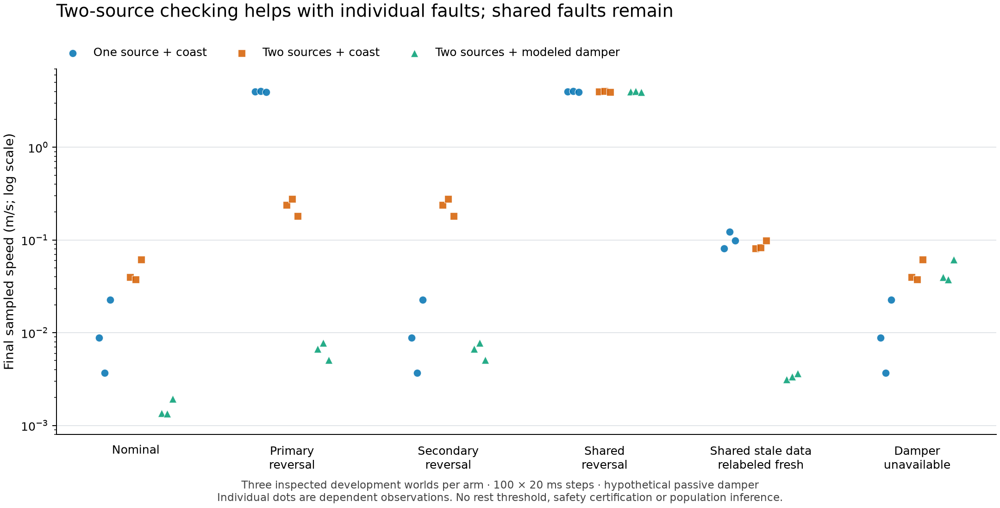

# V9-M5 two-source checking and passive fallback — development execution

**Date:** 2026-11-16, Asia/Bangkok. **Governance: `GATE_B_NOT_AUTHORIZED`.** Branch `codex/research-hardening`, parent `74b0bfab8e57cd450293e49de881207074df3141`. These additions are uncommitted development work. No V9-M4 reserved data/seed files, confirmatory evaluator, production ticket, frozen artifact or unapproved statistical decision rule is used or modified. No release commit, push, merge, publication or hardware validation occurred.

## Outcome

Implemented a separate two-source braking supervisor, a hypothetical delayed passive damper in MuJoCo, a conditional passive-motion reference and a source/physics-aware reader. Executed **108 development trajectories × 100 steps = 10,800 physics steps**, all completed and retained. All **36 matched triples** have matching initial states, runtime records and generated noise. **135 selected regression tests passed in 33.60 s**.

A separate nine-file source snapshot reproduced all 108 assignments using the same existing interpreter/native dependencies. Its complete raw ledger is **byte-identical** to the original:

`23732dd1c644d2a90daf264d8b2d2b2c783e917c70ed9e650ee8e756276f10de`

This establishes deterministic reproduction under that shared runtime; it is not a clean authenticated environment, independent scientific replication, hardware evidence or owner approval. Three already inspected worlds are reused. Test executions and source-snapshot reproduction are not additional independent trials.

The main negative findings are retained: **shared velocity reversals defeat all three arms; shared stale measurements relabeled as fresh invalidate the conditional travel bound; and an unavailable damper leaves the robot coasting.** A second sensor and a fallback request cannot by themselves establish reliable recovery.

## Intended outcomes and what this change actually supplies

| Intended outcome | Concrete addition | Claim boundary |
|---|---|---|
| Detect inconsistent estimates before issuing a command | Separate frame/source/freshness gates and position/velocity ball compatibility checks | Inconsistency is detected; the faulty source is not identified. Compatibility does not establish truth. |
| Avoid unsupported fusion | Candidate force checked over the **union** of source velocity balls | Conditional on at least one ball containing the true velocity. No independence assumption repairs shared invalid bounds. |
| Record motion after sensor or command refusal | Terminal refusal, continued physics and three-arm coast/damper comparison | Refusal is not rest. Passive damping is hypothetical hardware modeled in the plant. |
| Test fallback timing and availability | Three-tick delay, latched unavailability, native damping coefficient recorded after each step | Model-coefficient acknowledgement is not verified physical brake effectiveness. |
| Begin connecting sensing to recoverability | Retrospective conditional path reference from asserted speed bounds | This is not an operational collision-avoidance or safe-stop certificate. Missing bounds remain unsupported; contradictory outcomes remain visible. |
| Preserve reproducible development evidence | Exclusive fsynced ledger, source maps, deterministic reconstruction and separate source-path rerun | Same-runtime arithmetic and hashes do not independently authenticate the runtime or research claims. |

## Architecture, contracts and source evidence

`src/aegis/development/dual_source_braking.py:29` implements `SourceBrakeSupervisor`. It receives only two `BoundedStatePacket` objects and a decision time. Its source gates expect `SIM_PRIMARY` and `SIM_SECONDARY` in `WORLD`, with the existing bounded-state input/age contract. Expected labels are identifiers, not cryptographic authenticity or physical independence. Each source is propagated to the same decision time before comparison.

The supervisor first checks whether the two position balls and two velocity balls overlap. If either is disjoint it returns `CONTRADICTORY_SOURCE_BALLS`, without discarding a sensor, widening its bound or selecting whichever reading is convenient. Any refusal latches this diagnostic session. Later steps continue physical evolution, recording raw packets and truth-based scoring, but the command supervisor does not keep inspecting sources after its terminal refusal. Ongoing operational monitoring/restart is a separate unresolved work item.

If the balls are compatible, the existing bounded-braking module proposes a force from the primary estimate. The new supervisor checks that same force against **each** source ball, using the larger worst-case power and held-command energy bounds. It does not use intersection fusion or claim to have calibrated either source.

`src/aegis/development/dual_source_braking.py:95` implements `SimulatedDamperSwitch`. Inputs are step index, request and synthetic availability; it has no velocity input. A request at step `k` produces three complete undamped intervals, with damping applied from `k+3`. Unavailability when activation is due latches `FAILED_UNAVAILABLE`; it is not silently retried. In coast baselines it records `DISABLED_COAST_BASELINE`.

`src/aegis/development/passive_motion_reference.py:11` supplies an explicitly conditional model reference. `scripts/research/dual_source_fallback_study.py:45` declares assignments, `:64` generates documented sensor faults, `:97` performs retrospective path checks, `:152` executes physics, `:199` validates each episode, and `:267` validates the batch and matched triples.

The data path is: simulated plant → two measurement models → input gates and union command check → commanded force. Refusal → switch request → native passive damping after its delay. Simulated truth separately supplies measurement generation and post-decision scoring. No simulator position/velocity is passed to the supervisor, and `env.step()`/truth-state CBF are not invoked.

## Why the union matters

For force `f`, velocity center `v_i` and radius `r_i`, the support-function bound is

```
P_i = f·v_i + ||f|| r_i
P_union = max(P_primary, P_secondary)
ΔK_union = h P_union + h² ||f||²/(2m)
```

The supervisor requires both `P_union < 0` and `ΔK_union < 0`. The energy expression assumes a constant known mass, constant held force, ideal gravity compensation, and no unmodeled force/contact during that commanded interval. This is the same conditional ideal-model meaning as the previous bounded-braking diagnostic.

If at least one asserted velocity ball contains truth, its union with the other ball also contains truth. That implication does not require statistical independence, but the premise is not established by agreement. If both balls are wrong in the same way, the premise fails.

Intersection would make a stronger unsupported assumption: truth must belong to both balls. A retained synthetic example uses a narrow false primary ball around `+.5 m/s` and a wide secondary ball around the same center containing `-.5 m/s`. Their intersection is narrow and misleading; the union still includes the opposite direction, so the new check refuses the primary braking proposal. The code intentionally favors conservative refusal over identifying an honest sensor from two unauthenticated assertions. That can reduce utility even when the primary sensor is accurate.

Compatibility arithmetic and support/energy checks use ordinary floating-point calculations with numeric-range handling and analytic tests. This is not outward-rounded interval verification, a formal machine proof or a probabilistic coverage result.

## Passive model and recoverability limits

The hypothetical fallback is isotropic **native MuJoCo translational joint damping**, with coefficient `c=2 kg/s`, for a `1 kg` free body. The controller does not compute a truth-velocity damping force. MuJoCo computes passive dynamics inside the plant after `model.dof_damping[:3]` is changed by the simulated switch. Gravity compensation remains ideal. This models a hypothetical passive element; it does not assert that a drone or other real platform possesses it.

After refusal, incremental commanded force is zero. With no contact, native Euler integration satisfies the recorded check

```
v_next = (v + u*dt/m)/(1 + c*dt/m)
p_next = p + v_next*dt
```

With a valid initial speed upper bound `s`, coast delay at most `τ`, zero commanded/unmodeled force and damping continuously available afterward, the infinite-horizon additional path reference is

```
L <= s*τ + m*s/c
```

The decay is asymptotic; exact rest in finite time does not follow. A persistent admissible nonzero force can produce terminal speed `F/c > 0`, hence unbounded total future displacement. The reference therefore returns `UNSUPPORTED_PERSISTENT_DISTURBANCE` for **any positive** persistent-force allowance. Missing availability or zero damping also produces no bound.

The runner's path comparison is explicitly **retrospective**: it uses recorded source balls at first refusal and observed model activation/failure. It is not an online authorization to move. If required accepted state balls are absent, the comparison remains `UNSUPPORTED_MISSING_ACCEPTED_STATE_BALL`. If the reference's assumptions are violated, an observed exceedance is preserved rather than suppressed. No geometric collision-avoidance decision uses this scalar path bound.

Actual damping availability, saturation, mass/gravity uncertainty, switching dynamics, persistent disturbance, contact and platform-specific operational rest requirements remain unvalidated. Physical feedback proving brake effectiveness is not implemented by reading a model coefficient.

## Study design

Three explicitly designated development worlds use `[20261116, world, 0]`, `world=0,1,2`. Initial state is `[-2,-2,1.3] m` and `[.4+.2*U,0,0] m/s`, as in the previous inspected braking worlds. Primary and secondary noise streams use `[20261116,2,world,0]` and `[20261116,2,world,1]`. No reserved seed file is read. Separate RNG streams are a synthetic modeling construction, not evidence of independently failing physical sensors.

All assignments are declared in the header before execution: 12 conditions × three worlds × three arms, 100 steps each at `.02 s`. The three arms are `SINGLE_COAST`, `DUAL_COAST`, and `DUAL_DAMPER`. All use terminal refusal; the single arm explicitly ignores the secondary source. This differs from the earlier diagnostic's retry behavior after an uncertainty-only command refusal, so old and new results must not be pooled as a controlled ablation.

Synthetic bounded uniform component noise gives Euclidean position/velocity radii `.01 m/.02 m/s` for primary and `.015 m/.03 m/s` for secondary. The conditions are:

1. Nominal.
2. Primary velocity reversal, undeclared.
3. Secondary velocity reversal, undeclared.
4. Shared velocity reversal, undeclared.
5. Primary reversal with a radius expanded to contain the fault.
6. Shared three-tick-old measurements relabeled with current acquisition times and fresh sequences.
7. Exact primary packet replay.
8. Missing secondary packet.
9. Primary position bias `+.4 m` in X, undeclared.
10. Secondary position bias `+.4 m` in X, undeclared.
11. Shared position bias `+.4 m` in X, undeclared.
12. Damper unavailable; otherwise nominal measurements.

Faults begin at decision 6. Fresh innovations are generated on every scheduled step, including missing/replayed cases, so noise streams remain matched across arms. Replayed packets retain their original sequence. Relabeled stale packets deliberately lie about age and sequence, exposing the difference between checking metadata and authenticating acquisition freshness.

This is an exploratory diagnostic, not preregistration or confirmatory evaluation. Unit/smoke and development fixture results informed implementation. The actual batch ran after the code/tests stabilized; a final regression test was then added to preserve the observed stale-data path failure without changing executed study code. No sample size, significance threshold or scientific acceptance rule is inferred from these trajectories.

## Actual observations

Each final-speed range is three dependent observations across the inspected worlds, not a confidence interval. All 36 matched triples passed the specified reset/runtime/innovation consistency checks. No recorded collision flag occurred in this open braking setup. This is not an obstacle-avoidance benchmark or evidence of zero collision risk.

| Condition | Single + coast, final m/s | Dual + coast, final m/s | Dual + damper, final m/s | Interpretation |
|---|---:|---:|---:|---|
| Nominal | .003682–.022631 | .037465–.061345 | .001336–.001945 | Union checking refuses earlier; passive damping reduces residual motion under its model. |
| Primary reversal | 3.940316–4.035681 | .180607–.275862 | .005090–.007774 | Dual refusal at step 6; source identity is not diagnosed. |
| Secondary reversal | .003682–.022631 | .180607–.275862 | .005090–.007774 | An accurate primary is also refused when evidence conflicts. |
| Shared reversal | 3.940316–4.035681 | 3.940316–4.035681 | 3.940316–4.035681 | All arms issue accelerating commands; no refusal, so no damper request. |
| Primary reversal, declared radius | .180607–.275862 | .180607–.275862 | .005090–.007774 | Broad uncertainty correctly prevents choosing a direction. |
| Shared stale data relabeled fresh | .080973–.123007 | .080973–.098589 | .003123–.003656 | Initially compatible false freshness causes unsupported actions before eventual refusal. |
| Primary replay | .180607–.275862 | .180607–.275862 | .005090–.007774 | Replay is rejected; missing accepted state prevents a conditional path reference. |
| Secondary missing | .003682–.022631 | .180607–.275862 | .005090–.007774 | Dual mode does not silently fall back to primary; no full state-ball reference. |
| Primary position bias | .003682–.022631 | .180607–.275862 | .005090–.007774 | Position disagreement triggers refusal despite compatible velocities. |
| Secondary position bias | .003682–.022631 | .180607–.275862 | .005090–.007774 | Same conservative refusal. |
| Shared position bias | .003682–.022631 | .037465–.061345 | .001336–.001945 | Agreement misses the common position error; low speed does not establish localization accuracy. |
| Damper unavailable | .003682–.022631 | .037465–.061345 | .037465–.061345 | All 259 post-deadline fallback samples across the three damper trajectories are `FAILED_UNAVAILABLE`. |

Shared reversals produce **282 positive-command-power samples per arm** over the three worlds and leave no fallback request in those episodes. In contrast, individual reversals produce zero such samples in the dual arms. Counts are sampled descriptive diagnostics, not independent Bernoulli trials.

For shared stale relabeling, the dual arms have six positive-command-power samples across three worlds. The damper later reduces speed but **all three trajectories exceed their conditional path reference** because the initial speed bounds are false. Example, world 0: reference `.035832 m`, observed post-refusal path `.043783 m`. The honest-secondary primary-reversal fixture stays below its reference: world 0 `.147742 m` reference versus `.130344 m` observed. These checks retain contrary evidence; the former is not converted to a successful recovery because final speed is small.

Diagnostic positive-power/energy and geometry comparisons use `1e-10` numerical tolerances. These are implementation diagnostics, not approved research success thresholds. No rest threshold, dwell rule, population risk rate, p-value or statistical CI is asserted.



The PNG/SVG and plotting source show individual observations on a logarithmic speed axis. They have no inferential error bars or acceptance line.

## Regression and reproducibility evidence

The final selected suite ran with bytecode/cache disabled and a fresh temporary directory:

```sh
PYTHONDONTWRITEBYTECODE=1 PYTHONPATH=src:. .venv/bin/python -m pytest -q -x -p no:cacheprovider \
  tests/test_dual_source_braking.py tests/test_passive_motion_reference.py \
  tests/test_dual_source_fallback_study.py tests/test_bounded_braking.py \
  tests/test_bounded_estimation_study.py tests/test_development_ledger.py \
  --basetemp=/private/tmp/nexvia-dual-final-tests-20261116 \
  --junitxml=/private/tmp/nexvia-dual-final-tests-20261116.xml
```

**135 passed in 33.60 s**: 62 tests for the new components/study and 73 adjacent bounded-state/ledger tests. Earlier suites passed 26, 46 and 134 tests; they overlap and must not be added. No unexpected pytest failure or actual-batch error occurred. Deliberate sink/simulator failures retain STARTED/ERROR and unstarted assignments rather than favorable summaries. Rehashed contradictory records, missing physics, false model-damping acknowledgement, wrong source identity, altered noise/packets/power/union bound/geometry/clock/summary and corrupted impulse checks are rejected.

An initial one-episode smoke check passed, with final speed `.0067287735 m/s` in world 0 primary-reversal/damper mode. It occurred before the passive-reference addition. Its stdout summary and source revision are recorded; its original in-memory event list was not retained and is not treated as a complete raw-evidence run. Later completed studies and test fixtures use durable ledgers. Temporary plotting cache warnings and one premature image-view attempt were tooling issues; both PNG/SVG were subsequently generated and the PNG visually inspected.

The batch reader reconstructs noise from the recorded RNG keys, regenerates packets/faults/scoring from recorded physical histories, reconstructs supervisor and switch state, checks ordered continuous control/physics evidence, mass/gravity/timestep/integrator, damping coefficients, passive impulse, integration phase, geometry/collision consistency, source maps and terminal summaries. These are internal consistency checks; coherently fabricated records or a compromised runtime are not excluded by this mechanism.

The source-path reproduction copies seven executed source files plus two namespace files to a new temporary directory as read-only files, checks imports originate there, replays the exact declared assignments through the durable writer, and compares the entire ledger digest. The parent SHA/metadata are explicitly copied from the original execution header, not represented as a new Git checkout or release. The reproduction uses the same Python/NumPy/MuJoCo installation: Python `3.12.14`, NumPy `2.5.3`, MuJoCo `3.14.0`. It therefore addresses source-path reproducibility while leaving independent runtime provenance and native-library trust unresolved.

Evidence:

- `results/research_development/dev/dual_source_fallback_v1_2026-11-16/assignments.jsonl` and `summary.json` — actual batch.
- `results/research_development/analysis/dual_source_fallback_verification_2026-11-16.json` — source/test/artifact hashes, commands, versions, checks, smoke/tooling limitations and governance.
- Same analysis directory `dual_source_fallback_tests_2026-11-16.xml` — final suite receipt.
- `results/research_development/dev/dual_source_test_fixtures_2026-11-16.zip` — synthetic fixtures, deliberate failures and retained pre-envelope source revision.
- `results/research_development/dev/dual_source_snapshot_reproduction_2026-11-16.zip` — separate source snapshot, driver, copied header, reproduced ledger/analysis and verification.
- Same analysis directory `dual_source_diagnostic_2026-11-16.png`, `.svg`, and `plot_dual_source_diagnostic_2026-11-16.py` — descriptive figure and reproducer.

All previously retained bounded-study source hashes still match. The pre-existing tracked benchmark remains unchanged at SHA-256 `04bc31bf74423806200e39a44334e1dd0cf4063dde08797ef79dacb491b4323f`, with its original 46 insertions/2 deletions. Historical reports and evidence are preserved.

## Remaining-work alignment and next sequence

| Workstream | Current progress | Required next work and intended outcome |
|---|---|---|
| Error-bound validity | Two-source consistency and union checks implemented conditionally; shared failures reproduced | Add a separately modeled physical constraint/reference and acquisition-freshness witness. Test primary-only, secondary-only and shared faults; explicitly retain errors that remain unidentifiable. No calibration/independence claim from agreement. |
| Fallback/recoverability | Hypothetical delayed damping executed; availability failure and conditional path limits measured | Add an independently ticking command-duration/fallback watchdog, physical effectiveness feedback model, force saturation, mass/gravity uncertainty and persistent disturbance cases. Require a finite-horizon operational envelope; the zero-disturbance asymptotic reference is insufficient. |
| Common-mode detection | Demonstrated failure, not solved | Compare periodic independent checks with anomaly-triggered checks. Shared reversal never triggers this supervisor, so a fallback relying only on its refusal is insufficient. Define what external reference can actually reveal a shared sign/frame/clock error. |
| Active verification | Not implemented | Budget probe delay/displacement/energy from a justified recoverability envelope; compare probe, passive observation and immediate fallback. If bounds are unavailable, do not manufacture a probe authorization. |
| Continuous assurance/restart | Terminal braking diagnostic only | Specify continued monitoring, fault persistence and recovery/reset authority. Do not clear the latch because a later random sample looks favorable. |
| Statistical monitor | Separate reference remains conditional, physical null unvalidated | Independently review the conditional null, calibration coverage, dependence, missingness, restart and multiplicity before any confirmatory guarantee. |
| Reproducibility/trust | Exact separate-source reproduction complete under shared runtime | Independently reproduce from an authenticated immutable source/runtime bundle, including native packages; hashes alone do not provide the trust anchor. |
| Independent evaluation | Not executed | Prospectively fix unit/endpoints/denominators/baselines/missingness/sample size/multiplicity and obtain required review. Reused development worlds are not evaluation holdouts. |
| Hardware/release | No hardware; release remains blocked | Select real platform and operational rest/clearance/dwell requirements; validate actuator/sensor/transport behavior through staged bench tests before motion. Preserve the owner's V9-M4 restrictions and unresolved approval/trust review. |

Recommended immediate engineering order: **freshness witness and independent command watchdog → disturbed/saturated fallback dynamics and finite-horizon envelope → constrained active verification → broader development worlds and independent study design**. A watchdog alone does not solve a shared-sensor fault that still issues timely commands; the freshness/physical-reference work remains necessary.

Specific independent-review questions are: what evidence can justify at least one source's error coverage; whether any probabilistic coverage is conditional in the closed loop; what physically available fallback satisfies the assumed dynamics under power/transport/software failure; what operational rest/clearance criteria the intended application requires; and how source/timebase authenticity and shared dependencies are established. Engineering experiments can make these questions testable, but do not authenticate statistical, security or owner approval.

The system remains a development prototype. The intended outcome is an auditable research method that identifies both supported command properties and explicit failure conditions, not a claim that redundancy alone makes Physical AI safe. **Overall release readiness remains BLOCKED; Gate B remains `GATE_B_NOT_AUTHORIZED`.**
