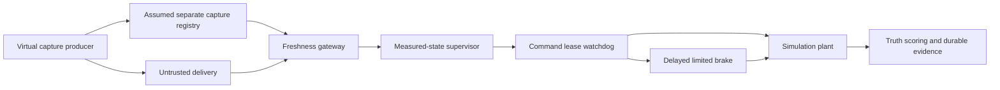
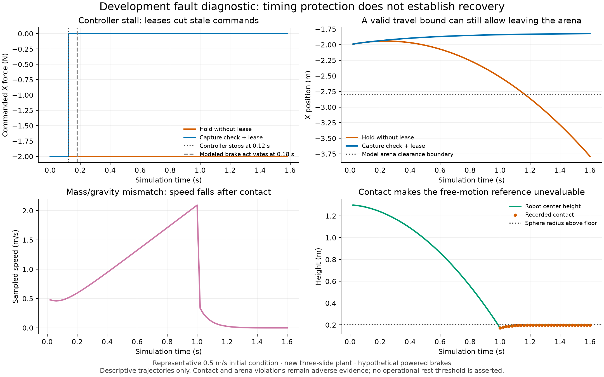

# V9-M5 capture freshness, command leases and limited-brake stress study

**Date:** 2026-11-16, Asia/Bangkok. **Status: development simulation; release BLOCKED; `GATE_B_NOT_AUTHORIZED`.** Branch `codex/research-hardening`, parent `74b0bfab8e57cd450293e49de881207074df3141`. Actual source hashes identify the uncommitted implementation. No reserved V9-M4 seed/outcome files, confirmatory evaluator, production ticket, frozen artifacts, registered decision rules, release commit, push, merge, publication or hardware validation were involved. Existing changes and prior evidence remain intact.

## Completed follow-up and principal findings

Implemented a separately scheduled capture-witness model, freshness gateway, one-tick command leases, a new native force-limited brake plant, and a conservative finite-horizon motion reference. Ran **117 assignments × 80 physics steps = 9,360 physics steps**, all retained and completed. All **39 matched triples** have matching reset/runtime/noise evidence. The selected suite passed **166 tests in 8.96 s**.

A separate read-only source snapshot reproduced the complete ledger byte for byte under the same existing interpreter/native dependencies:

`dec1755180cffe158a50b9ccec15418657acbc0e50000f9994fdfda489b60f2e`

Execution completion is not a safety pass. The important results are:

- The witness-enabled arm rejects modeled timestamp relabeling and payload substitution at fault tick 6.
- Separately ticking leases cut stale command force at tick 6 when the controller stalls; the hypothetical brake activates at tick 9.
- Fresh but semantically wrong shared reversals, compromised witnesses and shared scheduler failure remain damaging counterexamples.
- Force-limited braking cannot counter a larger persistent disturbance. Mass/gravity mismatch produces floor contact and near-zero final speed; the free-motion reference is **UNEVALUABLE**, never a successful recovery.
- A conservative valid sampled travel bound can still include paths outside the arena. It is not an operational permission or collision-avoidance guarantee.

## Components, source locations and trust boundaries

| Component | Source | Actual scope |
|---|---|---|
| Capture registry | `src/aegis/development/assurance_gateway.py:23` | Stores source/capture-tick/payload digest in a separately scheduled simulation producer. No signatures, hardware authentication or trusted external clock are supplied. |
| Freshness gateway | Same file `:47` | Binds delivery payload to the recorded capture, checks acquisition time, age, source and reuse; rejection latches. |
| Command lease/watchdog | Same file `:82` / `:89` | One-tick leases, monotone sequence/issue/expiry, force norm and independent tick progression. Failure produces zero incremental command and a fallback request. |
| Force-limited plant | `src/aegis/env/mujoco_lease_brake.py:14` | New three-slide-joint mass with native powered velocity servos and per-axis force caps. Different from previous free-joint/joint-damping studies. |
| Sampled motion reference | `src/aegis/development/sampled_motion_reference.py:11` | Conservative finite-horizon path/speed bound with no braking credit, conditional on stated dynamics/force/mass bounds and no contact. |
| Study and reader | `scripts/research/freshness_lease_study.py:45`, `:61`, `:162`, `:181`, `:245` | Declares all assignments; separates virtual capture, command production, watchdog, switch and physics; reconstructs the full evidence chain. |
| Tests | `tests/test_assurance_gateway.py`; `tests/test_freshness_lease_study.py` | Contract/math/native-force tests and full integrated fault/evidence fixtures. |

The existing `src/aegis/sim2real/safety_watchdog.py` explicitly notes that it cannot provide independent protection when its own process/control loop stops. It is unchanged. This new Python study models separate scheduling; it does not implement a separately powered hardware watchdog or isolate processes/security principals. The shared-scheduler fault tests that distinction directly.



Simulated truth generates noisy measurements and physical outputs. Neither the supervisor, gateway nor lease watchdog receives an environment or truth-state parameter. Native actuator physics uses the simulated state inside the plant; this is not a truth-velocity control override. No true-state CBF is called.

## Freshness contract and its limits

The modeled capture producer registers source identity, capture tick and SHA-256 of the complete measurement payload: position, velocity, error radii, frame, source and bound-basis label. Delivery sequence and acquisition time are excluded from that digest and checked separately against the capture record. Records cannot be reissued by the controller in this study. The gateway rejects missing/future/old/reused captures, source mismatch, relabeled acquisition time and payload substitution. It latches after rejection.

Maximum permitted capture age is four simulation ticks (`.08 s`), matching the previous development input-age setting. This is a fixture contract, not calibrated physical latency. Integer tick time is canonical (`tick*.02`); real clock synchronization/drift and sensor transport are not implemented.

Two counterexamples distinguish integrity from truth:

1. A fresh shared reversal registered by the capture layer matches its witness perfectly. The values are still wrong.
2. A compromised witness recertifies cached values with new identifiers/current capture times. Digest/time comparisons then agree with the false registry. After the fault starts, this case recursively reuses earlier captured frames; the physical information becomes increasingly stale.

Thus the registry is an **assumed trust boundary**, not a discovered or authenticated trust anchor. It is an ordinary Python object in the same interpreter. A real estimator also transforms/fuses raw measurements, so binding raw capture bytes would not establish the output estimate's dependency time or correctness. Authenticating acquisition, estimator dependencies and transformations requires a separate design/review.

## Lease timing and independent scheduling

A command lease is valid on `[issued_tick, expires_tick)`. Maximum duration is one tick, corresponding to the `.02 s` hold interval in the existing braking-energy diagnostic. A heartbeat alone cannot renew it. Force vector, sequence and issue/expiry are validated before application. Missing/expired lease, invalid duration, replay, clock discontinuity, controller refusal or failed freshness check latches fallback and zero incremental command.

The lease model ticks at every physics interval even if command production stops. With a controller stall at tick 6, the last lease expires at tick 6, so its force is removed before that interval. The switch has a three-interval delay, with braking from tick 9. During the delay the model coasts under gravity compensation/disturbance; it does not freeze physical motion.

A timely wrong command still has a valid lease. If controller, capture, watchdog and switch share a stopped scheduler, none can act on the missing tick. The plant continues holding the last force. The shared-scheduler fixture preserves that failure in every arm. During this stall, copied selection/watchdog/switch fields are the last published state, with scheduling flags false; they are not fresh health verdicts. The expired-force metric is reconstructed against the advancing physical tick. A frozen *watchdog clock while its evaluation still runs* is a different case: the discontinuity is detected and fallback requested.

## New plant and limited fallback dynamics

The new plant has three orthogonal translational slide joints, a spherical body, the existing static obstacle/floor geometry, no rotational/flight model, and Euler integration at `.02 s`. Three zero-target velocity servos model hypothetical **powered** brakes. In each axis their force is capped at `1 N`, or `.05 N` in the weak-brake case. Gain is zero before activation/unavailability and `2 kg/s` when active.

Native servo gain/bias and force-limit semantics were checked against the [MuJoCo 3.14 XML reference](https://mujoco.readthedocs.io/en/3.14.0/XMLreference.html#actuator-velocity). That reference recommends implicit/implicitfast for velocity servos generally. This diagnostic deliberately fixes Euler and verifies its sampled recurrence with small gain/timestep; it does not establish behavior for other integrators or general servo settings.

In contact-free steps the recorded native force and motion satisfy

```
brake_i = clip(-c*v_i, -F_cap, F_cap)
v_next = v + dt*((u + disturbance + nominal_gravity_compensation + brake)/m + gravity)
p_next = p + dt*v_next
```

The reader checks actual compiled XML/geometry/dimensions/mass/gravity/integrator/force limits, native gain/bias/target, pre-integration actuator force, impulse, synchronized position/qpos and both pre/post contact state. It does not apply a free-motion impulse check across a contact interval.

Nominal gravity compensation remains `9.81 N` for a `1 kg` body. The mass/gravity fixture deliberately uses actual mass `1.5 kg`, producing a `4.905 N` compensation deficit. A `5 N` external-force design allowance covers that residual before contact. This is a chosen stress case, not a measured platform uncertainty range. No physical brake availability, force effectiveness, saturation calibration or power-loss behavior is established by this simulation.

## Finite-horizon reference

Let `s0` bound initial speed, `m_min>0` lower-bound actual mass, `U` bound commanded force norm, `D` bound external force including compensation error, and `c_max*dt/m_min <= 1`. The clipped damping update is nonexpansive componentwise. Taking **no braking credit**, the conservative sampled bounds after `N` steps are

```
A = (U + D)/m_min
speed_N <= s0 + N*dt*A
sampled_path_N <= N*dt*s0 + A*dt²*N*(N+1)/2
```

The implementation rejects unsupported numerical ranges/damping steps. Tests include an exact no-braking worst-force trajectory and clipped-damping extremal cases. Ordinary floating-point arithmetic is not outward-rounded interval certification.

The study uses a predeclared setup bound `s0=.65 m/s` for starts `.4/.5/.6`, `m_min=1 kg`, `U=2 N`, and case-specific `D=0`, `.2`, or `5 N`. These are experimental model assertions, not measured robot bounds or statistical thresholds. The bound starts at reset and is checked retrospectively. Contact makes its evaluation `UNEVALUABLE_CONTACT`; no favorable Boolean is supplied.

A bound can contain an unsafe trajectory. For example, the nominal `N=80` path upper bound is `3.632 m`, which is too loose to authorize motion from the start position without geometry/recoverability checks. No geometric clearance decision, safe stopping rule, between-sample certificate, active probe authorization or rest criterion is derived from it.

## Study design and observed outcomes

The header declares 13 conditions × three initial speeds × three arms = **117 assignments**. Every trajectory has 80 steps (1.6 simulated seconds). Initial position is `[-2,-2,1.3] m`; initial velocities are `[.4,0,0]`, `[.5,0,0]`, `[.6,0,0] m/s`. These are designed development initial conditions, not random population worlds. Sensor noise uses explicit development RNG keys `[20261116,3,initial_index,source_index]`, with the previous bounded uniform position/velocity radii. No reserved seed file is read.

Arms:

- **DUAL_HOLD:** dual-source controller, fallback on controller refusal, no capture or lease enforcement. During a controller stall its last command remains applied as a declared adverse baseline.
- **LEASE:** separately ticking lease plus dual-source controller/fallback; no capture enforcement.
- **WITNESS_LEASE:** modeled capture check plus lease/controller/fallback.

The 13 conditions are nominal, old capture retimed, old payload substituted under a fresh capture ID, controller stall, excessive 20-tick lease, fresh shared velocity reversal, compromised witness, shared scheduler stall, unavailable brake, `.05 N` brake with `.2 N` persistent X disturbance, `1 N` brake with that disturbance, mass/gravity mismatch, and frozen watchdog clock. Faults begin at tick 6. Both nominal and adverse outcomes are retained.

The new dynamics, initial conditions, fault definitions and arm contracts differ from previous studies. Do not pool results or attribute differences from earlier free-joint studies solely to the added watchdog. Within each new matched triple, reset/runtime/noise are verified. The 117 trajectories and their steps are dependent comparisons, not independent reliability trials; no p-value, confidence interval or population success rate is reported.

Final-speed ranges below span three designed starts. Counts aggregate their sampled intervals, not independent Bernoulli trials.

| Condition | DUAL_HOLD final speed (m/s) | LEASE final speed (m/s) | WITNESS_LEASE final speed (m/s) | Retained interpretation |
|---|---:|---:|---:|---|
| Nominal | .00152–.00315 | .00152–.00315 | .00152–.00315 | Same command/fallback behavior in this fixture. |
| Retimed capture | .00557–.00793 | .00557–.00793 | .00883–.01984 | Witness arm refuses at tick 6; others later. Earlier refusal avoids unsupported commands, but does not minimize final speed. |
| Payload substitution | .00557–.00793 | .00557–.00793 | .00883–.01984 | Digest binding detects substitution at tick 6. |
| Controller stall | 2.60018–2.80025 | .00883–.01984 | .00883–.01984 | Baseline holds an expired force for 222 sampled intervals across starts and leaves the arena; lease arms cut it at tick 6. |
| Excessive lease duration | .00152–.00315 | .00883–.01984 | .00883–.01984 | Lease arms reject the unsupported duration at tick 6, even though this continuously updating baseline happens not to run away. |
| Fresh shared reversal | 3.11994–3.31995 | 3.11994–3.31995 | 3.11994–3.31995 | Fresh, timely wrong commands pass every arm; no fallback request. |
| Compromised witness | 2.59938–2.79697 | 2.59938–2.79697 | 2.59938–2.79697 | Recertified cached data passes; all arms leave the arena. |
| Shared scheduler stall | 2.60018–2.80025 | 2.60018–2.80025 | 2.60018–2.80025 | No monitor/switch execution; 222 expired-force intervals per arm and 66 boundary-violation samples per arm. |
| Brake unavailable | .02162–.04128 | .02162–.04128 | .02162–.04128 | Requests occur, but no effective modeled brake; residual motion remains. |
| Weak brake + persistent disturbance | .22032–.25401 | .22032–.25401 | .22032–.25401 | `.2 N` disturbance exceeds `.05 N` X braking authority. |
| Stronger brake + persistent disturbance | .09480–.09695 | .09480–.09695 | .09480–.09695 | Reduced drift; persistent disturbance still prevents exact rest. |
| Mass/gravity mismatch | approximately 1e-7–4e-6 | approximately 1e-7–4e-6 | approximately 1e-7–4e-6 | Near-zero speed follows floor contact. 94 contact samples per arm across starts; free-motion reference UNEVALUABLE. |
| Frozen watchdog clock | .00152–.00315 | .00883–.01984 | .00883–.01984 | Evaluating watchdog detects discontinuity at tick 6; this differs from a stopped scheduler. |

For retiming/substitution, the witness arm has **222 rejected-freshness ticks and zero positive-command-power samples** per condition. Each unchecked/lease-only arm has four positive-command-power samples. Shared reversal still produces 222 positive-command-power samples per arm; compromised witnesses produce 200. These show mechanism limits, not estimated risk probabilities.

All noncontact trajectories remain below the conservative sampled path bound, including trajectories that leave the arena. Contact cases have `path_exceeds_design_bound=None`. Positive-power/geometry/dynamics diagnostic comparisons use small numerical tolerances (principally `1e-10`); these are not approved scientific pass thresholds.



The figure selects the declared `.5 m/s` start to explain mechanisms. It is not an inferential comparison; the table and raw batch preserve all starts/arms. The floor-center/arena lines are model geometry definitions, not invented operational success thresholds.

## Regression, failures and reproducibility

Final selected command:

```sh
PYTHONDONTWRITEBYTECODE=1 PYTHONPATH=src:. .venv/bin/python -m pytest -q -x -p no:cacheprovider \
  tests/test_assurance_gateway.py tests/test_freshness_lease_study.py \
  tests/test_dual_source_braking.py tests/test_passive_motion_reference.py \
  tests/test_bounded_braking.py tests/test_development_ledger.py \
  --basetemp=/private/tmp/nexvia-assurance-regression-final-20261116 \
  --junitxml=/private/tmp/nexvia-assurance-regression-final-20261116.xml
```

**166 passed in 8.96 s:** 65 tests for the new gateway/lease/plant/reference/study, plus 101 adjacent component/ledger tests. Earlier suites passed 34 and 62 tests; they overlap and must not be added. This is not the full repository suite. No unexpected pytest failure or actual batch execution ERROR occurred. Scientifically adverse simulations remain adverse despite execution completing.

Coverage includes capture time/source/payload binding, missing/reused/stale/future capture, false trusted witnesses, lease expiry/replay/issue/duration/force/clock/refusal, latching, native saturation/gravity response, exact sampled-horizon examples, all full-horizon fault cases, contact invalidation, exclusive outputs, sink/simulator failures, and rehashed contradictions in receipts, leases, watchdog output, native gain/force/phase, XML, compiled geometry, noise, impulse, contact continuity, source identity and summary.

The sink-failure fixture retains one STARTED and 116 ASSIGNED assignments without integrating the rejected tick. Preparing model forces occurs before durable tick intent, then integration occurs only after it persists. Simulation can stop physics on write failure; a physical robot cannot be presumed to freeze. A simulator failure retains one ERROR and 116 ASSIGNED entries. Missing evidence never receives a favorable summary.

Runtime hardening followed the first 62-test fixture execution. Its original revision and raw fixture are retained separately. The earlier unit-only revision used a provisional `1.25 kg` plan value; the deliberately severe `1.5 kg`/`5 N` stress design was fixed before any integrated batch. No earlier scientific artifact was rewritten or retrospectively relabeled.

Read-only reanalysis matches the saved actual summary. A new directory contains nine executed source files plus two namespace files, read-only source copies, an explicit reproduction driver and the original assignment header. The driver checks module origins, source maps and Python/NumPy/MuJoCo versions, executes the same declared assignments through the durable writer and produces a byte-identical ledger. Parent identity is copied from the original header; no new checkout/release commit is represented. Same-runtime reproduction does not authenticate native wheels, OS, source ownership or independent review.

Artifacts:

- `results/research_development/dev/freshness_lease_v1_2026-11-16/assignments.jsonl` and `summary.json` — actual batch.
- `results/research_development/analysis/freshness_lease_verification_2026-11-16.json` — source/test/artifact identities, commands, checks and governance.
- Same analysis directory `freshness_lease_tests_2026-11-16.xml` — final suite receipt.
- `results/research_development/dev/freshness_lease_test_fixtures_2026-11-16.zip` — intentional failure/corruption fixtures and earlier source revisions.
- `results/research_development/dev/freshness_lease_source_reproduction_2026-11-16.zip` — complete separate-source reproduction bundle, including raw output.
- Same analysis directory `assurance_diagnostic_2026-11-16.png`, `.svg`, and `plot_assurance_diagnostic_2026-11-16.py` — inspected figure and reproducer.

All prior bounded/dual-study source hashes remain unchanged. The pre-existing tracked benchmark still has SHA-256 `04bc31bf74423806200e39a44334e1dd0cf4063dde08797ef79dacb491b4323f`; its tracked diff remains 46 insertions and 2 deletions. New files and evidence do not overwrite prior reports, simulations or user changes.

## Remaining work aligned with intended outcomes

| Work item | Outcome of this increment | Next closure evidence |
|---|---|---|
| Capture freshness | Implemented and tested under a modeled separate witness; retiming/substitution rejected | Specify independently authenticated raw capture and estimator dependency time/provenance, clock drift, receipt retention and trust principals. Do not assume a same-process hash map supplies authenticity. |
| Command deadlines | One-tick lease and separately scheduled simulation watchdog implemented | Actual independent execution/power/actuator-cutoff design; test suspension, process death, bus delay and missed callback while physical dynamics continue. A shared-scheduler failure remains unsolved. |
| Semantic/shared sensor faults | Fresh shared reversal and compromised-witness failures explicitly reproduced | Add a separately modeled physical consistency/reference channel with justified mass/force/frame/error bounds; test shared errors from initial calibration as well as sudden changes. Timely signed/hashed data alone cannot establish correctness. |
| Limited fallback | Capped powered-brake, availability, disturbance and gravity/mass stress executed | Platform-specific brake effectiveness feedback, power failure, force/ramp bounds and application geometry. Do not equate a coefficient/receipt with actual braking. |
| Recoverability | Conservative finite-horizon sampled reference implemented without braking credit | Justified initial state/force/mass bounds, between-sample geometry, contact policy and feasible terminal/fallback sets. Establish operational rest/dwell/clearance requirements prospectively. |
| Active verification | Not implemented or authorized by this bound | Budget probes from a justified recoverability envelope; if witness/model assumptions fail, return unsupported rather than inventing a probe permission. Compare periodic independent references with anomaly-triggered checks. |
| Statistical monitoring/evaluation | Frozen rules preserved; no confirmatory evaluation | Independent review of conditional calibration/null, dependence, missingness, multiplicity, reset and independent unit/endpoints/baselines before a new evaluation design. These trajectories cannot supply an untouched evaluation set. |
| Source/runtime trust | Same-runtime source-path reproduction completed | Independently authenticated immutable source/native-runtime bundle and required security review. No trust anchor or approval was invented here. |
| Hardware/release governance | No hardware, no production deployment; Gate B unauthorized | Owner-defined application/platform/operational requirements and required independent statistical/control/security reviews. Existing V9-M4 blockers remain outside this development closure. |

The next development target is a physical consistency/reference channel and actuator-effectiveness feedback model, with bounded model uncertainty and fault cases that can defeat both. This follows directly from the retained failures; adding more timely metadata without such a reference would not address semantic corruption. Operational criteria, physical trust assumptions and independent review remain prerequisites for stronger claims.

**Overall release readiness remains BLOCKED. Gate B remains `GATE_B_NOT_AUTHORIZED`.**
