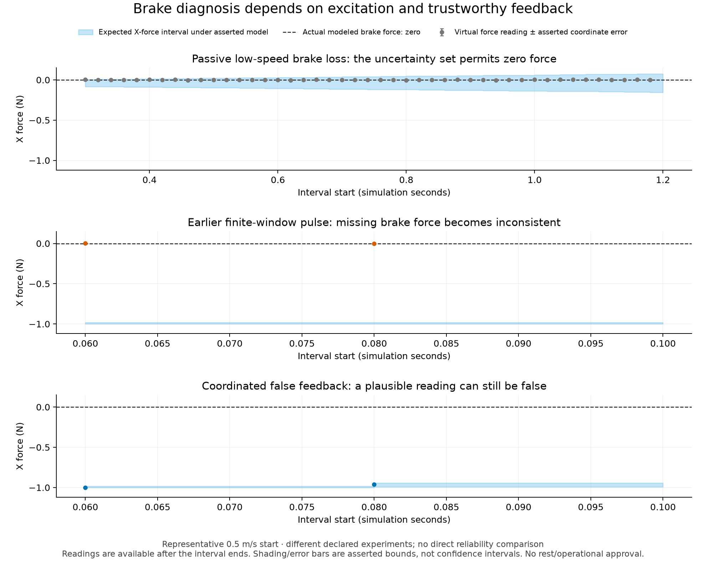

# V9-M5 physical reference, actuator feedback and bounded diagnostic window

**Date:** 2026-11-16, Asia/Bangkok. **Development simulation only. Release remains BLOCKED; `GATE_B_NOT_AUTHORIZED`.** Branch `codex/research-hardening`, parent `74b0bfab8e57cd450293e49de881207074df3141`; source hashes identify actual uncommitted bytes. No reserved V9-M4 seed/outcome files, confirmatory evaluator, production ticket, frozen artifact, registered statistical rule, release commit, push, merge or hardware validation was involved.

## What was completed

1. Implemented a measured kinematic reference with explicit initial-anchor and interval-acceleration error bounds.
2. Added continuous source/reference consistency checks, a disturbance-aware command-energy check, brake-force interval checks and a force/acceleration/mass consistency check. Monitoring continues after command refusal and throughout fallback.
3. Integrated three intervention arms into the existing capture/lease pipeline, retaining independent diagnostics and adverse physical motion.
4. Executed **126 development trajectories × 60 steps = 7,560 physics steps** across three designed starts, 14 fault/model conditions and three arms.
5. Investigated passive brake diagnosis that remained uninformative near zero speed. Implemented and executed a separate finite-window brake-only diagnostic: **21 designs, 18 executed windows × six steps = 108 physics steps; three clearance-bound rejections**.
6. Final selected regression: **192 passed in 14.49 s**. Both actual ledgers reproduce byte for byte from a separate source path using the same interpreter/native runtime. Neither test success nor deterministic reproduction authenticates physical assumptions or establishes an operational safety claim.

The important improvement is conditional: the reference-guard arms reject the modeled sudden shared reversal/cached-state faults before issuing their first wrong command at tick 6. The force/acceleration check diagnoses an initial sensor-frame error after one interval. Important limits remain: coherent sensor/model spoofing passes the checks; passive failed-brake diagnosis can be uninformative; and consistency does not establish sufficient braking authority or successful recovery.

## Scope and source map

| Component | Source | Role |
|---|---|---|
| Interval measurements/reference | `src/aegis/development/physical_reference.py:17`, `:33` | Strict kind/frame/interval checking; deterministic error-ball propagation from an anchor and virtual acceleration samples. |
| State consistency | Same file `:62` | Necessary overlap of source position/velocity balls with the reference. No identification of the faulty source and no fusion into an unjustified smaller set. |
| Disturbance-aware command reference | Same file `:81` | Conservative energy-increase bound for an active command, including asserted net disturbance and mass lower bound. |
| Brake force check | Same file `:102` | Compares a force-transducer reading with the set expected from reference velocity, requested gain and cap; separates inconsistency from uninformative near-zero evidence. |
| Force/acceleration check | Same file `:125` | Tests whether any mass in the supplied interval can explain the measurements under bounded disturbance/errors. |
| Continuous integration | `scripts/research/physical_reference_study.py:56`, `:112`, `:191`, `:219` | Sensor fault generator, controller wrapper, durable execution and read-only reader. |
| Diagnostic-window design | `src/aegis/development/probe_window.py:13` | Conservative sampled displacement versus map-clearance lower bound, with no braking credit or operational authorization. |
| Short probe runner/reader | `scripts/research/brake_probe_study.py:40`, `:106` | Separate early brake pulse, declared adversarial force/feedback cases, no-probe design rejection and read-only reconstruction. |
| Tests | `tests/test_physical_reference.py`, `tests/test_physical_reference_study.py`, `tests/test_brake_probe.py` | Analytical/synthetic boundaries, complete batch fixtures, missing evidence, sensor/physics retention and rehashed contradictions. |

The previous `freshness_lease_study.Logic` is composed with a new controller wrapper; earlier files are unchanged. The existing native three-slide-joint plant is reused. This is not a flight/rotational model. Simulated truth is used in virtual sensor generation, plant physics and post-decision scoring; the controller and monitor receive measurements and asserted model bounds, not an environment or truth-state argument.

## Reference sensor assumptions and mathematics

The new virtual acceleration channel supplies the **world-frame interval-mean change of translational velocity**, plus bounded synthetic noise. It is not a raw hardware IMU stream, orientation estimator, gravity-compensated inertial-navigation implementation or calibrated physical sensor. A separate initial position/velocity anchor is also assumed. Their frames, clocks, calibration and provenance are not authenticated by adding Python objects or hashes.

At 20 ms intervals, the sampled reference propagates

```
v_c,next = v_c + h*a_measured
r_v,next = r_v + h*e_a
p_c,next = p_c + h*v_c,next
r_p,next = r_p + h*r_v,next
```

The position update intentionally matches the selected semi-implicit simulation phase. It does not substitute a continuous-time `h²/2` position update. Initial anchor radii are `.005 m` and `.01 m/s`; interval acceleration error norm is `.04 m/s²`. These are declared synthetic bounded-uniform constructions, not confidence intervals. Triangle-inequality propagation does not need statistically independent errors if the asserted bounds hold. It also grows uncertainty and can become uninformative.

Source/reference comparisons are necessary error-ball overlaps at the same tick/frame. Compatible sets can both be wrong. The command assessment additionally evaluates a proposed force against the reference velocity ball. With `||d||<=D`, mass at least `m_min`, no contact and a constant held command `f`, the implemented conservative bound is

```
P_upper = f·v_c + ||f||*r_v + D*(||v_c||+r_v)
ΔK_upper = h*P_upper + h²*(||f||+D)²/(2*m_min)
```

A negative bound is a conditional command property, not a stopping guarantee. It assumes the reference and force/model bounds are true; fallback forces are outside this pre-fallback active-command check. The previously latched lease guard prevents automatic rearming. Numerical range failures remain unsupported; ordinary floating-point arithmetic is not outward-rounded interval certification.

## Actuator feedback: consistency, observability and sufficiency

The virtual brake-force transducer measures the effective pre-integration native brake force plus norm-bounded `.005 N` noise. It is an assumed additional sensor, not a model-parameter acknowledgement and not authenticated force feedback hardware. For each reference velocity coordinate `v_i±r_v`, the expected capped-brake interval is

```
[clip(-c*(v_i+r_v), -cap, cap), clip(-c*(v_i-r_v), -cap, cap)]
```

Measured force coordinates have projected uncertainty `±e_F`. Disjoint intervals are inconsistent. If the expected set can contain zero or measured force cannot be distinguished from zero, the status is **UNINFORMATIVE_NEAR_ZERO**, not “brake verified.” This conservative box check is only necessary consistency, not a sufficiency proof.

The second check uses an independently modeled acceleration reading. Let `F = requested_active_force + measured_brake_force`, and `β in [1/m_max,1/m_min]`. It minimizes the distance of measured acceleration to the segment `β*F` and requires

```
min_β ||a_measured - β*F|| <= e_a + (e_F + D)/m_min
```

Mass bounds are `[1,1.5] kg`. Disturbance allowances are the declared model values `0`, `.2`, or `5 N`, including the nominal-compensation error in the mass stress case. These are chosen development assertions, not experimentally calibrated platform bounds. Inconsistency cannot determine whether the actuator, sensor, calibration, contact or model is responsible. A persistent force bias can also be indistinguishable from a different admissible mass for part of the trajectory.

Checks continue after refusal. Thus feedback can diagnose a failed brake after fallback starts, even when it cannot restore physical brake authority. A diagnosis is not an implemented rescue action. The diagnostic `CAP_EXCEEDS_ASSERTED_DISTURBANCE_ONLY` is deliberately weaker than a recovery claim; `.05 N` per-axis braking against `.2 N` X disturbance has no guaranteed rest margin even when all measurements match the model.

## Study A — continuous reference/feedback integration

All 126 assignments are declared before execution: starts `.4/.5/.6 m/s`, 14 conditions and three arms, each 60 steps (1.2 simulated seconds). Positions begin `[-2,-2,1.3] m`. Pose/velocity sources use explicit development noise keys `[20261116,4,start_index,source_index]`; the reference/force stream uses `[20261116,4,start_index,2]`. No reserved seed file is read.

The three arms are:

- **WITNESS_BASELINE:** existing capture/lease/controller action; reference diagnostics are logged but do not intervene.
- **REFERENCE_GUARD:** adds reference-state and disturbance-aware command checks.
- **REFERENCE_FEEDBACK:** also latches force/model feedback failures into the next decision.

The reference anchor and all synthetic noise innovations match across each triple. Controller-dependent brake activation and spoof onset are recorded; matching innovations does not make adaptive physical exposures identical. Starts, sensor streams and time steps are dependent development comparisons, not independent risk trials.

Conditions: nominal; sudden shared velocity reversal; recertified cached capture; wrong initial sensor/reference X frame; coherent wrong frame plus corrupted command/model port; brake loss; force feedback spoof; force-plus-acceleration spoof; coordinated fictitious pose/velocity/force/acceleration after brake request; `.2 N` persistent disturbance with normal or weak cap; `1.5 kg` mass/gravity mismatch; reference dropout; and `.3 m/s²` reference acceleration bias after interval 6.

The joint-frame/model case corrupts more than sensors: it also reverses the command vector supplied to the model checker. It is an explicit violation of trusted frame/command-provenance assumptions, not a disproof of a conditional theorem under valid inputs. The coordinated fictitious-trajectory case corrupts all relevant observation channels after the requested brake becomes active while the actual brake is absent. Fault generation reads plant truth to create adversarial virtual sensors; that truth is not a monitor input.

### Actual observations

| Condition | Baseline final speed range (m/s) | Reference+feedback final speed range (m/s) | Diagnostic finding across the three starts |
|---|---:|---:|---|
| Nominal | .00360–.00712 | .00360–.00712 | No reference/feedback inconsistency; 60 evaluable reference intervals per trajectory. |
| Sudden shared reversal | 2.31998–2.51994 | .01997–.04489 | Reference arms request fallback at tick 6; zero positive-command-power intervals versus 162 in baseline. |
| Recertified cached capture | 1.79984–1.99819 | .01997–.04489 | Reference arms reject at tick 6; the capture witness alone cannot detect the false registry. |
| Wrong initial frame | 2.79991–2.99993 | .04473–.06765 | State/reference agreement alone misses it. Force/acceleration feedback responds at tick 1, after one wrong interval per start. |
| Joint frame and model-port corruption | 2.79991–2.99993 | 2.79991–2.99993 | All diagnostics remain compatible; no fallback request and 180 positive-power intervals per arm. |
| Brake loss | .02260–.04117 | .02260–.04117 | Detected at ticks 13 and 18 for two starts; the middle start remains uninformative, not verified. Detection does not repair the brake. |
| Force-only feedback spoof | .02260–.04117 | .02260–.04117 | Force/acceleration check detects at ticks 13,21,18; force-interval checks alone are fooled. |
| Force+acceleration spoof | .02260–.04117 | .02260–.04117 | Later inconsistencies in two starts; one remains undetected within the horizon. |
| Coordinated fictitious trajectory | .02260–.04117 | .02260–.04117 | No monitor failure, despite false force/acceleration feedback. All three actual velocities still lie inside the broad reference velocity balls in this short horizon. |
| Persistent disturbance | .08827–.09303 | .08827–.09303 | Model-compatible drift does not establish rest. |
| Weak brake + disturbance | .16042–.19352 | .16042–.19352 | Feedback matches the weak actuator; authority remains insufficient. |
| Mass/gravity mismatch | .00219–.02519 | .00568 | All arms contact the floor; free-motion evaluation is UNEVALUABLE_CONTACT. Earlier refusal does not supply an adequate fallback. |
| Reference dropout | .00360–.00712 | .01561–.04157 | Six evaluable and 54 unevaluable intervals per trajectory. Reference arms request fallback at tick 7. |
| Reference acceleration bias | .00576–.00712 | .00576–.01915 | Feedback failures at ticks 10,11,13, not immediately at tick 7; mass/model uncertainty can temporarily explain the bias. |

The REFERENCE_GUARD arm without feedback remains blind to the wrong initial frame, reaching the same `2.8–3.0 m/s` range as baseline. This separates the reference-integration contribution from the force/acceleration relation.

For coordinated fictitious trajectories, force sensor error exceeds its asserted bound while no inconsistency is detected. **There are zero observed reference velocity-ball violations for all three starts**, because those balls become broad enough to cover true coasting. This is not evidence that the forged transducers are valid. It is also not a counterexample to an error-ball theorem whose assumptions actually hold. Force-model observability and bound coverage are distinct questions.

Reference dropout is not counted as favorable coverage. Raw errors remain retained, but only CONDITIONAL_REFERENCE intervals enter the violation count; unavailable intervals and missing sensors have explicit separate counts. Positive-power and consistency/geometry comparisons are numerical diagnostics (principally `1e-10` tolerances), not approved scientific pass thresholds.

## Study B — separate early brake-only diagnostic

The passive study exposed low-speed ambiguity. A **new, separate development experiment** was therefore prepared; passive trajectories were not altered, extended or relabeled. Its purpose is to inspect brake behavior at a more informative velocity, not to claim better overall task performance.

There are 21 declared designs: three starts × seven cases. Each accepted design has three delay intervals, two brake-pulse intervals and one feedback interval: six ticks = `.12 s`. Active commanded body force is zero. Requested brake gain is `2 kg/s`, capped at `1 N` per axis. The hypothetical effect is conservatively treated as an arbitrary force of norm at most `sqrt(3)*cap`, including wrong sign; no braking credit is taken.

The design check uses reference speed upper bound, initial position uncertainty and a map-clearance lower bound (after robot radius and reference position error). It evaluates the existing conservative sampled-motion bound over the complete window and requires strict clearance greater than displacement. It always returns `operational_authorization=False` and `post_window_recoverability_established=False`. This is a finite sampled design check, not a between-sample invariant proof, energy-admission decision or a guarantee of what happens after the window.

Cases: nominal brake; brake absent; false force reading with honest acceleration; coherent false force+acceleration; wrong-sign force; force exceeding the declared budget; and a near-wall design. Wrong-sign/over-budget actuator faults are modeled as explicit additional body forces while native brake gain is disabled, with both contributions recorded separately.

**Results:** 18 windows executed (108 physics steps). Three near-wall designs were declined without a probe; this conservative rejection is not proof that the physical motion would necessarily collide.

| Case | Observation |
|---|---|
| Nominal | Both pulse samples per start match the asserted model. Residual motion remains. |
| Brake absent | Both pulse samples are inconsistent in all three starts. The early signal separates expected nonzero force from zero under the declared noise bounds. |
| Force-only spoof | Force interval alone is fooled; force/acceleration inconsistency occurs in both pulse samples. |
| Coherent spoof | Both feedback checks are fooled; false force and acceleration exceed asserted sensor bounds. This isolated diagnostic does not measure a new independent pose channel. |
| Wrong sign | Both pulse samples are inconsistent; the model force budget remains satisfied. |
| Force over budget | Actual injected `3 N` exceeds the `sqrt(3) N` budget; the motion-bound evaluation is UNEVALUABLE_FORCE_BUDGET even though the realized short path stays small. |
| Near wall | Three design rejections, zero physics steps and no residual-speed result. |

For the `.5 m/s` start, declared clearance is approximately `.795991 m` and sampled displacement bound `.076185 m`. Actual nominal path is `.058032 m`, residual speed `.4608 m/s`. Absent/coherently spoofed brakes leave `.5 m/s`; wrong-sign force leaves `.54 m/s`; the over-budget fault leaves `.62 m/s`. The observed kinetic-energy changes for a `1 kg` model are about `-.018832 J`, `0 J`, `+.0208 J`, and `+.0672 J`, respectively. No maximum permissible energy increase or post-window recovery rule was supplied, so neither is invented. Time, path, residual speed and energy costs are retained as descriptive model outputs.

The probe resolves some passive ambiguity by providing stronger excitation under declared bounds. It does **not** solve coordinated sensor/model deception, authenticate actuator force, establish rest, or provide complete active-verification admission for a real robot.



The figure selects the declared `.5 m/s` start. Its experiments have different timing/policies; it is a mechanism illustration, not a direct reliability comparison. Shading and error bars are asserted deterministic bounds, not confidence intervals. Measurements are available after the plotted interval ends.

## Tests, unsuccessful expectations and retained evidence

Final selected suite: **192 passed in 14.49 s**. It includes 72 new tests (30 reference, 27 integration/evidence, 15 probe) and 120 adjacent gateway/dual-source/bounded-braking/ledger tests. It is not the full repository suite. The earlier 177-test suite and 15 probe tests overlap this final run and must not be added.

```sh
PYTHONDONTWRITEBYTECODE=1 PYTHONPATH=src:. .venv/bin/python -m pytest -q -x -p no:cacheprovider \
  tests/test_physical_reference.py tests/test_physical_reference_study.py tests/test_brake_probe.py \
  tests/test_assurance_gateway.py tests/test_dual_source_braking.py \
  tests/test_bounded_braking.py tests/test_development_ledger.py \
  --basetemp=/private/tmp/nexvia-reference-probe-final-tests-20261116 \
  --junitxml=/private/tmp/nexvia-reference-probe-final-tests-20261116.xml
```

Analytic tests cover exact discrete error transport, extremal/adversarial energy examples, inverse-mass projection, sensor/model interval/time failures, no false force verification near zero, and joint spoof counterexamples. Integration tests cover complete retained horizons, continuous post-refusal diagnostics, unknown reference counts, contact invalidation, exclusive outputs and rehashed anchor/force/acceleration/command-port/feedback/phase/geometry/source contradictions. Probe tests cover clearance rejection, force observability, false feedback, violated force budgets and a reader that is explicitly prevented from advancing physics.

There were **four unsuccessful overlapping test invocations** while overly strong expectations were being corrected:

1. `30 passed, 1 failed`: the initial test wrongly required all ghost trajectories to violate the velocity ball.
2. `34 passed, 1 failed`: the partial correction still wrongly required at least one violation; actual count is zero for all starts.
3. `35 passed, 1 failed`: a different assertion wrongly required every passive brake-loss case to be diagnosed.
4. A broader selected invocation repeated that unchanged brake-loss expectation: `35 passed, 1 failed`.

Inspection also showed that partial spoofing can remain unobserved and reference bias need not be detected immediately. Those expectations were corrected before subsequent passing suites; sensor bounds, model intervals, decision thresholds and experimental trajectories were **not** tuned to manufacture detection. The failed logs, XML and earlier code revisions remain retained. Correcting tests to distinguish uninformative evidence from detected failures is not an owner/statistician approval or a scientific pass criterion.

A separate hardening fix rejects bool/noninteger reading ticks; it changes malformed-input behavior, not any trajectory's scientific thresholds. The first 26-test unit-only suite preceded that fix and is retained. Actual batches subsequently completed without execution ERROR, while scientifically adverse outcomes remained adverse.

Persistence tests distinguish failures before and after physics. A TICK sink failure retains RESET only. A SENSORS sink failure retains RESET/TICK/PHYSICS with one STARTED assignment and 125 unstarted; its summary is unknown, not “no motion.” A simulator failure retains ERROR and all remaining assignments. Simulation can stop integration on a failed write; no such physical-world freeze is assumed.

## Reproduction and artifact retention

Both readers reconstruct records and arithmetic without running episodes. The probe reader compiles/checks the initial model but never advances physics; a regression test enforces this. Read-only reanalysis matches each saved summary.

A separate directory contains thirteen executed source files plus two namespace files as read-only copies. Its explicit driver verifies import origins/source/version maps, reexecutes each declared batch through new exclusive ledgers, and reproduces both original byte sequences:

- Reference batch SHA-256: `ffd27fea2278806bc8dfe25ef25c8ffeec9fda4b710f0f5966b271c261cc477d`.
- Probe batch SHA-256: `a4371c63269f580afe7b9cd6a09c71e83cacabc270a98c30f2b22c934e36739b`.

The driver uses the same existing interpreter/native dependencies and copied original parent metadata. This is not an authenticated new checkout, independent runtime build, independent human review or additional scientific replication.

Artifacts:

- `results/research_development/dev/physical_reference_v1_2026-11-16/assignments.jsonl` and `summary.json` — actual main batch.
- `results/research_development/dev/brake_probe_v1_2026-11-16/assignments.jsonl` and `summary.json` — separate actual short-window study.
- `results/research_development/analysis/physical_reference_probe_verification_2026-11-16.json` — source/test/artifact identities, commands, failed expectations and limitations.
- Same analysis directory `physical_reference_probe_tests_2026-11-16.xml`, `brake_probe_observed_costs_2026-11-16.json`, `compute_brake_probe_costs_2026-11-16.py`, figure PNG/SVG and plotting source.
- `results/research_development/dev/physical_reference_test_fixtures_2026-11-16.zip` — test/failure evidence and earlier revisions, stored by content hash with a logical-path manifest to avoid duplicating identical ledgers. All unique file bytes remain recoverable and verified.
- `results/research_development/dev/physical_reference_source_reproduction_2026-11-16.zip` — source snapshot, driver, both reproduced raw ledgers and verification.

All previous study source maps remain unchanged. The pre-existing tracked benchmark retains SHA-256 `04bc31bf74423806200e39a44334e1dd0cf4063dde08797ef79dacb491b4323f` and its original 46-insertion/2-deletion diff. No earlier report or research evidence was overwritten. New code and evidence remain local/uncommitted.

## Remaining-task register and intended outcomes

| ID | Intended outcome | Current status | Concrete remaining work / closure evidence |
|---|---|---|---|
| M5-REF-01 | Detect physically implausible state estimates | Conditional prototype executed; catches modeled sudden shared errors | Justify initial anchor, frames, interval sensing errors/latency and calibration; extend beyond translation-only dynamics. Test initial/shared model corruption, not only abrupt faults. |
| M5-ACT-01 | Establish actual actuator effectiveness | Model checks and continuous feedback executed; low-speed ambiguity retained | Authenticate/validate independent force and motion feedback, command-frame mapping and actual actuator dynamics. Consistency is not proof of sufficient brake authority. |
| M5-OBS-01 | Make diagnostic actions informative within budgets | Short-window prototype executed, three designs declined | Establish energy limits, between-sample geometry, terminal/fallback viability and outcome rules before operational admission. The current window does not establish post-test recovery. |
| M5-REC-01 | Recover under failure/disturbance | Insufficient-authority/contact counterexamples remain | Specify a physically available fallback with adequate force/power/ramp capacity and a justified disturbance set. Define safe terminal/viable sets; zeroing a command alone is insufficient. |
| M5-SCHED-01 | Continue assurance during software/process failure | Simulation lease/watchdog models tested previously; continuous feedback added | Independently powered/scheduled execution, bus/clock failure and effectiveness feedback in a real or independently validated model. Shared scheduler loss remains unsolved by another same-process checker. |
| M5-CAL-01 | Defensible statistical monitoring | Separate conditional monitor reference exists; physical null unvalidated | Independently review conditional calibration, dependence, missingness, restart and multiplicity. No new anytime-valid physical claim follows from deterministic fixture counts. |
| M5-EVAL-01 | Reliable independent evaluation | Not executed | Freeze a narrow prospective design with unit/endpoints/denominators/baselines/missingness/sample-size/multiplicity and required review; these inspected development cases cannot become an untouched test set. |
| M5-TRUST-01 | Authentic, reproducible evidence/runtime | Same-runtime source-path reproduction complete | Independently authenticated immutable source/native-runtime package and security review. Hashes and repeatable fabricated channels do not establish truth. |
| M5-HW-01 | Transfer to a real platform | No hardware available | Owner-defined platform and operational speed/dwell/clearance/energy requirements; staged sensor/actuator/transport bench evidence before motion. No default criterion was inserted. |
| M4-GOV-01 | Authorized confirmatory/release path | BLOCKED under standing restrictions | Resolve owner/independent scientific and security decisions through the existing process. Do not infer authorization from historical repository prose, run Holdout or create/sign production tickets. |

Recommended next engineering sequence: **reference/actuator calibration and latency fault models → post-diagnostic viability/terminal policy under bounded disturbance → operational requirements and energy budgets → prospective independent simulation design**. Retain the specific nondetection cases as required negative controls. Broader or longer development sweeps should follow a stated question and fixed endpoints, rather than inflating episode counts.

Required independent-review questions are precise: can the initial/reference and actuator error bounds be justified in the intended frame/clock; what adversary/common dependency can corrupt both measurements and command-model ports; what feedback can identify failures without sufficient excitation; what physically available fallback remains feasible after a diagnostic; and what conditional statistical assumptions support a future scientific claim? AI-generated tests and recommendations do not substitute for those approvals.

**The new development package is complete within its stated scope. Overall research and release readiness remain incomplete/BLOCKED; Gate B remains `GATE_B_NOT_AUTHORIZED`.**
