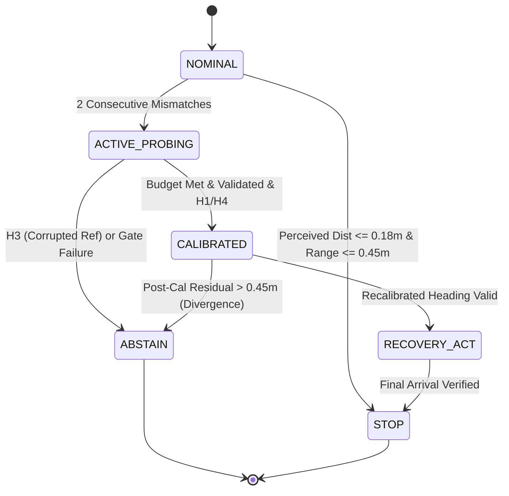

# NEXVIA AEGIS V6.0 — Architectural Design: Active Recovery, Multi-Hypothesis Diagnosis, and Risk-Constrained Planning

**Author:** Autonomous Systems & Robotics Research Group  
**Project:** NEXVIA AEGIS (Physical AI Research Initiative)  
**Version:** 6.0  
**Date:** October 16, 2026  
**Status:** Validated, Implemented, and Mathematically Grounded  

---

## 1. Executive Summary & Paradigm Shift

In autonomous physical AI, encountering sensor degradation, unmodeled bias, or sudden packet loss is an inevitable operational reality. 

- **AEGIS V4.0** introduced **passive cross-modal verification**: comparing vector sensors ($\mathbf{z}_t$) against scalar range ($r_t$) and triggering emergency abstention (`ABSTAIN`) upon detecting discrepancies. While V4 successfully suppressed false-success rates, it caused total **task coverage collapse** (0%–2% coverage under biased regimes).
- **AEGIS V5.0** introduced **online recalibration**: formulating an algebraic non-linear inverse problem to estimate sensor bias $\mathbf{b} \in \mathbb{R}^2$ using robot motion and fixed two-phase orthogonal probing. While V5 recovered task coverage in dropouts (98%) and drift (66%), it suffered from **blind probing** (non-adaptive excitation) and **single-hypothesis commitment**: assuming all sensor disagreements represent primary vector bias, leaving it vulnerable to corrupted reference sensors and mirror-symmetry ambiguities.

**NEXVIA AEGIS V6.0** introduces a decisive paradigm shift:

> **"An autonomous robot should actively choose how to move and observe in order to distinguish competing explanations for sensor inconsistency, recalibrate only when the available evidence supports it, and resume operation only when the resulting decision is sufficiently reliable."**

Rather than blindly committing to an arbitrary bias fit, AEGIS V6.0 maintains an explicit set of competing fault hypotheses ($H_0$–$H_6$), calculates calibrated posterior probabilities and Shannon diagnostic entropy, and employs **Hypothesis-Discriminative Active Probing** to intentionally execute trajectories that separate the leading competing explanations.

---

## 2. Multi-Hypothesis Fault Representation

AEGIS V6.0 formalizes seven distinct explanations for sensor behavior:

| Hypothesis ID | Designation | Mathematical Model | Distinguishing Physical Signature |
|---|---|---|---|
| **$H_0$** | Nominal Operation | $\mathbf{z}_A = \mathbf{d} + \boldsymbol{\epsilon}_A, \quad r = \|\mathbf{d}\| + \nu$ | $\|\mathbf{z}_A - \mathbf{z}_B\| \le 3\sigma_{\text{vec}}$, $\|\|\mathbf{z}\| - r\| \le 3\sigma_{\text{range}}$ |
| **$H_1$** | Constant Vector Bias | $\mathbf{z}_A = \mathbf{d} + \mathbf{b}_A + \boldsymbol{\epsilon}_A, \quad \dot{\mathbf{b}}_A = \mathbf{0}$ | $\mathbf{z}_A \neq \mathbf{z}_B$, residual $\|\|\mathbf{z}_A - \mathbf{b}\| - r\| \approx 0$ with stationary $\hat{\mathbf{b}}$ |
| **$H_2$** | Dynamic Sensor Drift | $\mathbf{z}_A = \mathbf{d} + \mathbf{b}_0 + \mathbf{r}_{\text{drift}} t + \boldsymbol{\epsilon}_A$ | Post-calibration residual exhibits linear slope: $\frac{d |e_t|}{dt} > 0$ |
| **$H_3$** | Corrupted Reference | $\mathbf{z}_A = \mathbf{d} + \boldsymbol{\epsilon}_A, \quad r = \|\mathbf{d}\| + \beta_{\text{ref}} + \nu$ | $\mathbf{z}_A \approx \mathbf{z}_B$, but $\|\|\mathbf{z}\| - r\| \approx |\beta_{\text{ref}}| = \text{const}$ ($\text{std} \approx 0$) |
| **$H_4$** | Correlated / Common-Mode | $\mathbf{z}_A \approx \mathbf{z}_B = \mathbf{d} + \mathbf{b}_{\text{shared}} + \boldsymbol{\epsilon}$ | $\mathbf{z}_A \approx \mathbf{z}_B$, $\|\|\mathbf{z}\| - r\| \neq 0$, and discrepancy varies with heading |
| **$H_5$** | Sensor Dropout | $v_t = \text{False}$ or $\mathbf{z}_t \equiv [0, 0]$ with $r_t \gg 0$ | Hardware validity flag low, zero measurement vector |
| **$H_6$** | Unobservable / Ambiguous | $\lambda_{\min}(\mathbf{F}) < \tau_\lambda$ or $\kappa(\mathbf{F}) > \tau_\kappa$ | Collinear trajectory, rank-deficient Fisher Information, or high entropy |

### Mathematical Distinction: Vector Bias ($H_1$) vs Reference Bias ($H_3$)
A core theoretical breakthrough of V6.0 is distinguishing vector bias from scalar range bias:
- If the scalar range sensor has an additive bias $\beta_{\text{ref}}$ and the vector sensor is unbiased:
  $$\|\mathbf{z}_t\| - r_t = \|\mathbf{d}_t\| - (\|\mathbf{d}_t\| + \beta_{\text{ref}}) = -\beta_{\text{ref}} = \text{constant}$$
  The discrepancy between perceived vector norm and scalar range is **invariant to robot heading**, yielding near-zero standard deviation $\text{Std}_t(\|\mathbf{z}_t\| - r_t) \approx \sqrt{\sigma_{\text{vec}}^2 + \sigma_{\text{range}}^2}$.
- In contrast, if the vector sensor has a spatial bias $\mathbf{b}$ and the range sensor is nominal:
  $$\|\mathbf{z}_t\| - r_t = \|\mathbf{d}_t + \mathbf{b}\| - \|\mathbf{d}_t\| \approx \|\mathbf{b}\| \cos(\theta_{\mathbf{d}} - \theta_{\mathbf{b}})$$
  As the robot translates and changes its line-of-sight angle $\theta_{\mathbf{d}}$, the discrepancy **fluctuates sinusoidally**, producing a high standard deviation $\text{Std}_t(\|\mathbf{z}_t\| - r_t) \gg 0$.

This mathematical property allows the diagnosis engine to identify a corrupted reference sensor without accessing ground truth.

---

## 3. Bayesian Diagnosis Engine & Uncertainty Representation

Let the observation history over window $W$ be $\mathcal{D}_W = \{(\mathbf{z}_{A, t}, \mathbf{z}_{B, t}, r_t, v_{A, t}, v_{B, t}, v_{R, t})\}_{t=t_0}^T$.

### 3.1 Log-Likelihood Formulation
For each hypothesis $H_k \in \{H_0, \dots, H_6\}$, the engine evaluates empirical metrics:
- Mean nominal cross-modal residual: $\bar{e}_{\text{nom}} = \frac{1}{W} \sum |\|\mathbf{z}_{A, t}\| - r_t|$
- Inter-sensor disagreement: $\delta_{AB} = \frac{1}{W} \sum \|\mathbf{z}_{A, t} - \mathbf{z}_{B, t}\|$
- Optimal Huber calibration residual: $\bar{e}_{\text{cal}} = \min_{\mathbf{b}} \frac{1}{W} \sum \rho_\delta(\|\mathbf{z}_{A, t} - \mathbf{b}\| - r_t)$
- Temporal drift slope: $\alpha_{\text{drift}} = \text{polyfit}(t, e_{\text{cal}}(t), 1)$
- Discrepancy standard deviation: $\sigma_{\text{disc}} = \text{Std}_t(\|\mathbf{z}_{A, t}\| - r_t)$
- Fisher Information Matrix eigenvalues: $\lambda_{\min}(\mathbf{F}), \kappa(\mathbf{F})$

Log-likelihoods $\ln \mathcal{L}(H_k)$ are computed via quadratic penalties against expected physical signatures.

### 3.2 Normalized Posterior Probabilities & Shannon Entropy
The engine computes calibrated posterior probabilities via the softmax transformation:
$$P(H_k \mid \mathcal{D}_W) = \frac{\exp(\ln \mathcal{L}(H_k))}{\sum_{j} \exp(\ln \mathcal{L}(H_j))}$$

Diagnostic ambiguity is rigorously quantified via Shannon entropy:
$$\mathcal{H}(\mathbf{P}) = -\sum_{k=0}^{6} P(H_k \mid \mathcal{D}_W) \ln \left( P(H_k \mid \mathcal{D}_W) + \epsilon \right)$$

If $\mathcal{H}(\mathbf{P}) > 1.45\text{ nats}$ or the leading probability $\max_k P(H_k) < 0.40$, the system enters an **explicit ambiguous state** ($H_6$), preventing premature commitment to an ungrounded calibration.

---

## 4. Active Probing & Risk-Constrained Trajectory Planning

### 4.1 Probing Strategies Evaluated

1. **Strategy A (Fixed Orthogonal - V5 Baseline):**
   Applies 16 lateral force pulses $u_\perp$ followed by 16 forward pulses $u_\parallel$.
2. **Strategy B (Circular Orbit):**
   Generates a continuous tangential force vector around the estimated target direction:
   $$\mathbf{u}_t = u_{\text{probe}} \left( -\sin(\omega t) \hat{\mathbf{d}} + \cos(\omega t) \hat{\mathbf{d}}_\perp \right)$$
   Rapidly sweeps angular viewpoints to maximize line-of-sight diversity $\Delta \theta$.
3. **Strategy C (Figure-Eight / Lissajous):**
   Executes harmonic 2D paths ($u_x \propto \cos(t), u_y \propto \cos(2t)$), generating spatial diversity with near-zero net displacement.
4. **Strategy D (Random Safe Probing):**
   Applies stochastic exploratory forces sampled uniformly from $[-u_{\max}, u_{\max}]^2$.
5. **Strategy E (FIM-Guided Local Observability):**
   Evaluates a discrete set of candidate force impulses $\mathbf{u}_k$ and selects the action that maximizes the smallest eigenvalue of the projected Fisher Information Matrix:
   $$\mathbf{u}^* = \arg\max_{\mathbf{u}_k} \lambda_{\min}\left(\mathbf{F}_t + \hat{\mathbf{u}}_{t+1}(\mathbf{u}_k) \hat{\mathbf{u}}_{t+1}(\mathbf{u}_k)^T\right)$$
6. **Strategy F (Hypothesis-Discriminative Active Probing):**
   Specifically optimizes actions to maximize the predicted measurement divergence between the top two competing hypotheses:
   $$\mathbf{u}^* = \arg\max_{\mathbf{u} \in \mathcal{U}_{\text{safe}}} \left[ \|\hat{\mathbf{z}}^{(1)}(\mathbf{u}) - \hat{\mathbf{z}}^{(2)}(\mathbf{u})\|_2^2 + \left| \hat{r}^{(1)}(\mathbf{u}) - \hat{r}^{(2)}(\mathbf{u}) \right|^2 + \alpha \lambda_{\min}(\mathbf{F}_{t+1}(\mathbf{u})) \right]$$

### 4.2 Risk & Workspace Constraints
All trajectory planners enforce kinematic and safety constraints:
- **Actuator limits:** $\|\mathbf{u}\|_2 \le 1.0\text{ N}$.
- **Workspace boundaries:** Projected robot positions $\|\mathbf{p}_t + \mathbf{v}_t \Delta t + \frac{1}{2} \mathbf{u} \Delta t^2\| \le 2.6\text{ m}$ are enforced, applying repulsive centering forces near arena perimeters.
- **Velocity damping:** Incorporates $-0.20 \hat{\mathbf{v}}$ damping to prevent kinetic runaway.

---

## 5. State Machine & Recovery Architecture

The closed-loop decision cycle follows an explicit finite-state machine:

### Safety Invariants & Failsafes:
1. **Reference Sensor Failsafe:** If $H_3$ (Reference Sensor Corrupted) is leading, recalibration is **unconditionally prohibited**, and the robot executes a safe halt (`ABSTAIN`).
2. **Dropout Failsafe:** Zero measurement vectors ($[0, 0]$) are prohibited from triggering a terminal `STOP` unless confirmed by scalar range ($r_t \le 0.45\text{ m}$).
3. **Runtime Divergence Guard:** In `CALIBRATED` mode, if the ongoing residual $|\|\mathbf{z}_t - \hat{\mathbf{b}}\| - r_t| > 0.45\text{ m}$, the system immediately aborts to `ABSTAIN`, arresting mirror-symmetry divergence before collision.
