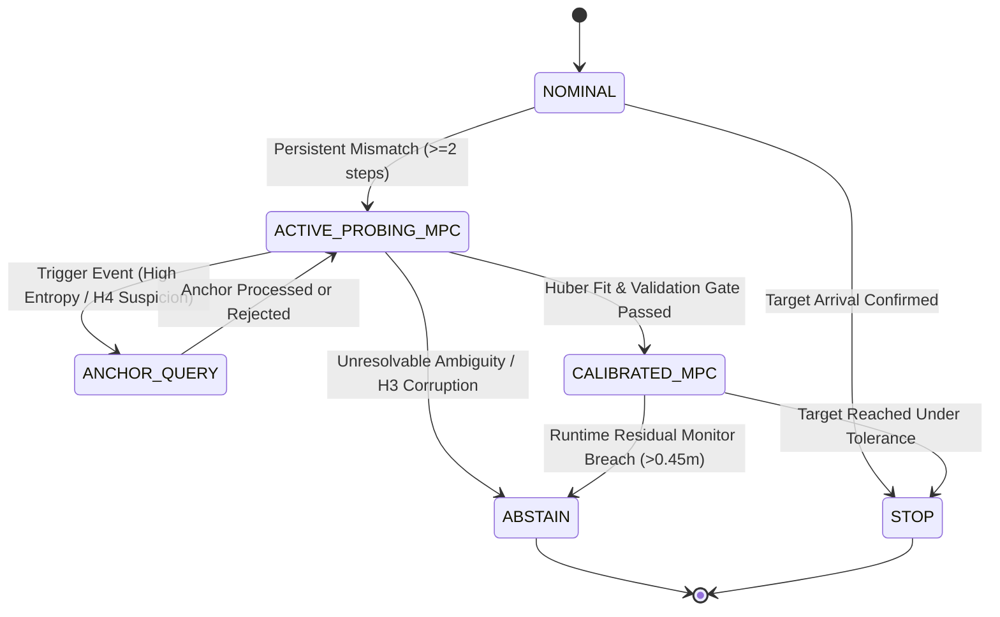

# NEXVIA AEGIS V7.0 — Architecture and Algorithmic Design
**Title:** Risk-Constrained Model Predictive Control, Active Sensor Diagnosis, and Intermittent Independent Anchoring  
**Document:** Technical Design Specification  
**Status:** Approved for Implementation  

---

## 1. System Overview

AEGIS V7.0 is a self-verifying decision layer for physical AI operating under severe sensor uncertainty, adversarial corruption, and dynamical momentum constraints.

V7.0 unifies three core subsystems:
1. **Receding-Horizon Model Predictive Control (MPC):** Plans dynamically feasible trajectories over finite horizons $N$, enforcing workspace limits, velocity constraints, control bounds, and active terminal velocity braking.
2. **Multi-Hypothesis Diagnosis Engine:** Evaluates likelihoods across hypotheses $H_0$–$H_6$, computing Shannon diagnostic entropy $\mathcal{H}$ and hypothesis separation.
3. **Intermittent Independent Sensor Anchoring (AEGIS-Anchor):** An event-triggered 3rd sensor modality with configurable query cost and an integrity verification gate, specifically resolving common-mode and underdetermined fault regimes ($H_4$).

---

## 2. Mathematical Formulation of Risk-Constrained MPC

### 2.1 Predictive State-Space Dynamics
The robot dynamics in MuJoCo are modeled as a discrete-time double integrator with sampling interval $\Delta t = 0.02\text{ s}$ and mass $m = 1.0\text{ kg}$:
$$\mathbf{x}_k = \begin{bmatrix} \mathbf{p}_k \\ \mathbf{v}_k \end{bmatrix} \in \mathbb{R}^4, \quad \mathbf{u}_k \in \mathbb{R}^2$$
$$\mathbf{x}_{k+1} = \mathbf{A} \mathbf{x}_k + \mathbf{B} \mathbf{u}_k$$
where:
$$\mathbf{A} = \begin{bmatrix} \mathbf{I}_2 & \Delta t \mathbf{I}_2 \\ \mathbf{0}_2 & \mathbf{I}_2 \end{bmatrix}, \quad \mathbf{B} = \begin{bmatrix} \frac{\Delta t^2}{2m} \mathbf{I}_2 \\ \frac{\Delta t}{m} \mathbf{I}_2 \end{bmatrix}$$
For $N$ steps, the predicted trajectory over control sequence $\mathbf{U} = [\mathbf{u}_0^T, \mathbf{u}_1^T, \dots, \mathbf{u}_{N-1}^T]^T$ is:
$$\mathbf{x}_k = \mathbf{A}^k \mathbf{x}_0 + \sum_{j=0}^{k-1} \mathbf{A}^{k-1-j} \mathbf{B} \mathbf{u}_j$$

### 2.2 Objective Functions by Control Mode
The MPC planner operates in two distinct operational regimes:

#### Regime 1: Active Probing Mode (`ACTIVE_PROBING`)
During sensor fault diagnosis, the objective is to maximize parameter observability while enforcing zero momentum at the terminal step $N$:
$$J_{\text{probe}}(\mathbf{U}) = -w_{\text{info}} \mathcal{L}_{\text{info}}(\mathbf{U}) + w_{\text{term}} \|\mathbf{v}_N\|^2 + \sum_{k=0}^{N-1} \left( w_u \|\mathbf{u}_k\|^2 + w_{\Delta u} \|\mathbf{u}_k - \mathbf{u}_{k-1}\|^2 \right)$$
where:
- $\mathcal{L}_{\text{info}}(\mathbf{U}) = \sum_{k=1}^N \|\hat{\mathbf{u}}_k \times \hat{\mathbf{u}}_0\|^2$ measures transverse angular excitation of the line-of-sight unit vector $\hat{\mathbf{u}}_k = \frac{\mathbf{z}_{v,k}}{\|\mathbf{z}_{v,k}\|}$.
- Terminal velocity penalty $w_{\text{term}} \|\mathbf{v}_N\|^2$ with $w_{\text{term}} = 10.0$ forces active reverse-thrust counter-actions, eliminating the physical coasting overshoot discovered in V6.
- Control smoothness $w_{\Delta u} \|\mathbf{u}_k - \mathbf{u}_{k-1}\|^2$ prevents high-frequency chatter.

#### Regime 2: Calibrated Approach Mode (`CALIBRATED_APPROACH`)
Once sensors are verified or recalibrated, the objective shifts to target convergence and precision docking:
$$J_{\text{approach}}(\mathbf{U}) = w_{\text{pos}} \|\mathbf{p}_N - \mathbf{p}^*_{\text{est}}\|^2 + w_{\text{term}} \|\mathbf{v}_N\|^2 + \sum_{k=0}^{N-1} \left( w_{\text{track}} \|\mathbf{p}_k - \mathbf{p}^*_{\text{est}}\|^2 + w_u \|\mathbf{u}_k\|^2 \right)$$
where $\mathbf{p}^*_{\text{est}}$ is the estimated target location derived from calibrated observations.

### 2.3 Physical and Operational Constraints
At every prediction step $k \in \{0, \dots, N\}$:
1. **Actuator Force Limits (Box Constraint):**
   $$\|\mathbf{u}_k\|_\infty \le 1.0 \implies -1.0 \le u_{x,k} \le 1.0, \quad -1.0 \le u_{y,k} \le 1.0$$
2. **Velocity Saturation:**
   $$\|\mathbf{v}_k\|_2 \le v_{\max} = 0.60\text{ m/s}$$
3. **Workspace Boundary Avoidance:**
   $$\|\mathbf{p}_k\|_2 \le R_{\text{safe}} = 2.60\text{ m}$$
   Penalized via soft barrier function if approached:
   $$\mathcal{B}(\mathbf{p}_k) = \max(0, \|\mathbf{p}_k\| - R_{\text{boundary}})^2$$

### 2.4 Numerical Optimization & Infeasible Fallback
The MPC problem is solved using a bounded sequential QP / forward shooting solver over horizon $N = 5$.
- **Replanning:** Receding horizon: only $\mathbf{u}_0$ is applied to the simulator; at the next step, a new problem is solved from the updated state estimate.
- **Infeasibility Safeguard:** If no feasible action is found within tolerance, the controller executes a guaranteed safe braking action:
  $$\mathbf{u}_{\text{fallback}} = -\text{clip}\left(\frac{\mathbf{v}_0}{\Delta t}, -1.0, 1.0\right)$$

---

## 3. Intermittent Independent Sensor Anchoring (AEGIS-Anchor)

### 3.1 Observation Model
The anchor sensor represents an independent 3rd observation modality (e.g., UWB ranging network or visual fiducial reference) physically decoupled from the primary vector and secondary range sensors.
$$\mathbf{z}_{\text{anchor}, t} = (\mathbf{p}^* - \mathbf{p}_t) + \mathbf{b}_{\text{anchor}} + \mathbf{w}_{\text{anchor}, t}$$
where:
- Nominal noise: $\mathbf{w}_{\text{anchor}, t} \sim \mathcal{N}(\mathbf{0}, \sigma_{\text{anchor}}^2 \mathbf{I}_2)$ with $\sigma_{\text{anchor}} = 0.04\text{ m}$.
- Nominal bias: $\mathbf{b}_{\text{anchor}} = \mathbf{0}$.
- Fault Mode (Corrupted Anchor): $\mathbf{b}_{\text{anchor}} = [1.2, -1.0]^T\text{ m}$.
- Query Cost: Every query accrues an operational cost $C_{\text{query}} = 0.05$ units.

### 3.2 Event-Triggered Query Policy
The anchor is queried selectively rather than continuously. A query is triggered if and only if any of the following conditions hold:
1. **High Diagnostic Entropy:** $\mathcal{H}(\mathcal{D}_t) > 1.0\text{ nats}$ (indicating unresolved ambiguity among competing explanations).
2. **Persistent Disagreement:** Cross-modal mismatch $r_t > 0.35\text{ m}$ for $\ge 3$ consecutive steps.
3. **Common-Mode Suspicion:** The diagnosis engine identifies $H_4$ (`CORRELATED_BIAS`) or $H_6$ (`AMBIGUOUS_EVIDENCE`) as the leading candidate, indicating the two-sensor geometry is insufficient.

### 3.3 Anchor Integrity Gate
To protect the agent against corrupted anchors, every received anchor measurement is validated:
$$\Delta_{\text{range}} = \left| \|\mathbf{z}_{\text{anchor}, t}\| - z_{\text{range}, t} \right|$$
- **Consistency Criterion:** If $\Delta_{\text{range}} \le 3\sqrt{\sigma_{\text{anchor}}^2 + \sigma_{\text{range}}^2} + \epsilon_{\text{tol}} \approx 0.30\text{ m}$, the anchor is certified as consistent with the physical range measurement.
- **Resolving Common-Mode Bias ($H_4$):** When both vector sensors are corrupted by $\mathbf{b}_v = [0.7, 0.7]^T$ but the range sensor is nominal:
  - $\mathbf{z}_{v,t}$ disagrees with $z_{\text{range}, t}$.
  - The anchor $\mathbf{z}_{\text{anchor}, t}$ agrees with $z_{\text{range}, t}$ ($\Delta_{\text{range}} < 0.15\text{ m}$) but disagrees with $\mathbf{z}_{v,t}$.
  - This 2-to-1 consensus immediately breaks the symmetry of $H_4$, isolating the vector sensors as biased and providing a ground-referenced anchor for recalibration!
- **Corrupted Anchor Rejection:** If $\mathbf{z}_{\text{anchor}, t}$ disagrees with both the vector sensors AND the range sensor, the anchor is rejected, and the agent abstains safely.

---

## 4. Closed-Loop Decision Cycle & State Machine

### 4.1 Formal State Definitions
1. **`NOMINAL`:** Standard target approach under MPC tracking. Monitors cross-modal agreement.
2. **`ACTIVE_PROBING_MPC`:** Executes MPC-planned probing steps with terminal braking to excite FIM while preserving zero momentum at step $N_{\text{probe}}$.
3. **`ANCHOR_QUERY`:** Event-triggered query to the 3rd modality. Validates anchor integrity and breaks fault symmetry.
4. **`CALIBRATED_MPC`:** Receding-horizon approach using calibrated target estimates $\mathbf{p}^*_{\text{est}} = \mathbf{p}_t + (\mathbf{z}_{v,t} - \hat{\mathbf{b}})$.
5. **`ABSTAIN`:** Safe stop triggered when evidence is unresolvable or reference sensors are compromised.
6. **`STOP`:** Target arrival confirmed by both vector and range modalities.
