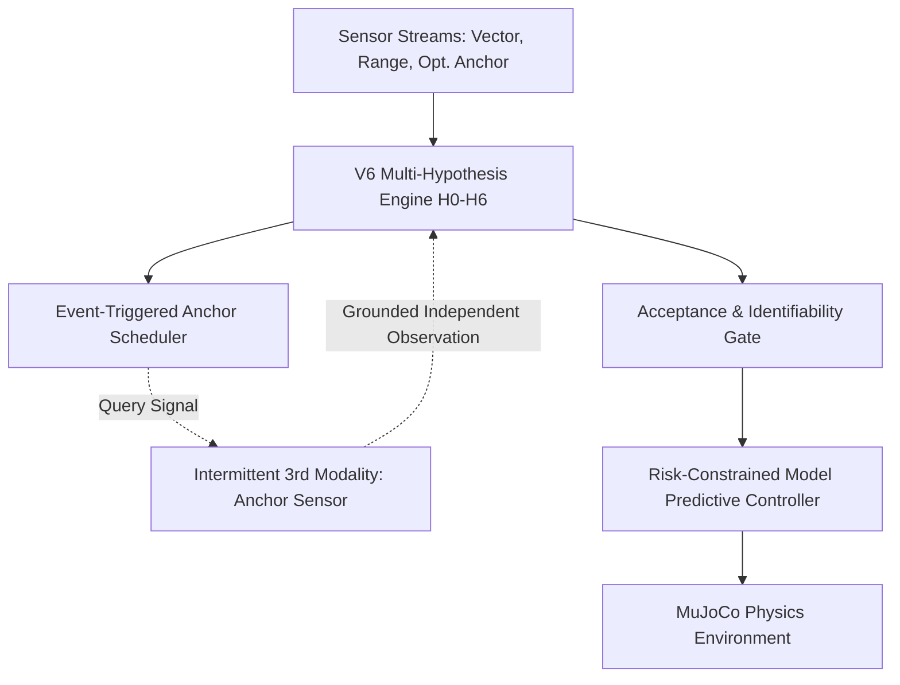

# NEXVIA AEGIS V7.0 — Research and Technical Architecture Audit
**Audit Date:** October 2026  
**Auditor / Role:** Senior Robotics Research Scientist, MPC Specialist, and Systems Architect  
**Lineage Context:** Transition from V6.0 Active Probing & Multi-Hypothesis Diagnosis to V7.0 Risk-Constrained Model Predictive Control and Intermittent Independent Anchoring.

---

## 1. Executive Summary

This audit assesses the state of the NEXVIA AEGIS repository at the conclusion of V6.0, identifying:
1. Physical dynamics, contact mechanics, and the mechanistic origin of momentum overshoot in MuJoCo.
2. The mathematical structure of sensor observations and the theoretical identifiability boundary under correlated faults ($H_4$).
3. The operational limitations of open-loop trajectory generation in V6.
4. The required architectural additions for V7.0 (Risk-Constrained MPC, Intermittent Independent Anchoring, and Event-Triggered Query Scheduling).

---

## 2. Physical State, Dynamics, and Momentum Mechanistics

### 2.1 State and Control Input Definitions
In `AegisPhysicalWorld` (`src/aegis/v3/env/world.py`) and `AegisMuJoCoEnv` (`src/aegis/env/mujoco_world.py`), the physical system is simulated in MuJoCo 3.14.0:
- **State Vector:**
  $$\mathbf{x} = [\mathbf{p}^T, \mathbf{v}^T]^T \in \mathbb{R}^4, \quad \mathbf{p} = [p_x, p_y]^T \in \mathbb{R}^2, \quad \mathbf{v} = [v_x, v_y]^T \in \mathbb{R}^2$$
  where $\mathbf{p}$ is extracted from `data.xpos[robot_body_id][:2]` and $\mathbf{v}$ from `data.qvel[:2]`.
- **Control Input:**
  $$\mathbf{u} \in [-1.0, 1.0]^2 \subset \mathbb{R}^2$$
  applied as external Cartesian force:
  $$\mathbf{F}_{\text{applied}} = \mathbf{u} \cdot F_{\max}, \quad F_{\max} = 1.0\text{ N}$$
- **Time Parameters:**
  Simulation timestep $\Delta t = 0.02\text{ s}$ ($50\text{ Hz}$).
- **Inertial Properties:**
  Robot is modeled as a rigid sphere with mass $m = 1.0\text{ kg}$ and radius $R = 0.20\text{ m}$.

### 2.2 Discrete-Time Kinematic Transitions vs. MuJoCo Physics
The idealized continuous-time double-integrator dynamics are:
$$\dot{\mathbf{p}}(t) = \mathbf{v}(t), \quad \dot{\mathbf{v}}(t) = \frac{\mathbf{F}(t)}{m} = \mathbf{u}(t)$$
Over discrete intervals $\Delta t = 0.02\text{ s}$, the semi-implicit Euler approximation is:
$$\mathbf{v}_{k+1} = \mathbf{v}_k + \frac{\Delta t}{m} \mathbf{u}_k$$
$$\mathbf{p}_{k+1} = \mathbf{p}_k + \Delta t \mathbf{v}_{k+1}$$

### 2.3 Mechanistic Root Cause of Momentum Overshoot in V6
In empirical test verification of `AegisPhysicalWorld`, when the robot is pushed with constant force $\mathbf{u} = [1.0, 0.0]^T$ for 20 steps and then control is released ($\mathbf{u} = [0.0, 0.0]^T$):
- Velocity after acceleration: $\mathbf{v} = [0.2848, 0.0]^T\text{ m/s}$.
- Velocity after 20 coasting steps with $\mathbf{u} = \mathbf{0}$: $\mathbf{v} = [0.2846, 0.0]^T\text{ m/s}$.
- **Deceleration:** $-0.0002\text{ m/s}$ over $0.4\text{ s}$ ($\approx 0.0005\text{ m/s}^2$).
- **Physical Reason:** The robot body is a sphere with a freejoint resting on a frictionless horizontal plane (`floor`). It experiences almost **zero rolling resistance**.
- **Impact on V6:** In V6 Strategy B (Circular Orbit), open-loop lateral probing accelerates the sphere tangentially. Once the 32-step probing budget finishes, the sphere continues coasting at $\sim 0.35\text{ m/s}$. When the agent transitions to calibrated navigation, it fails to brake instantaneously, causing kinetic overshoot past the target. The post-calibration residual monitor ($r > 0.45\text{ m}$) detects this spatial discrepancy and triggers an emergency abort (causing Circular Probing to collapse to $4.0\%$ True Success in `PRIMARY_BIAS`).

---

## 3. Sensor Models & Identifiability Audit

### 3.1 Existing Two-Sensor Modalities (V6)
1. **Primary & Secondary Vector Sensors:**
   $$\mathbf{z}_{v,t} = \mathbf{p}^* - \mathbf{p}_t + \mathbf{b}_v + \mathbf{w}_{v,t}, \quad \mathbf{w}_v \sim \mathcal{N}(\mathbf{0}, \sigma_v^2 \mathbf{I}), \quad \sigma_v = 0.05\text{ m}$$
2. **Reference Range Sensor (Radar):**
   $$z_{r,t} = \|\mathbf{p}^* - \mathbf{p}_t\| + b_r + w_{r,t}, \quad w_r \sim \mathcal{N}(0, \sigma_r^2), \quad \sigma_r = 0.05\text{ m}$$

### 3.2 The Correlated Bias ($H_4$) Identifiability Boundary
In Scenario 4 (`CORRELATED_BIAS`), both vector sensors share identical bias $\mathbf{b}_v = [+0.7, +0.7]^T$, and the range sensor has $b_r = 0$.
The vector disagreement is zero:
$$\|\mathbf{z}_{a,t} - \mathbf{z}_{b,t}\| \approx 0$$
The cross-modal residual is:
$$r_t(\mathbf{0}) = |\|\mathbf{z}_{v,t}\| - z_{r,t}| = |\|\mathbf{d}_t + \mathbf{b}_v\| - \|\mathbf{d}_t\||$$
While $r_t(\mathbf{0}) > 0$, the measurement geometry cannot distinguish between:
1. Both vector sensors are biased by $\mathbf{b}_v$ while range is nominal.
2. Vector sensors are nominal while range sensor is biased by $b_r = -(\|\mathbf{d}_t + \mathbf{b}_v\| - \|\mathbf{d}_t\|)$.
3. Both sensors share a coupled common-mode scale distortion.

Because the system possesses only 2 modalities (relative vector and relative distance), an adversarial or common-mode shift creates an underdetermined inverse problem. In V6, the agent correctly identified this ambiguity and safely abstained ($98.0\%$ abstention), but could not recover.

---

## 4. Proposed V7 Architecture

To resolve momentum overshoot and common-mode ambiguity, V7 introduces two core pillars:

### 4.1 Pillar 1: Risk-Constrained Model Predictive Control (`mpc_planner.py`)
- Replaces open-loop probing velocity generators with a receding-horizon predictive controller ($N=5$, $\Delta t=0.02\text{ s}$).
- State vector: $\mathbf{x} = [\mathbf{p}^T, \mathbf{v}^T]^T \in \mathbb{R}^4$.
- Cost Function:
  $$J(\mathbf{U}) = \sum_{k=0}^{N-1} \left( w_{\text{info}} \mathcal{L}_{\text{info}}(\mathbf{x}_k, \mathbf{u}_k) + w_u \|\mathbf{u}_k\|^2 + w_{\Delta u} \|\mathbf{u}_k - \mathbf{u}_{k-1}\|^2 \right) + w_{\text{term}} \|\mathbf{v}_N\|^2 + w_{\text{task}} \|\mathbf{p}_N - \mathbf{p}^*\|^2$$
- Explicitly penalizes terminal velocity $\mathbf{v}_N$ during probing to guarantee zero coasting momentum at the transition point.
- Hard constraints:
  - Actuator limits: $\|\mathbf{u}_k\|_\infty \le 1.0$.
  - Velocity limits: $\|\mathbf{v}_k\| \le 0.60\text{ m/s}$.
  - Workspace boundaries: $\|\mathbf{p}_k\| \le 2.60\text{ m}$.

### 4.2 Pillar 2: Intermittent Independent Anchoring (`anchor_sensor.py`)
- Simulates an on-demand independent localization modality (e.g. UWB anchor / fiducial reference) with known error model:
  $$\mathbf{z}_{\text{anchor}, t} = (\mathbf{p}^* - \mathbf{p}_t) + \mathbf{b}_{\text{anchor}} + \mathbf{w}_{\text{anchor}, t}$$
- Configurable parameters:
  - Query cost $C_{\text{query}} = 0.05$ (energy/bandwidth penalty).
  - Noise $\sigma_{\text{anchor}} = 0.04\text{ m}$.
  - Fault modes: nominal, intermittent dropout, corrupted anchor.

### 4.3 Pillar 3: Event-Triggered Query Scheduling (`anchor_scheduler.py`)
- Avoids unconditional querying to minimize operational overhead.
- Query Trigger Conditions:
  1. High diagnostic uncertainty: $\mathcal{H} > 1.0\text{ nats}$.
  2. Persistent cross-modal disagreement: $r_t > 0.35\text{ m}$ for $\ge 3$ consecutive steps.
  3. Suspected common-mode failure ($H_4$) or low observability ($H_6$).
- Anchor Integrity Gate:
  Validates anchor observation against range baseline:
  $$|\|\mathbf{z}_{\text{anchor}}\| - z_{\text{range}}| \le 3\sqrt{\sigma_{\text{anchor}}^2 + \sigma_{\text{range}}^2}$$
  If validation fails, the anchor is rejected as corrupted.

---

## 5. File & Module Plan for V7

| Module | Location | Purpose |
| :--- | :--- | :--- |
| `src/aegis/v7/__init__.py` | Package init | Exports V7 public API |
| `src/aegis/v7/mpc_planner.py` | Core Motion Planner | Receding-horizon QP / forward optimization with terminal damping |
| `src/aegis/v7/anchor_sensor.py` | Sensor Modality | Simulated intermittent independent anchor with noise and fault models |
| `src/aegis/v7/anchor_scheduler.py`| Scheduling & Gate | Event-triggered query logic and anchor integrity validation |
| `src/aegis/v7/recovery_controller.py`| State Controller | Closed-loop V7 controller integrating MPC, diagnosis, and anchor |
| `src/aegis/v7/agent_v7.py` | High-level Agent | Gym-compatible agent interface |
| `experiments/research_benchmark_v7.py`| Main Benchmark | 6 policies $\times$ 10 scenarios $\times$ 50 matched episodes = 3,000 runs |
| `experiments/ablation_v7.py` | Ablation Suite | Isolates MPC horizon, terminal penalty, anchor, and query scheduler |
| `experiments/plot_v7_results.py` | Visualization | Generates 300 DPI publication figures |
| `tests/test_v7_architecture.py` | Unit & Regression | 15+ comprehensive deterministic tests |

---

## 6. Preservation Invariants

1. Frozen V1 environment and reference policies are never modified.
2. Benchmark records and summaries in `results/v4/` and `results/v5/` remain untouched.
3. V6 implementation in `src/aegis/v6/` and results in `results/v6/` are preserved as baseline comparison.
4. All 42 passing tests in `tests/` must continue to pass with 100% green status.
5. Zero ground-truth leakage into live online controllers or estimators.
