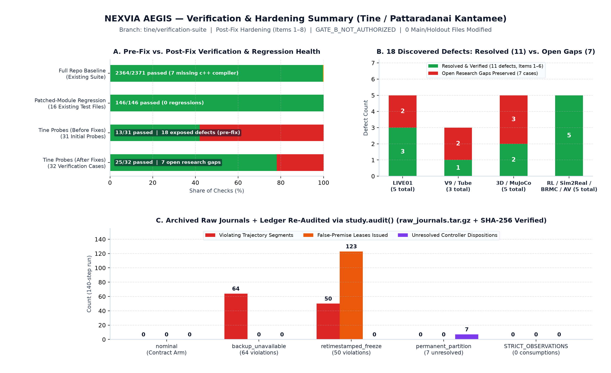

# NEXVIA AEGIS — Tine Verification & Hardening Results

- **Lead:** Pattaradanai Kantamee (Tine) — Verification & Reproducibility Lead
- **Branch:** `tine/verification-suite`
- **Status:** `BLOCKED` · `GATE_B_NOT_AUTHORIZED`
- **Rule Compliance:** Zero `main`, historical `results/`/`docs/`, frozen scientific rules, or V9-M4 Holdout data touched. All 8 requested hardening & evidence items implemented and verified with **0 regressions** across 146 existing regression tests.



## Quick Summary (Pre-Fix vs. Post-Fix)

| Check | Scope | Result | Evidence |
| --- | --- | --- | --- |
| Existing Repo Baseline | Full `tests/` (pre-fix baseline) | **2,364 passed**, 3 failed, 4 errors (`c++` compiler absent in fresh WSL2) | `repo_baseline_output.txt`, `repo_baseline_junit.xml` |
| Patched-Module Regressions | 16 existing test files across all patched modules | **146 / 146 passed (0 regressions)** | Verified after Items 1–6 fixes |
| Tine Probes (Pre-Fix) | Phases 1–3 (`31` cases) | **13 passed**, **18 exposed defects** | `tine_*_verification_{output.txt,junit.xml}` |
| Tine Probes (Post-Fix) | Phases 1–3 (`32` cases, incl. CSV full key coverage + raw archive audit) | **25 passed**, **7 open research gaps preserved** | `tine_post_fix_output.txt`, `tine_post_fix_junit.xml` |
| CSV Full Key Coverage | `six_outcomes.csv` (42/42) + `recovery_phases.csv` (294/294) | **100% exact set equality** (zero skipped/missing/duplicate keys) | Phase 2 & Phase 3 suites |
| Archived Raw Journals + Ledger | 5-case LIVE01 campaign (`nominal`, `backup_unavailable`, `retimestamped_freeze`, `permanent_partition`, `STRICT_OBSERVATIONS_nominal`) | **5 / 5 COMPLETED**, SHA-256 verified, `study.audit()` reproduces `live01_audit.json` byte-for-byte | `live01_campaign_evidence/` (`raw_journals.tar.gz`, `raw_journals.tar.gz.sha256`, `declared_plan.json`, `assignments.jsonl`, `live01_audit.json`) |

## Status of All 18 Discovered Defects (11 Resolved · 7 Open Research Gaps)

| # | Area | Finding | Location | Status |
| :-: | --- | --- | --- | --- |
| 1 | LIVE01 | Future host timestamp accepted | `live_recovery_contract.py:96,128`, `live_recovery_processes.py:175,212` | **FIXED & VERIFIED** |
| 2 | LIVE01 | Malformed `STATUS` crashes controller | `live_recovery_processes.py` | **FIXED & VERIFIED** |
| 3 | LIVE01 | Malformed `HEARTBEAT` crashes watchdog | `live_recovery_processes.py` | **FIXED & VERIFIED** |
| 4 | V9 | `NaN` / negative covariance bypasses Observability Gate | `robust_tube_clbf.py` | **FIXED & VERIFIED** |
| 5 | 3D | MuJoCo env fed simulator truth directly to CBF | `mujoco_3d_cbf.py`, `mujoco_3d_synchronized.py` | **FIXED & VERIFIED** (`measured_pos`/`measured_vel` + `require_measured_feedback=True`) |
| 6 | 3D | 3D controller read fault-injection `.dropped` flag | `v9/controller_3d.py` | **FIXED & VERIFIED** |
| 7 | RL | Safe RL wrapper fed simulator truth to HOCBF & gated on `sensor_fault_active` | `rl/safe_env_wrapper.py` | **FIXED & VERIFIED** |
| 8 | Sim2Real | Watchdog ignored configured `heartbeat_timeout_s` | `sim2real/safety_watchdog.py` | **FIXED & VERIFIED** |
| 9 | Multi-Agent | BRMC propagated Byzantine `NaN` into consensus | `multiagent/brmc_engine.py` | **FIXED & VERIFIED** |
| 10 | Multi-Agent | BRMC duplicate `agent_id` Sybil weight inflation | `multiagent/brmc_engine.py` | **FIXED & VERIFIED** |
| 11 | AV | Frenet CBF shield passed `NaN` controls through | `av/frenet_cbf_shield.py` | **FIXED & VERIFIED** |
| 12 | LIVE01 | Intra-epoch `clock_offset_ms` forgery | `live_recovery_contract.py:223` | Open gap (preserved) |
| 13 | LIVE01 | Cross-frame beacon rollback accepted | `live_recovery_contract.py` | Open gap (preserved) |
| 14 | V9 | All-channel silent freeze blind spot | `v9/controller.py` | Open gap (preserved) |
| 15 | V9 | No-oracle covariance estimator freeze blind spot | `sensor_corruption_suite.py` | Open gap (preserved) |
| 16 | 3D | 3D controller fails to latch terminal `ABSTAIN` | `v9/controller_3d.py` | Open gap (preserved) |
| 17 | 3D | 3D controller ignores range blackout in `NOMINAL` | `v9/controller_3d.py` | Open gap (preserved) |
| 18 | 3D | 3D controller all-channel silent freeze blind spot | `v9/controller_3d.py` | Open gap (preserved) |

## Independent Audit of Archived Raw Journals & Ledger

```bash
cd results/research_development/tine_verification/live01_campaign_evidence
sha256sum -c raw_journals.tar.gz.sha256
mkdir -p /tmp/tine_audit_check && tar -xzf raw_journals.tar.gz -C /tmp/tine_audit_check
PYTHONPATH=src:. uv run python -m scripts.research.live_recovery_study audit /tmp/tine_audit_check --output /tmp/tine_audit_check_out.json
```

## Reports & Test Suites

- **Reports:** [`Phase 1`](../../../docs/research/TINE_VERIFICATION_ANOMALY_REPORT_2026-11-18.md) · [`Phase 2`](../../../docs/research/TINE_SYSTEM_VERIFICATION_PHASE2_REPORT_2026-11-19.md) · [`Phase 3`](../../../docs/research/TINE_SYSTEM_VERIFICATION_PHASE3_REPORT_2026-11-19.md)
- **Test Suites:** [`Phase 1`](../../../tests/test_tine_anomaly_verification.py) · [`Phase 2`](../../../tests/test_tine_system_verification_phase2.py) · [`Phase 3`](../../../tests/test_tine_system_verification_phase3.py)